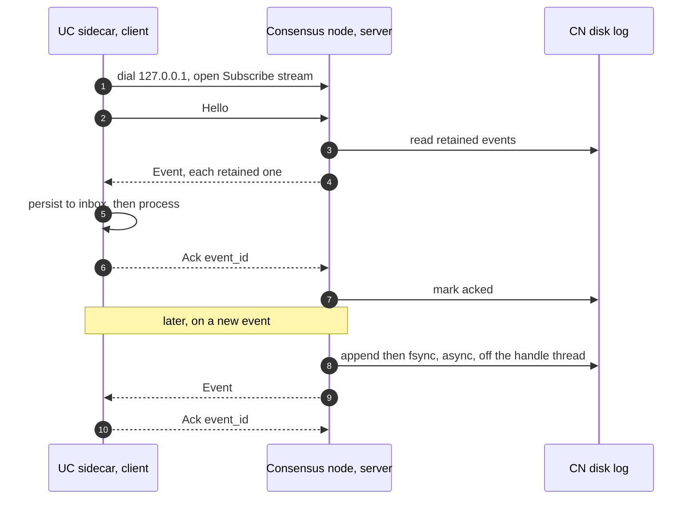

# CN → UC event stream: a durable gRPC notification channel

How the consensus node (CN) notifies the UC sidecar through a long-lived gRPC stream, with the CN
persisting events to disk so delivery survives a restart on either side. This replaces the marker
files the CN writes today.

**Status:** design. It needs a CN code change, so the CN team owns the protobuf schema and the server. During the transition both run in parallel
(dual mode); the marker files are removed once the stream is everywhere. 

## Summary

1. **The CN runs a gRPC server on loopback. The UC connects.** One long-lived bidirectional stream per
   pod: the CN sends events, the UC sends one acknowledgement per event.
2. **No authentication.** The stream is on `127.0.0.1` inside the pod's network namespace, and every
   container in a CN pod is trusted. There is no secret to mount or rotate.
3. **Events are protobuf.** The CN team publishes the schema. The UC decodes it directly.
4. **Delivery is durable.** The CN appends each event to a disk log before it sends, and keeps it until the
   UC acknowledges. A restart on either side loses nothing.
5. **Event IDs are deterministic and self-describing**, so the UC dedupes and the CN re-derives the same
   id after a restart.
6. **The stream carries what files cannot:** the roster, the adoption decision, the DAB changes and TSS
   readiness. These replace log scraping and the version-floor assumption in the marker-file design.

## Why a stream

| | Marker files (today) | gRPC event stream |
|---|---|---|
| Latency | UC polls every 60s (1s after `freeze_scheduled.mf`), configurable | Immediate push |
| Payload | None (a check mark or a timestamp) | Roster, decision, DAB change, round |
| Adoption result | Parsed from CN log text, which can change | An explicit event |
| DAB changes before the freeze | Invisible | `nodecreate` / `nodeupdate` / `nodedelete` events |
| Delivery proof | None | The UC acknowledges after it persists |
| Survives a UC restart | Yes (the file persists) | Yes (the CN keeps the event until acked) |
| Survives a CN restart | Yes (the file persists) | Yes (the CN's disk log, plus re-derivation from state) |

## What was verified

- **The CN already speaks bidirectional gRPC streaming.** `BlockNodeStreamingConnection`
  ("Manages a single gRPC bidirectional streaming connection to a block node") and
  `BlockStreamPublishBytesClient` ("Opens a bidirectional publish stream") run an ack-and-resend stream to
  block nodes. There the CN is the **client**; here it is the **server**, which is a new role but uses the
  same machinery. The CN already runs gRPC servers for HAPI, so serving another service is not new.
- **Start-up order** (`ServicesMain.java`): `hedera.initializeStatesApi(...)` runs first (lines ~202 and
  205) and runs the service migrations, including the roster schema's `restart` and so the adoption hook
  (`Hedera.java` ~1024). The platform is built only afterwards (lines ~252 to 270). So the event server must
  start **before** `initializeStatesApi`, earlier than the HAPI gRPC server, or the adoption event has
  nowhere to go. It must not depend on the platform or the node key, neither of which exists yet.
- **Loopback is private to the pod.** The capsule deployment sets no `hostNetwork`, so `127.0.0.1` is
  reachable only by the pod's own containers.
- **The UC container** is built in `buildUcContainer` (`internal/resources/consensus/deployment.go`) and
  runs as uid and gid 2000. It already persists CRs to a durable path (`CRPersistPath`,
  `/opt/solo/weaver/uc/crs`), so a durable event inbox fits the same pattern.
- **Marker writes are in one place**, `ReadableFreezeUpgradeActions.writeMarker`, re-run by
  `catchUpOnMissedSideEffects`, which `ReconnectListener` calls after a reconnect. There is no plain-restart
  caller, so a restarted CN relies on PCES replay, which is why the disk log below is the durable record.

## Design

### The connection



- **The UC is the client.** It dials the CN's loopback port, opens one `Subscribe` stream, and reconnects
  with backoff if it drops. One stream per pod.
- **Two independent flows.** The CN sends `Event` and `Heartbeat`; the UC sends `Hello` and `Ack`. Either
  side sends at any time, so an ack never waits for the next event.
- **Resend everything on connect.** The CN replays all retained events on each new stream. The UC dedupes
  by `Event.id`. There is no cursor to track and no sequence to resynchronise (see
  [Resume without a cursor](#resume-without-a-cursor)).
- **Liveness.** `Heartbeat` (or gRPC keepalive) lets each side notice a half-dead connection and reconnect.

### Trust model

- **Loopback only.** The server binds `127.0.0.1` with no Service, no `containerPort` and no `hostNetwork`,
  so nothing outside the pod can reach it.
- **All containers in the pod are trusted,** so there is no authentication. This drops the shared secret,
  the HMAC and the rotation handling from the earlier proposal.
- **The one residual risk** is that any container in the pod could open the stream and send a forged `Ack`,
  which would make the CN drop an unacked event early. That costs durability, not integrity: it cannot
  forge an event or change a CR. The events and roster are public data anyway.
- The stream grants no new capability. Every effect still needs a CR, and the operator still decides.

### Events and their IDs

**The ID format is `<type>-<nodeRef>-<trigger>`:**

- **`type`** names the event, lower case, for example `upgradeprepare`.
- **`nodeRef`** is `n<id>` for a consensus node or `rn<id>` for a registered node. For a DAB event it is the
  **subject** (the node that changed); for an upgrade event it is the **emitting** node, which each CN fills
  with its own id.
- **`trigger`** is the `TransactionID` for a transaction-driven event, rendered `<payer>_<sec>.<nanos>`
  (the canonical `@` replaced with `_` to stay name-safe), or `round<N>` for a platform event with no
  transaction.

The id is deterministic: the same transaction or round yields the same id on every node and after a
restart, so the UC dedupes and the CN re-derives it from state. The id does **not** carry the software
version, because the CN does not know the target version at prepare time; the version travels in the
payload and the UC reads it from the package, as today.

| Event | `type` | Trigger | Example id | Key payload |
|---|---|---|---|---|
| Node created | `nodecreate` | DAB txn | `nodecreate-n7-0.0.55_1792400100.010000000` | node id, account, gossip cert fingerprint, gossip endpoints |
| Node updated | `nodeupdate` | DAB txn | `nodeupdate-n3-0.0.801_1792400050.900000000` | node id, changed fields |
| Node deleted | `nodedelete` | DAB txn | `nodedelete-n5-0.0.55_1792400100.010000000` | node id |
| Registered node created | `registerednodecreate` | txn | `registerednodecreate-rn12-0.0.55_1792400200.000000000` | registered node id, block-node endpoints |
| Registered node updated | `registerednodeupdate` | txn | `registerednodeupdate-rn12-0.0.55_1792400260.000000000` | registered node id, changed endpoints |
| Registered node deleted | `registerednodedelete` | txn | `registerednodedelete-rn12-0.0.55_1792400300.000000000` | registered node id |
| Upgrade prepare ready | `upgradeprepare` | `PREPARE_UPGRADE` txn | `upgradeprepare-n5-0.0.2_1792449990.000000007` | upgrade file id and hash, freeze type |
| Candidate roster ready | `candidaterosterready` | same `PREPARE_UPGRADE` txn | `candidaterosterready-n5-0.0.2_1792449990.000000007` | the roster bytes and sha256 |
| Upgrade freeze scheduled | `upgradefreeze` | `FREEZE_UPGRADE` txn | `upgradefreeze-n5-0.0.2_1792451000.500000000` | freeze time, upgrade file hash |
| Upgrade aborted | `upgradeabort` | `FREEZE_ABORT` txn | `upgradeabort-n5-0.0.2_1792451500.700000000` | aborted freeze time |
| Upgrade frozen | `upgradefrozen` | freeze round (no txn) | `upgradefrozen-n5-round48211397` | freeze round, freeze time |
| Roster adoption decided | `rosteradoption` | restart round (no txn) | `rosteradoption-n5-round48211398` | result (`adopted` / `rejected` / `none`), round |

One transaction can raise more than one event: `PREPARE_UPGRADE` raises both `upgradeprepare` and
`candidaterosterready`, which share the trigger and differ only by `type`. The DAB events are early
warnings, days before the freeze, that the next roster will change; the operator still makes every decision
from the candidate roster at prepare time.

### Protobuf schema (proposed)

The CN team owns the final package and path. This is the shape the UC expects.

```proto
syntax = "proto3";

package com.hedera.hapi.node.uc;

// The UC dials the CN and keeps one stream open. The CN sends events; the UC
// sends one ack per event. Loopback only, no authentication.
service UcNotification {
  rpc Subscribe(stream UcMessage) returns (stream CnMessage);
}

message UcMessage {
  oneof msg {
    Hello hello = 1;  // first frame after connect
    Ack   ack   = 2;  // one per event the UC has durably stored
  }
}

// No cursor: on every connect the CN resends all retained events and the UC
// dedupes by Event.id.
message Hello {
  int64  node_id    = 1;  // the UC's own node id, a sanity check
  string uc_version = 2;
}

message Ack {
  string event_id = 1;
}

message CnMessage {
  oneof msg {
    Event     event     = 1;
    Heartbeat heartbeat = 2;  // liveness while idle
  }
}

message Heartbeat {
  int64 cn_unix_nanos = 1;
}

enum EventType {
  EVENT_TYPE_UNSPECIFIED  = 0;
  NODE_CREATE             = 1;
  NODE_UPDATE             = 2;
  NODE_DELETE             = 3;
  REGISTERED_NODE_CREATE  = 4;
  REGISTERED_NODE_UPDATE  = 5;
  REGISTERED_NODE_DELETE  = 6;
  UPGRADE_PREPARE         = 7;
  CANDIDATE_ROSTER_READY  = 8;
  UPGRADE_FREEZE          = 9;
  UPGRADE_ABORT           = 10;
  UPGRADE_FROZEN          = 11;
  ROSTER_ADOPTION         = 12;
}

message Event {
  uint32    schema_version   = 1;
  string    id               = 2;  // "<type>-<nodeRef>-<trigger>", deterministic
  EventType type             = 3;
  string    software_version = 4;  // the version the CN is running now
  int64     cn_unix_nanos    = 5;  // wall-clock emit time, for logging only

  // Exactly one identifies the trigger and seeds the id. A payload may repeat it.
  TransactionId txn_id = 6;  // transaction-driven events
  uint64        round  = 7;  // platform events (frozen, adoption)

  oneof payload {
    NodeChange           node_change            = 16;
    RegisteredNodeChange registered_node_change = 17;
    UpgradePrepare       upgrade_prepare        = 18;
    CandidateRoster      candidate_roster       = 19;
    FreezeScheduled      freeze_scheduled       = 20;
    FreezeAborted        freeze_aborted         = 21;
    NowFrozen            now_frozen             = 22;
    RosterAdoption       roster_adoption        = 23;
  }
}

// Matches HAPI TransactionID (nonce and scheduled omitted for DAB and freeze).
message TransactionId {
  string payer             = 1;  // "shard.realm.num", e.g. "0.0.55"
  int64  valid_start_sec   = 2;
  int32  valid_start_nanos = 3;
}

message NodeChange {
  int64  node_id                 = 1;  // the subject node
  string account_id              = 2;  // create and update
  string gossip_cert_fingerprint = 3;  // SHA-384 hex; lets the operator pre-check the staged key
  repeated Endpoint gossip_endpoint = 4;
}

message RegisteredNodeChange {
  int64  registered_node_id = 1;
  repeated Endpoint block_node_endpoint = 2;  // RegisteredServiceEndpoint (block-node API)
}

message UpgradePrepare {
  string upgrade_file_id   = 1;  // e.g. "0.0.150"
  string upgrade_file_hash = 2;  // hex
  string freeze_type       = 3;  // "PREPARE_UPGRADE"
}

message CandidateRoster {
  bytes  roster = 1;  // the PBJ Network message, the bytes candidate-roster.json holds
  string sha256 = 2;  // hex
}

message FreezeScheduled {
  int64  freeze_time_sec   = 1;
  int32  freeze_time_nanos = 2;
  string upgrade_file_hash = 3;
}

message FreezeAborted {
  int64 aborted_freeze_time_sec   = 1;
  int32 aborted_freeze_time_nanos = 2;
}

message NowFrozen {
  uint64 freeze_round      = 1;
  int64  freeze_time_sec   = 2;
  int32  freeze_time_nanos = 3;
}

message RosterAdoption {
  enum Result {
    RESULT_UNSPECIFIED = 0;
    ADOPTED            = 1;
    REJECTED           = 2;
    NONE               = 3;
  }
  Result result = 1;
  uint64 round  = 2;
}

message Endpoint {
  string domain_name   = 1;
  bytes  ip_address_v4 = 2;  // 4 bytes
  int32  port          = 3;
}
```

### JSON examples

These follow the proto3 JSON mapping (int64 as strings, bytes as base64, enums as names). They are the same
messages as above, shown for readability; the wire format is protobuf.

The UC's `Hello` and an `Ack`:

```json
{ "hello": { "nodeId": "5", "ucVersion": "0.76.1" } }
```
```json
{ "ack": { "eventId": "upgradeprepare-n5-0.0.2_1792449990.000000007" } }
```

`nodecreate` (a DAB early warning; the subject is node 7):

```json
{
  "schemaVersion": 1,
  "id": "nodecreate-n7-0.0.55_1792400100.010000000",
  "type": "NODE_CREATE",
  "softwareVersion": "0.76.1",
  "cnUnixNanos": "1792400101482000000",
  "txnId": { "payer": "0.0.55", "validStartSec": "1792400100", "validStartNanos": 10000000 },
  "nodeChange": {
    "nodeId": "7",
    "accountId": "0.0.10",
    "gossipCertFingerprint": "3fa91c2e8b4d6f0a1c7e2d9b8a5c4f30",
    "gossipEndpoint": [ { "domainName": "node7.example.com", "port": 50111 } ]
  }
}
```

`registerednodecreate` (block-node endpoints; the subject is registered node 12):

```json
{
  "schemaVersion": 1,
  "id": "registerednodecreate-rn12-0.0.55_1792400200.000000000",
  "type": "REGISTERED_NODE_CREATE",
  "softwareVersion": "0.76.1",
  "cnUnixNanos": "1792400200250000000",
  "txnId": { "payer": "0.0.55", "validStartSec": "1792400190", "validStartNanos": 0 },
  "registeredNodeChange": {
    "registeredNodeId": "12",
    "blockNodeEndpoint": [ { "domainName": "bn3.example.com", "port": 40840 } ]
  }
}
```

`upgradeprepare` and `candidaterosterready` (one `PREPARE_UPGRADE`, two events, shared trigger):

```json
{
  "schemaVersion": 1,
  "id": "upgradeprepare-n5-0.0.2_1792449990.000000007",
  "type": "UPGRADE_PREPARE",
  "softwareVersion": "0.76.1",
  "cnUnixNanos": "1792450007482000000",
  "txnId": { "payer": "0.0.2", "validStartSec": "1792449990", "validStartNanos": 7 },
  "upgradePrepare": {
    "upgradeFileId": "0.0.150",
    "upgradeFileHash": "9f86d081884c7d659a2feaa0c55ad015a3bf4f1b2b0b822cd15d6c15b0f00a08",
    "freezeType": "PREPARE_UPGRADE"
  }
}
```
```json
{
  "schemaVersion": 1,
  "id": "candidaterosterready-n5-0.0.2_1792449990.000000007",
  "type": "CANDIDATE_ROSTER_READY",
  "softwareVersion": "0.76.1",
  "cnUnixNanos": "1792450007500000000",
  "txnId": { "payer": "0.0.2", "validStartSec": "1792449990", "validStartNanos": 7 },
  "candidateRoster": {
    "roster": "CrsBCjgK... (base64 of the PBJ Network message)",
    "sha256": "5b0f3c9a77d14e2a8c61d0b94e1f7a32e9c4d81f05a6b37d2c9e48f1a0b7d635"
  }
}
```

`upgradefrozen` and `rosteradoption` (no transaction, so the trigger is the round):

```json
{
  "schemaVersion": 1,
  "id": "upgradefrozen-n5-round48211397",
  "type": "UPGRADE_FROZEN",
  "softwareVersion": "0.76.1",
  "cnUnixNanos": "1792492204220000000",
  "round": "48211397",
  "nowFrozen": { "freezeRound": "48211397", "freezeTimeSec": "1792492200", "freezeTimeNanos": 0 }
}
```
```json
{
  "schemaVersion": 1,
  "id": "rosteradoption-n5-round48211398",
  "type": "ROSTER_ADOPTION",
  "softwareVersion": "0.76.2",
  "cnUnixNanos": "1792492491903000000",
  "round": "48211398",
  "rosterAdoption": { "result": "ADOPTED", "round": "48211398" }
}
```

### Durability: the CN disk log

- **Path:** `data/upgrade/uc/` under the CN's home, that is
  `/opt/hgcapp/services-hedera/HapiApp2.0/data/upgrade/uc/`. The operator mounts a volume there, a PVC on
  mainnet, so it survives a pod restart. It sits beside `current/`, never inside it, because the CN wipes
  `current/` during package extraction.
- **Write off the hot path.** The handle thread only enqueues the event. A single background writer appends
  it to the log and `fsync`s, in batches. The CN sends the event only after the write is durable, so
  anything the UC ever sees is already on the CN's disk. The handle thread never waits on I/O, which is why
  this adds no consensus latency.
- **Remove on ack.** An acked event can be pruned, but keep the last few upgrades regardless of acks so a
  recreated UC inbox can be rebuilt.
- **Overflow never blocks consensus.** Events are sparse (about six per upgrade), so overflow means the UC
  was gone a long time. First compact (drop an event that a newer event of the same type for the same
  operation supersedes), then drop the oldest with a loud log line and a metric. A small cap, roughly 100
  events or 8 MiB, is ample (a roster payload can reach 512 KiB). This is the opposite of the block buffer,
  which applies back pressure and never drops; a dropped notification must never stall the node.
- **Disk failure** logs an error and the CN keeps streaming from memory. It never blocks.

### Restart reconcile (CN)

A plain CN restart has no marker re-run, so on start the CN rebuilds its view from two sources:

1. **The disk log** gives the last events and their ids.
2. **Consensus state** gives the current facts: the prepared upgrade's file hash, the candidate roster,
   `freeze_time`, `last_frozen_time` and `latest_freeze_round`.

For each fact in state with no matching event in the log, the CN appends the event with its deterministic
id. Events already handled in a round before the last saved state are not replayed by PCES, so this scan is
what closes that gap. A few facts are not in state (an abort, and possibly the adoption result), so the
disk log is their only record; if the log is lost, the UC's own inference covers the abort (a freeze that
was scheduled and is now neither scheduled nor frozen).

### Resume without a cursor

On every connect the CN resends all retained events and the UC dedupes by `Event.id`. This avoids a cursor
and the "log epoch" problem: if the CN's log volume were recreated and a sequence restarted from zero, a
cursor-based UC could skip new events silently. Resending everything is safe because the UC's handlers
already dedupe by operation id, and the volume is tiny. A cursor can be added later if resend volume ever
matters.

### The UC side

- **A gRPC client event source** next to today's `MarkerMonitor`, supervised by daemonkit, with a reconnect
  loop and backoff. In dual mode both feed the same handlers (`HandleExecuteImmediate` and the others),
  which already dedupe by operation id and persist before acting.
- **Persist, then ack, then process.** The UC writes the event to its durable inbox and `fsync`s, sends the
  `Ack`, then runs the handler. A UC restart replays the inbox, so an acked event is never lost.
- **The roster comes from the event**, not a file. On `candidaterosterready` the UC checks `roster` against
  `sha256` and puts it in the Prepare CR's `spec.artifacts`.
- **One Prepare CR, created once, with the roster.** The Prepare spec is immutable (CEL `self == oldSelf`),
  so the UC cannot create the CR on `upgradeprepare` and attach the roster later. The two events share a
  trigger but can arrive in either order, so the UC holds the CR until both are in hand (or the wait ends),
  then creates it once. An integration test covers the immutability rule.

## Failure and ordering

- **UC down or restarting:** the CN keeps every unacked event on disk and resends on reconnect. Nothing is
  lost; delivery is just delayed.
- **CN restarting:** the disk log plus the state scan rebuild the events, with the same ids. The UC dedupes
  the resend.
- **Adoption at start-up:** the adoption hook runs during `initializeStatesApi`, before the platform
  exists, so the event server must already be listening and the writer must be able to enqueue. Neither
  needs the platform or the node key.
- **Duplicates** are expected and harmless, because ids are deterministic and the UC dedupes.
- **Out-of-order** events are fine: the UC reconciles to current state rather than replaying a strict
  sequence, the same way a controller does.
- **Overflow:** compact, then drop the oldest, loudly. Never block.

## Retiring the marker files

The aim is to stop writing the marker files, once the stream is everywhere. A `notification.sinks` property
on the CN selects the behaviour, so no new flag is needed later:

| `notification.sinks` | Marker files and `candidate-roster.json` | Event stream |
|---|---|---|
| `file` (default) | written, as today | off |
| `file,uc` | written | on |
| `uc` | **not written** | on |

1. **Now:** `file`, then `file,uc` as nodes adopt the stream. The markers stay the source of truth.
2. **After the NMT and the legacy UC are gone:** `file,uc` everywhere. The stream is primary; nothing
   outside the UC depends on the markers.
3. **Then, per environment:** `uc`. This needs the UC's durable inbox, the CN's disk log and restart
   reconcile (all above), and a check that nothing else reads the markers. `execute_immediate.mf` and some
   others are part of the CN's own upgrade handling, so confirm before turning them off.

`candidate-roster.json` is the last to go; with `uc` it is not written and the roster travels in the event.

## Rollout

HIP-1494's two-upgrade pattern applies:

1. **Upgrade N:** the UC ships the gRPC client, and the operator mounts the `data/upgrade/uc` volume (a pod
   template change that rides the upgrade restart). The CN does not serve the stream yet, and the UC's
   client simply fails to connect and falls back to markers.
2. **Upgrade N+1:** a CN release that serves the stream, enabled through `node.properties`.

## What it changes in the marker-file design

| In the marker-file design | With the stream |
|---|---|
| UC parses `swirlds.log` for the adoption result | The CN sends `rosteradoption` |
| `canAdoptRosterFromVersion` is a standing assumption | A TSS-readiness event can make it per upgrade later |
| The roster travels as an export file in `data/upgrade/` | It travels in `candidaterosterready`, avoiding the `cleanDirectory` race |
| The CN property for the export path must ship first | Not needed for the event path |
| DAB changes are invisible until the roster diff at prepare | `nodecreate` / `nodeupdate` / `nodedelete` warn days ahead |
| Marker files are always written | `notification.sinks` can turn them off once the stream is primary |

## Open questions

1. **Ownership and schema.** Who builds the CN server and owns the `.proto`, and which release carries it.
2. **TransactionID at emit time.** Confirm a handler can read the `TransactionID` when it emits a
   transaction-driven event, and the round number for the two platform events (it is in state).
3. **Re-derivable ids for prepare and abort.** Their trigger timestamp is not in state, so a lost log plus a
   restart scan could re-emit them with a different id. The UC guard (ignore a prepare when a non-terminal
   operation already exists for the same upgrade file hash) covers this; confirm it is enough, or store the
   prepare's consensus time in state.
4. **Adoption result in state.** Whether `rosteradoption` can be re-derived from state, or exists only as the
   event and a log line.
5. **Server start order.** Confirm the gRPC server and the disk writer can start before `initializeStatesApi`
   and enqueue the adoption event raised there.
6. **Port and versioning.** The loopback port, and how the service and `schema_version` evolve.
7. **PCES replay and side effects.** Whether replayed rounds re-run the freeze handlers' event emission, which
   decides how much the restart scan must cover.
8. **Volume sizing.** The PVC size for `data/upgrade/uc` (tiny, but it needs a floor and the overflow cap).
