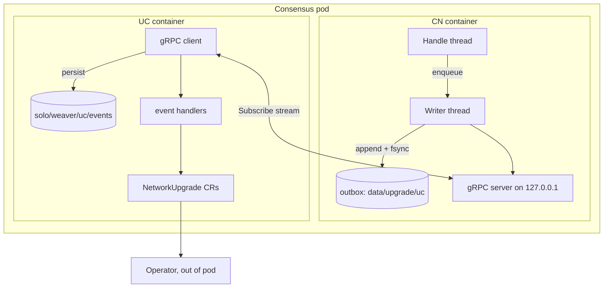
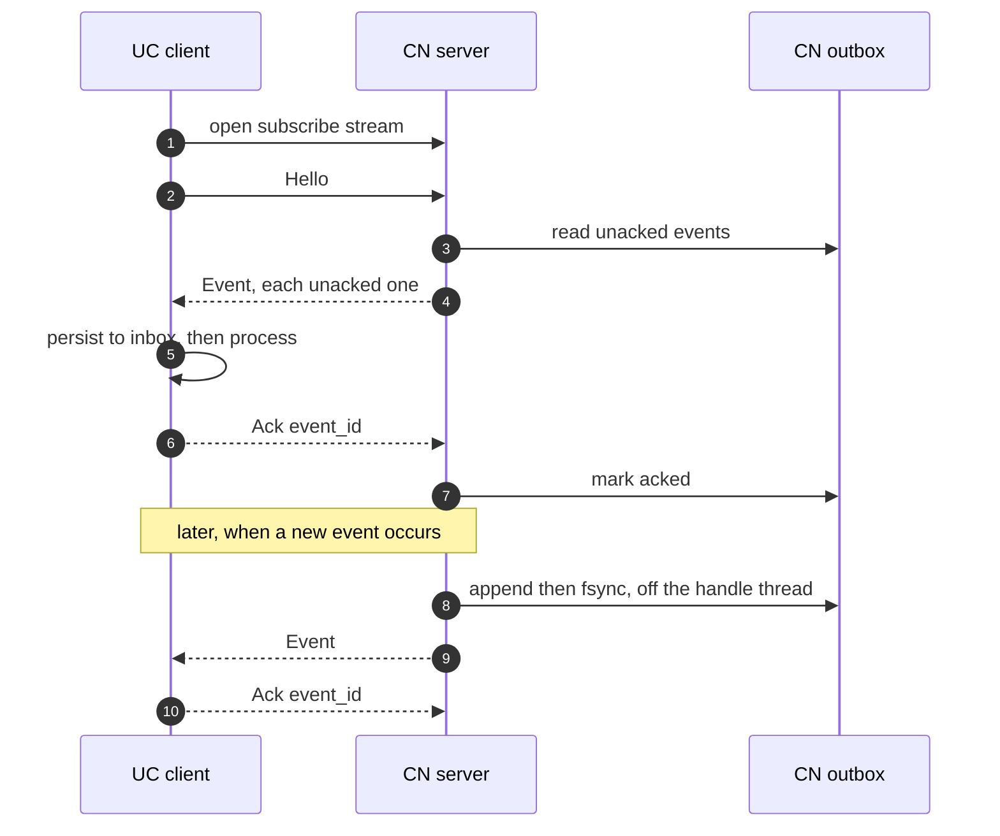
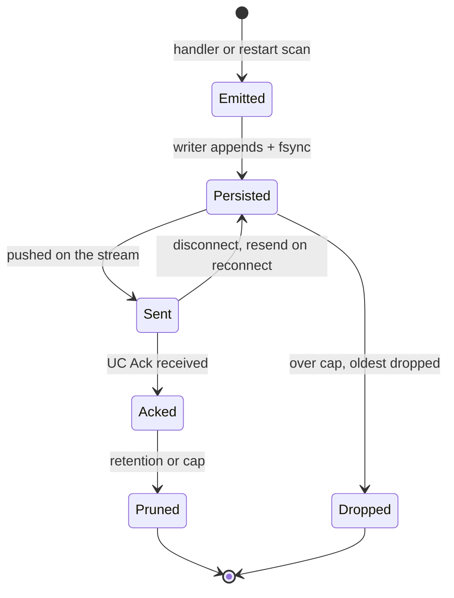
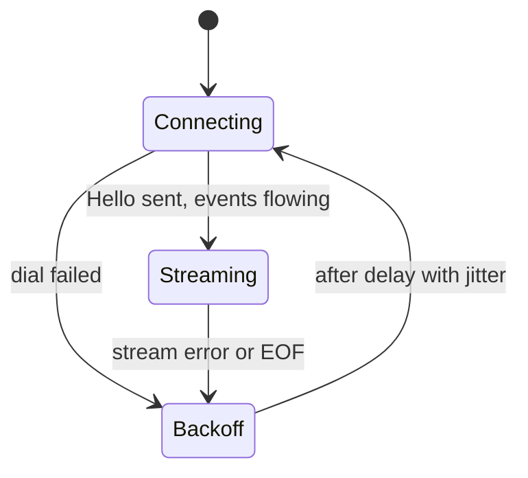

# CN → UC event stream: a durable gRPC notification channel

A solution design for how the consensus node (CN) notifies the UC sidecar of upgrade and dynamic
address book (DAB) events, over one long-lived gRPC stream, durably enough that a restart on either
side loses nothing. This channel replaces the marker files the CN writes today.

**Status:** Needs a CN code change (the server and the schema) and a UC
code change (the client). The [marker-file design](https://github.com/hashgraph/solo-operator/blob/feat/dab-firewall-plan/docs/design/dab-key-rotation-and-firewall-marker-file.md) covers the
operator, firewall and roster-diff work, which does not change with the transport.

## How to read this document

- **Part 1 — the shared contract.** The stream, the protobuf, the event IDs and the failure behaviour. Read
  this first; it assumes no prior knowledge of either side.
- **Part 2 — the CN implementation.** Uses CN terms freely (handle thread, `PlatformStateUpdates`,
  `initializeStatesApi`, PCES replay).
- **Part 3 — the UC implementation.** Uses solo-operator terms freely (`MarkerMonitor`,
  `HandleExecuteImmediate`, daemonkit, the config CRs).
- The **[Glossary](#glossary)** defines the CN and UC terms used throughout.
- Code locations are in the **[Code touchpoints](#appendix-code-touchpoints)** table, by symbol, not line
  number, so they survive refactors.

---

# Part 1 — Shared contract

## Context and problem

A network upgrade and every DAB change (a node added, removed or re-keyed, or a registered node created,
updated or deleted) happen inside the CN. The UC, a
sidecar container in the same pod, has to react: build the `NetworkUpgrade*` custom resources (CRs) that the
operator reconciles. Today the CN signals the UC by writing **marker files** into a shared directory, which
the UC **polls** on an interval (around 500 ms at best). That is slow for an event that should act at once,
carries no data (a marker
is a check mark or a timestamp), and cannot report things that never reach a file, such as the roster or the
roster-adoption decision.

This design gives the CN a push channel to the UC that is immediate, carries structured data, and is durable.

## Goals

- **Push, not poll.** The CN notifies the UC the moment an event occurs.
- **Carry data.** Events carry the candidate roster, the adoption result, and the DAB change, not just a flag.
- **Durability.** No event is lost across a restart of the CN or the UC.
- **Deterministic identity.** Each event has a stable, self-describing ID so the UC can dedupe and the CN can
  re-derive it after a restart.
- **Never affect consensus.** Nothing on this channel may block or slow the CN's transaction handling.
- **Dual-mode transition.** Run alongside the marker files until the stream is everywhere, then retire them.

## Non-goals

- Changing the operator, the firewall plan or the roster diff (see the marker-file design).
- Carrying the block stream or any consensus data. This is a side channel for upgrade and DAB events only.
- A fleet-wide aggregation service. Each UC talks only to its own CN.
- Authentication or encryption (see [Trust model](#trust-model) for why).

## Glossary

| Term | Side | Meaning |
|---|---|---|
| CN | — | Consensus node, the Hedera/Hiero node process (Java). |
| UC | — | Upgrade Coordinator, the sidecar container beside the CN (Go, part of solo-operator). |
| Event | both | One notification the CN sends the UC (a DAB change, an upgrade step, an adoption result). |
| Trigger | both | What caused an event: a transaction, or a consensus round. Seeds the event ID. |
| Outbox | CN | The CN's durable store of emitted events, kept until the UC acks them. A mounted volume: a PVC in cluster-only mode, a hostPath mount on mainnet. |
| Inbox | UC | The UC's durable store of received events, for replay after a UC restart. Same volume model as the outbox. |
| Marker file | CN | The legacy signal: a small file the CN writes and the UC polls for. |
| Handle thread | CN | The single thread that applies transactions in consensus order. Must never block. |
| PCES replay | CN | On restart, the CN re-applies rounds after the last saved state from the pre-consensus event stream. |
| Roster / candidate roster | CN | The set of nodes with weights and gossip certs; the candidate is the next roster, taken at prepare. |
| Capsule (`ConsensusCapsule`) | UC | The CR describing one consensus node; the UC runs beside one capsule's pod. |
| `operationId` | UC | The id grouping the CRs of one upgrade (e.g. `node5-upgrade-0.76.1-…`). |
| Reconciler | UC/operator | The controller loop that drives a CR toward its desired state. |

## Requirements

**Functional**

1. The CN delivers each event listed in [Events](#events-and-their-ids) to the UC.
2. Each event carries a deterministic ID and a typed payload.
3. The UC acknowledges an event only after it has stored it durably.
4. The CN keeps an unacked event and redelivers it after any disconnect.
5. After a CN restart, the CN reproduces any event that state still implies but the outbox is missing.
6. The marker files keep working until configuration turns them off.

**Non-functional** (proposed defaults; tune per environment)

| Property | Target |
|---|---|
| Delivery latency (event to UC) | **Near real-time** — nanosecond-scale on the loopback stream, bounded by network and processing, versus around 500 ms by polling. This is the main reason for the stream over markers. |
| Durability | No loss across a single-side restart; CN fsyncs before it sends |
| Max event size | 1 MiB (the roster, the only large payload, is ≤ 512 KiB) |
| Retained-event cap | Generous runaway guard (e.g. 100 events or 8 MiB); over it, drop the oldest and alert |
| Reconnect backoff (UC) | exponential 1 s → 30 s, with jitter |
| Keepalive | ping every 20 s, 10 s timeout |
| fsync | per batch, batch window ≤ 50 ms (per-event is fine at this volume) |
| Consensus impact | none; the handle thread only enqueues in memory |

## Architecture

The CN and UC are two containers in one Kubernetes pod, sharing the pod's network namespace and two
persistent volumes.



- The CN **serves**; the UC **connects**. The port is bound to `127.0.0.1` only.
- The CN's outbox lives on the `upgrade` volume; the UC's inbox on the `uc-data` volume. Both are mounted
  volumes — a PVC in cluster-only mode, a hostPath mount on mainnet — so they survive a pod restart.

## The connection

- **One bidirectional stream per pod.** The UC opens `subscribe`, sends `Hello`, then receives events and
  sends one `Ack` each. The CN sends events and heartbeats. Either side sends at any time.
- **Reconnect.** If the stream drops, the UC redials with backoff and opens a fresh stream. The CN resends its
  unacked events and the UC dedupes (see [Resume without a cursor](#resume-without-a-cursor)).
- **Push, not poll.** The UC blocks in the stream's receive call; it wakes only when the CN pushes. This is
  not polling — there is no timer and no idle traffic beyond keepalive pings.



### Flow control

Backpressure is a property of gRPC over HTTP/2, handled by each side's own stack — **the UC takes no CN
dependency.** The CN uses its Java gRPC runtime (PBJ); the UC uses `grpc-go` and `protobuf-go`, which
solo-operator already depends on. The only shared artifact is the `.proto`; each side generates its own stubs.

- **The UC paces the CN by consuming.** It receives an event, persists and acks it, then receives the next.
  While it is busy it does not receive, the HTTP/2 window is not replenished, and the CN's next send waits.
  The transport window, the per-event ack and the bounded outbox give enough backpressure; there is no
  application-level credit field.
- **The CN never pauses consensus for this channel.** When its outbox is over cap it drops (see
  [Bounds against a runaway CN](#bounds-against-a-runaway-cn)), the opposite of the block buffer, which pauses
  block production and never drops. Same transport mechanism, opposite overflow policy, because a block is
  ledger output while a
  notification is recoverable from state.

### Trust model

- **Loopback only.** The server binds `127.0.0.1`, with no Service, no `containerPort`, no `hostNetwork`, so
  nothing outside the pod can reach it.
- **All containers in the pod are trusted,** so there is no authentication.
- **The one residual risk:** any container in the pod could open the stream and send a forged `Ack`, making
  the CN drop an unacked event early. That costs durability, not integrity — it cannot forge an event or
  change a CR, and the events are public data.
- The stream grants no new capability: every effect still needs a CR, and the operator still decides.

## Protobuf contract

The CN team owns the final package, path and doc comments. The schema below follows the
`hapi/hapi/src/main/proto` conventions: a `uc/` folder, the `com.hedera.node.internal.uc` package (the
node-internal convention, as in `network.proto`), the PBJ java options, enum values prefixed with the enum
name, a lowerCamelCase rpc, and reuse of `proto.TransactionID` and `proto.Timestamp` from `basic_types.proto`.
Line comments are kept here for brevity; the published file uses `/** */` doc comments like its neighbours.

```proto
syntax = "proto3";

package com.hedera.node.internal.uc;

// SPDX-License-Identifier: Apache-2.0
import "services/basic_types.proto";  // proto.TransactionID, proto.Timestamp

option java_package = "com.hedera.node.internal.uc.protoc";
// <<<pbj.java_package = "com.hedera.node.internal.uc">>> This comment is special code for setting PBJ Compiler java package
option java_multiple_files = true;

// The UC dials the CN and keeps one stream open. The CN sends events; the UC
// sends one ack per event. Loopback only, no authentication.
service UcNotificationService {
  rpc subscribe (stream UcMessage) returns (stream CnMessage);
}

message UcMessage {
  oneof msg {
    Hello hello = 1;  // first frame after connect
    Ack   ack   = 2;  // one per event the UC has durably stored
  }
}

// No cursor: on every connect the CN resends its unacked events (from its own
// ack records) and the UC dedupes by Event.id.
message Hello {
  int64  node_id    = 1;  // the UC's own node id, a sanity check
  string uc_version = 2;
}

message Ack {
  string event_id = 1;
}

message CnMessage {
  oneof msg {
    Event     event     = 1;
    Heartbeat heartbeat = 2;  // liveness while idle
  }
}

message Heartbeat {
  proto.Timestamp cn_time = 1;
}

enum EventType {
  EVENT_TYPE_UNSPECIFIED            = 0;
  EVENT_TYPE_NODE_CREATE            = 1;
  EVENT_TYPE_NODE_UPDATE            = 2;
  EVENT_TYPE_NODE_DELETE            = 3;
  EVENT_TYPE_REGISTERED_NODE_CREATE = 4;
  EVENT_TYPE_REGISTERED_NODE_UPDATE = 5;
  EVENT_TYPE_REGISTERED_NODE_DELETE = 6;
  EVENT_TYPE_UPGRADE_PREPARE        = 7;
  EVENT_TYPE_CANDIDATE_ROSTER_READY = 8;
  EVENT_TYPE_UPGRADE_FREEZE         = 9;
  EVENT_TYPE_UPGRADE_ABORT          = 10;
  EVENT_TYPE_UPGRADE_FROZEN         = 11;
  EVENT_TYPE_ROSTER_ADOPTION        = 12;
}

message Event {
  uint32          schema_version   = 1;
  string          id               = 2;  // "<type>-<nodeRef>-<trigger>-<seq>", deterministic
  EventType       type             = 3;
  string          software_version = 4;  // the version the CN is running now
  proto.Timestamp cn_time          = 5;  // wall-clock emit time, for logging only
  uint32          seq              = 6;  // 0-based emission index within this trigger; the CN assigns it in
                                         // emit order. Not derived from EventType. (consensus_time, seq) is
                                         // the total order.
  proto.Timestamp consensus_time   = 9;  // ORDERING KEY: consensus time of the txn, or the round's consensus
                                         // time when there is no txn. Monotonic and deterministic across
                                         // nodes and restarts. Not cn_time. Ties (same trigger) break by seq.

  // Exactly one identifies the trigger and seeds the id. A payload may repeat it.
  proto.TransactionID txn_id = 7;  // transaction-driven events; carries nonce for atomic batches
  uint64              round  = 8;  // events with no txn: the round they were emitted in (frozen, adoption)

  oneof payload {
    NodeChange           node_change            = 16;
    RegisteredNodeChange registered_node_change = 17;
    UpgradePrepare       upgrade_prepare        = 18;
    CandidateRoster      candidate_roster       = 19;
    FreezeScheduled      freeze_scheduled       = 20;
    FreezeAborted        freeze_aborted         = 21;
    NowFrozen            now_frozen             = 22;
    RosterAdoption       roster_adoption        = 23;
  }
}

message NodeChange {
  int64  node_id                 = 1;  // the subject node
  string account_id              = 2;  // create and update
  string gossip_cert_fingerprint = 3;  // SHA-384 hex; lets the operator pre-check the staged key
  repeated Endpoint gossip_endpoint = 4;
}

message RegisteredNodeChange {
  int64  registered_node_id = 1;
  repeated Endpoint block_node_endpoint = 2;  // RegisteredServiceEndpoint (block-node API)
}

message UpgradePrepare {
  string upgrade_file_id   = 1;  // e.g. "0.0.150"
  string upgrade_file_hash = 2;  // hex
  string freeze_type       = 3;  // "PREPARE_UPGRADE"
}

message CandidateRoster {
  bytes  roster = 1;  // the serialized Network message, the bytes candidate-roster.json holds
  string sha256 = 2;  // hex
  // When the roster takes effect. Unset = at the next upgrade (pair with that upgrade's
  // upgradeprepare). Set = a scheduled change with no upgrade (future no-freeze path).
  proto.Timestamp applies_at = 3;
}

message FreezeScheduled {
  proto.Timestamp freeze_time       = 1;
  string          upgrade_file_hash = 2;
}

message FreezeAborted {
  proto.Timestamp aborted_freeze_time = 1;
}

message NowFrozen {
  uint64          freeze_round = 1;
  proto.Timestamp freeze_time  = 2;
}

message RosterAdoption {
  enum Result {
    RESULT_UNSPECIFIED = 0;
    RESULT_ADOPTED     = 1;
    RESULT_REJECTED    = 2;
    RESULT_NONE        = 3;
  }
  Result result = 1;
  uint64 round  = 2;
}

message Endpoint {
  string domain_name   = 1;
  bytes  ip_address_v4 = 2;  // 4 bytes
  int32  port          = 3;
}
```

The roster travels as `bytes` (the serialized `Network` message) so the UC forwards it verbatim without
parsing, matching the marker-file design. Reusing the typed `Network` message is an option for the CN team;
see [Open questions](#open-questions).

## Events and their IDs

**The ID format is `<type>-<nodeRef>-<trigger>-<seq>`:**

- **`type`** names the event, lower case, e.g. `upgradeprepare`.
- **`nodeRef`** is `n<id>` for a consensus node or `rn<id>` for a registered node. For a DAB event it is the
  **subject** (the node that changed); for an upgrade event it is the **emitting** node, which each CN fills
  with its own id.
- **`trigger`** is the `TransactionID` for a transaction-driven event, rendered `<payer>_<sec>.<nanos>` (the
  canonical `@` replaced with `_` to stay name-safe). An event with **no transaction** is anchored to the round
  it is emitted in, rendered `round<N>` — there is always a current round, so every event has a trigger. For an
  **inner transaction of an atomic batch** the nonzero `nonce` is appended as `_n<nonce>`.
- **`seq`** is the event's **0-based position in the CN's emission order for its trigger**, zero-padded, and the
  **last** field. The CN assigns it as it emits a trigger's events, so it is deterministic and the CN owns the
  order explicitly — nothing is derived from the `EventType` numbering. A trigger that raises one event is `00`;
  `PREPARE_UPGRADE` emits the **candidate roster first** (`00`), then prepare (`01`), so the data lands before
  the trigger to act on it.

The ID is deterministic: the same transaction or round yields the same ID on every node and after a restart,
so the UC dedupes and the CN re-derives it. The software version and the upgrade file hash travel in the
payload, not the ID.

**Ordering.** The ID identifies an event; it does not order it. Every event also carries `consensus_time` —
the consensus timestamp of its triggering transaction, or the round's consensus time for a round-based event.
That is the ordering key: monotonic, deterministic, and the same on every node, so prepare sorts before
freeze before frozen regardless of how the bytes happen to arrive (see
[Ordering and out-of-order delivery](#ordering-and-out-of-order-delivery)).

| Event | `type` | Trigger | Example id | Key payload |
|---|---|---|---|---|
| Node created | `nodecreate` | DAB txn | `nodecreate-n7-0.0.55_1792400100.010000000-00` | node id, account, gossip cert fingerprint, gossip endpoints |
| Node updated | `nodeupdate` | DAB txn | `nodeupdate-n3-0.0.801_1792400050.900000000-00` | node id, changed fields |
| Node deleted | `nodedelete` | DAB txn | `nodedelete-n5-0.0.55_1792400100.010000000-00` | node id |
| Registered node created | `registerednodecreate` | txn | `registerednodecreate-rn12-0.0.55_1792400200.000000000-00` | registered node id, block-node endpoints |
| Registered node updated | `registerednodeupdate` | txn | `registerednodeupdate-rn12-0.0.55_1792400260.000000000-00` | registered node id, changed endpoints |
| Registered node deleted | `registerednodedelete` | txn | `registerednodedelete-rn12-0.0.55_1792400300.000000000-00` | registered node id |
| Upgrade prepare ready | `upgradeprepare` | `PREPARE_UPGRADE` txn | `upgradeprepare-n5-0.0.2_1792449990.000000007-01` | upgrade file id and hash, freeze type |
| Candidate roster ready | `candidaterosterready` | same `PREPARE_UPGRADE` txn | `candidaterosterready-n5-0.0.2_1792449990.000000007-00` | the roster bytes, sha256, and `applies_at` |
| Upgrade freeze scheduled | `upgradefreeze` | `FREEZE_UPGRADE` txn | `upgradefreeze-n5-0.0.2_1792451000.500000000-00` | freeze time, upgrade file hash |
| Upgrade aborted | `upgradeabort` | `FREEZE_ABORT` txn | `upgradeabort-n5-0.0.2_1792451500.700000000-00` | aborted freeze time |
| Upgrade frozen | `upgradefrozen` | freeze round (no txn) | `upgradefrozen-n5-round48211397-00` | freeze round, freeze time |
| Roster adoption decided | `rosteradoption` | restart round (no txn) | `rosteradoption-n5-round48211398-00` | result (`adopted`/`rejected`/`none`), round |

One transaction can raise more than one event: `PREPARE_UPGRADE` raises both `upgradeprepare` and
`candidaterosterready`, which share the trigger and differ only by `type`. The DAB events are early warnings,
days before the freeze, that the next roster will change; the operator still decides from the candidate roster
at prepare time.

### JSON examples

proto3 JSON mapping: int64 as strings, bytes as base64, enums as value names, `Timestamp` and `TransactionID`
as nested objects with zero values omitted. `seq` is a zero-valued `uint32` here, so proto3 omits it; the id
still ends in `-00`. The wire format is protobuf; these are for reading.

`Hello` and an `Ack`:

```json
{ "hello": { "nodeId": "5", "ucVersion": "0.76.1" } }
```
```json
{ "ack": { "eventId": "upgradeprepare-n5-0.0.2_1792449990.000000007-01" } }
```

`nodecreate` (early warning; subject is node 7):

```json
{
  "schemaVersion": 1,
  "id": "nodecreate-n7-0.0.55_1792400100.010000000-00",
  "type": "EVENT_TYPE_NODE_CREATE",
  "softwareVersion": "0.76.1",
  "cnTime": { "seconds": "1792400101", "nanos": 482000000 },
  "txnId": {
    "transactionValidStart": { "seconds": "1792400100", "nanos": 10000000 },
    "accountID": { "accountNum": "55" }
  },
  "nodeChange": {
    "nodeId": "7",
    "accountId": "0.0.10",
    "gossipCertFingerprint": "3fa91c2e8b4d6f0a1c7e2d9b8a5c4f30",
    "gossipEndpoint": [ { "domainName": "node7.example.com", "port": 50111 } ]
  }
}
```

`upgradeprepare` and `candidaterosterready` (one `PREPARE_UPGRADE`, two events, shared trigger):

```json
{
  "schemaVersion": 1,
  "id": "upgradeprepare-n5-0.0.2_1792449990.000000007-01",
  "type": "EVENT_TYPE_UPGRADE_PREPARE",
  "softwareVersion": "0.76.1",
  "cnTime": { "seconds": "1792450007", "nanos": 482000000 },
  "txnId": {
    "transactionValidStart": { "seconds": "1792449990", "nanos": 7 },
    "accountID": { "accountNum": "2" }
  },
  "upgradePrepare": {
    "upgradeFileId": "0.0.150",
    "upgradeFileHash": "9f86d081884c7d659a2feaa0c55ad015a3bf4f1b2b0b822cd15d6c15b0f00a08",
    "freezeType": "PREPARE_UPGRADE"
  }
}
```
```json
{
  "schemaVersion": 1,
  "id": "candidaterosterready-n5-0.0.2_1792449990.000000007-00",
  "type": "EVENT_TYPE_CANDIDATE_ROSTER_READY",
  "softwareVersion": "0.76.1",
  "cnTime": { "seconds": "1792450007", "nanos": 500000000 },
  "txnId": {
    "transactionValidStart": { "seconds": "1792449990", "nanos": 7 },
    "accountID": { "accountNum": "2" }
  },
  "candidateRoster": {
    "roster": "CrsBCjgK... (base64 of the serialized Network message)",
    "sha256": "5b0f3c9a77d14e2a8c61d0b94e1f7a32e9c4d81f05a6b37d2c9e48f1a0b7d635"
  }
}
```

`upgradefrozen` and `rosteradoption` (no transaction, so the trigger is the round):

```json
{
  "schemaVersion": 1,
  "id": "upgradefrozen-n5-round48211397-00",
  "type": "EVENT_TYPE_UPGRADE_FROZEN",
  "softwareVersion": "0.76.1",
  "cnTime": { "seconds": "1792492204", "nanos": 220000000 },
  "round": "48211397",
  "nowFrozen": { "freezeRound": "48211397", "freezeTime": { "seconds": "1792492200" } }
}
```
```json
{
  "schemaVersion": 1,
  "id": "rosteradoption-n5-round48211398-00",
  "type": "EVENT_TYPE_ROSTER_ADOPTION",
  "softwareVersion": "0.76.2",
  "cnTime": { "seconds": "1792492491", "nanos": 903000000 },
  "round": "48211398",
  "rosterAdoption": { "result": "RESULT_ADOPTED", "round": "48211398" }
}
```

## State machines

**An event's lifecycle** (CN view):



**The stream** (UC view):



## Failure and ordering

| Situation | Behaviour |
|---|---|
| UC down or restarting | The CN keeps every unacked event on disk and resends on reconnect. Delivery is delayed, not lost. |
| CN restarting | The outbox plus the state scan rebuild the events with the same ids. The UC dedupes the resend. |
| Adoption at CN start-up | The server and writer must already be up before `initializeStatesApi`, so the adoption event has somewhere to go. Neither needs the platform or the node key. |
| Duplicates | Expected and harmless: ids are deterministic and the UC dedupes. |
| Out-of-order | A single stream preserves send order; on resend and reconcile the CN orders by `consensus_time`; the UC also holds an event whose prerequisite is missing (see [Ordering](#ordering-and-out-of-order-delivery)). |
| Over cap (runaway CN) | Drop the oldest, loudly, and alert. Never block. |
| Forged ack | Costs durability only (see [Trust model](#trust-model)). |

### Ordering and out-of-order delivery

Order matters: the upgrade events form a chain (`upgradeprepare` → `upgradefreeze` → `upgradefrozen` →
`rosteradoption`), and creating a downstream CR before its upstream one — a Freeze CR with no Prepare CR — is
wrong. Three layers keep delivery ordered, none of them a cursor:

1. **A single stream preserves order.** gRPC over HTTP/2 delivers one stream's messages in send order, and the
   CN sends in emit order (the handle thread enqueues in consensus order). So on a healthy connection the UC
   receives prepare before freeze before frozen.
2. **The CN orders by `consensus_time` on resend and reconcile.** After a reconnect it replays its outbox in
   `consensus_time` order; after a restart it emits the events it rebuilds from state in that order too. This
   is why the key is the **consensus** timestamp and not `cn_time`: reconstructed events are emitted "now", so
   their wall-clock times collapse and cannot order them, while `consensus_time` is fixed in state.
3. **The UC enforces prerequisites as a safety net.** It applies events in `consensus_time` order and, for the
   upgrade chain, holds an event whose prerequisite CR is not yet present (an `upgradefreeze` waits until the
   Prepare CR for its operation exists) and retries, rather than creating a downstream CR early. This covers
   any residual reordering without trusting arrival order.

**Breaking ties.** Distinct transactions get distinct consensus timestamps, so two events share a
`consensus_time` only when they come from the **same** trigger — `upgradeprepare` and `candidaterosterready`
from one `PREPARE_UPGRADE`. The full ordering key is **`(consensus_time, seq)`**, where `seq` is the CN's
emission index for that trigger (candidate-roster `0`, prepare `1`). The CN maintains this order as it emits,
so it is explicit and deterministic — it is **not** derived from the `EventType` numbering, which the CN team
can renumber freely. Every node emits a trigger's events in the same order, so resend and reconcile replay it
the same way. This particular tie is benign anyway — the UC holds the Prepare CR until both prepare and roster
arrive — so the tiebreaker is really about keeping the CN's emission stable rather than about correctness.

### Resume without a cursor

On every connect the CN resends its **unacked** events — the ones it has no ack for in its own outbox — and the
UC **dedupes by `Event.id`** as a safety net (an ack may have been in flight when the link dropped). The UC
never tracks a resume position; the CN decides what to resend from its own records, and the retained set is
tiny, so the resend is cheap.

The CN keeps a small window of **acked** events too, and resends those only to rebuild a UC that lost its
inbox (for example an `emptyDir` wiped on pod recreation); a UC with its inbox intact dedupes them away.

---

# Part 2 — CN implementation (Java)

This part assumes familiarity with the CN codebase. Symbols are in the
[Code touchpoints](#appendix-code-touchpoints) table.

## Responsibilities

The CN gains a notification service with four jobs: emit an event at each source, persist it before sending,
serve the stream, and rebuild events from state after a restart. None of this runs on the handle thread
beyond a non-blocking enqueue.

## Emission hooks

The CN already has the exact points where each event originates. The service adds an `emit(event)` call at
each; the hooks are named here and located in the touchpoints table.

| Hook | Fires | Events |
|---|---|---|
| **Hook A — freeze marker** | the method that writes freeze marker files | `upgradeprepare`, `upgradefreeze`, `upgradeabort`, `upgradefrozen` |
| **Hook B — roster export** | the candidate-roster export at prepare | `candidaterosterready` |
| **Hook C — roster adoption** | the roster-schema restart adoption decision | `rosteradoption` |
| **Hook D — DAB handlers** | the node and registered-node transaction handlers | `nodecreate/update/delete`, `registerednodecreate/update/delete` |

During the dual-mode transition the same hooks still write the marker files; `emit(event)` is added beside the
existing write, behind `notification.stream.enabled`, and the marker writes stay untouched (see
[Retiring the marker files](#retiring-the-marker-files)).

## Deterministic ID derivation

```
function eventId(type, nodeRef, trigger, seq):
    if trigger.isTransaction:
        t = trigger.txnId
        s = t.payer + "_" + t.validStartSeconds + "." + pad9(t.validStartNanos)
        if t.nonce != 0:
            s = s + "_n" + t.nonce
    else:
        s = "round" + trigger.round
    return type + "-" + nodeRef + "-" + s + "-" + pad2(seq)
```

`pad9` zero-pads nanoseconds to 9 digits; `pad2` pads the sequence to 2. `nodeRef` is `n<id>` or `rn<id>`.
The function is pure: same inputs, same id, on every node and after a restart.

## The outbox

- **Location:** `data/upgrade/uc/` under the CN home
  (`/opt/hgcapp/services-hedera/HapiApp2.0/data/upgrade/uc/`), on the `upgrade` volume (a mounted volume: a PVC in cluster-only mode, a hostPath mount on mainnet). It
  sits beside `current/`, never inside it, because the CN wipes `current/` during package extraction.
- **Format:** the retained set keyed by id. A simple, robust choice is to hold it in memory and rewrite the
  file on change (write a temp file, `fsync`, atomic rename), since the set is tiny and changes a handful of
  times per upgrade. An append-only file with a sidecar set of acked ids is the alternative, but it is more
  machinery than this volume needs.
- **Write path, off the handle thread:**

```
# handle thread — never blocks on IO:
onEmit(event):
    queue.offer(event)          # bounded, non-blocking

# writer thread:
loop:
    batch = queue.drainUpTo(N, within = fsyncWindow)   # e.g. 50 ms
    for e in batch:
        outbox.appendRecord(serialize(e))
    outbox.fsync()                 # one fsync per batch
    for e in batch:
        retained.add(e)
        server.offerToConnectedStream(e)   # send only after durable
```

The CN sends an event only after it is durable, so anything the UC can see is already on the CN's disk.

## Bounds against a runaway CN

Events are sparse (about six per upgrade), and a UC outage cannot flood the outbox — upgrades stall without the
UC, so events can't pile up. The case the bounds exist for is a **CN defect** that emits far more than
expected: a hook looping, catch-up re-running, emission on every round. Three cheap layers contain it, none
of which touches the handle thread or consensus.

**1. Deterministic IDs absorb the common case for free.** The usual flood bug re-emits the *same* logical
event, which produces the *same* id. The retained set is keyed by id, so a re-insert is a no-op — no growth,
no disk churn. Most real flood bugs are caught here with no policy at all.

**2. A bounded in-memory queue protects consensus.** The handle thread does a non-blocking `offer`; if the
queue is full it drops and increments a metric, and **never blocks**. A flood can never back up into
transaction handling.

**3. A bounded outbox caps the disk.** For a bug that emits genuinely *distinct* events (distinct id), a
hard cap keeps the outbox at a steady size — each over-cap write drops the oldest, so the disk cannot grow
without limit however fast the CN emits.

```
pruneRetained():            # when count or bytes exceed the cap
    drop acked events, oldest first        # confirmed; safe to remove
    while still over cap:
        drop the oldest unacked, log WARN, metric events.dropped++
```

Keep the newest (it reflects current state and is the most useful on reconnect); the oldest is usually
re-derivable from state anyway. **No compaction** — a flood of distinct events is not "supersession," so
grouping by `(type, subject)` would add correctness-sensitive logic without helping this case.

**The caps are a runaway guard, not a tuning knob.** Set them generously (the defaults below are ample), so
they never trip in normal or moderately-abnormal operation. Under a real flood, dropping events is damage
limitation: a flooding CN is a severe defect, so the goal is a bounded disk and an unaffected node, plus a
**loud signal** — `events.dropped > 0`, a climbing `outbox.unackedCount`, and an abnormal emission rate are what
get the bug fixed.

## Restart reconcile

A plain restart has no marker re-run, and PCES only replays rounds after the last saved state, so an event
from an earlier round would not re-fire. The reconcile closes that gap from the outbox plus state.

```
onStart():                              # before initializeStatesApi
    retained = outbox.loadAll()            # ids the outbox already has
    facts = readFactsFromState()        # prepared file hash, candidate roster,
                                        # freezeTime, lastFrozenTime, latestFreezeRound
    for f in facts:
        id = eventId(f.type, f.nodeRef, f.trigger, 0)
        if id not in retained:
            e = buildEvent(f)
            outbox.appendRecord(serialize(e)); outbox.fsync()
            retained.add(e)
    startServer()                       # listening before the adoption hook can fire
```

An abort and the DAB events are not in state, so the outbox is their only record; if the outbox is lost, the UC's
own "scheduled then neither scheduled nor frozen" inference still catches an abort.

When the stream reconnects after this, the CN sends the outbox in **`consensus_time` order**, so a UC that
missed events during the restart still receives them prepare-before-freeze (see
[Ordering](#ordering-and-out-of-order-delivery)).

## Threading and start-up order

- **Handle thread:** only `queue.offer`. No IO, no lock held across the stream.
- **Writer thread:** one thread owns the file; appends, fsyncs, hands durable events to the server.
- **Server:** the gRPC server and the writer **must be up before `initializeStatesApi`**, because the
  roster-adoption hook (Hook C) runs there, before the platform exists. The service must not depend on the
  platform or the node key.

## Observability (CN)

Follow the existing CN metrics pattern: a dedicated holder class (like `BlockStreamMetrics`) that registers
through the platform `Metrics` API, with a category, grouped names, `Counter` / `LongGauge` / `DoubleGauge`,
each with a description, and **states encoded as a gauge** (as the block buffer encodes back-pressure state).

Proposed holder `UcNotificationMetrics`, category `ucNotification`, groups `stream` and `outbox`:

| Metric | Type | Meaning |
|---|---|---|
| `ucNotification.stream.connected` | LongGauge | 1 while a UC stream is open, else 0 |
| `ucNotification.stream.opened` | Counter | streams opened |
| `ucNotification.stream.closed` | Counter | streams closed |
| `ucNotification.events.emitted` | Counter | events produced (handlers + reconcile) |
| `ucNotification.events.sent` | Counter | events pushed to the UC |
| `ucNotification.events.acked` | Counter | acks received |
| `ucNotification.events.dropped` | Counter | events dropped on overflow |
| `ucNotification.outbox.unackedCount` | LongGauge | unacked events on disk |
| `ucNotification.outbox.bytes` | LongGauge | outbox size |
| `ucNotification.outbox.oldestUnackedAgeSeconds` | LongGauge | age of the oldest unacked event |
| `ucNotification.outbox.writeFailures` | Counter | fsync or append failures |

These flow out through the CN's existing metrics path (the Alloy sidecar), like every other CN metric.

## CN configuration

| Property (`node.properties`) | Default | Meaning |
|---|---|---|
| `notification.stream.enabled` | `false` | serve the stream and emit events |
| `notification.markers.enabled` | `true` | write the marker files, as today; set `false` to retire them |
| `notification.uc.port` | TBD | loopback port for the server |
| `notification.uc.outboxDir` | `data/upgrade/uc` | outbox directory |
| `notification.uc.retainedMaxEvents` | 100 | overflow cap by count |
| `notification.uc.retainedMaxBytes` | 8 MiB | overflow cap by size |
| `notification.uc.fsyncWindowMillis` | 50 | writer batch window |

---

# Part 3 — UC implementation (Go)

This part assumes familiarity with solo-operator's `internal/uc`. Symbols are in the
[Code touchpoints](#appendix-code-touchpoints) table.

## Responsibilities

The UC gains a gRPC client event source beside `MarkerMonitor`. It receives events, stores each durably,
acks, then feeds the existing handlers, which already dedupe by `operationId` and persist before acting.

## Client lifecycle

```
run(ctx):
    backoff = newBackoff(1s, 30s, jitter)
    for ctx not done:
        conn = dial("127.0.0.1:" + port)          # grpc-go, insecure, loopback
        if err: sleep(backoff.next()); continue
        stream = conn.subscribe(ctx)
        stream.Send(Hello{nodeId, ucVersion})
        backoff.reset()
        for:
            msg = stream.Recv()                    # blocks until the CN pushes
            if err: break                          # drop out, reconnect
            if msg.heartbeat: continue
            handleEvent(msg.event, stream)
```

- Supervised by daemonkit, like the other UC monitors.
- `Recv()` blocks; it is a push wake-up, not a poll. The receive loop paces the CN (see
  [Flow control](#flow-control)).

## Persist, then ack, then process

```
handleEvent(e, stream):
    if inbox.has(e.id):           # already stored (resend or dup)
        stream.Send(Ack{e.id})
        return
    inbox.persist(e); fsync()     # durable BEFORE ack
    stream.Send(Ack{e.id})
    process(e)                    # existing handlers; idempotent by operationId
```

- **Inbox:** `/opt/solo/weaver/uc/events/` on the `uc-data` volume (a mounted volume: a PVC in cluster-only mode, a hostPath mount on mainnet), beside the existing
  `crs/` persistence. A UC restart replays the inbox, so an acked event is never lost.
- **Dedup:** by `Event.id`. This is a new, finer check than the existing `operationId` dedup; both apply.

## Mapping events to handlers

| Event | UC action |
|---|---|
| `candidaterosterready` | **Store** the roster, keyed by its operation; no CR yet. It arrives before `upgradeprepare`, so it is pre-positioned. |
| `upgradeprepare` | Build the `NetworkUpgradePrepare` CR **once**, with the stored roster in `spec.artifacts` (the Prepare spec is immutable, so it must be complete at creation). |
| `upgradefreeze` | Build `NetworkUpgradeFreeze`. |
| `upgradeabort` | Build `NetworkUpgradeFreezeAbort`. |
| `upgradefrozen` | Build `NetworkUpgradeExecute`. |
| `rosteradoption` | Record the adoption result on the UC pod condition (today's `roster_adoption` path), for the operator to proxy. |
| `nodecreate/update/delete`, `registerednode*` | Early-warning signal; no CR by itself. Surface for the operator's roster-diff and firewall pre-checks. |

**The roster is pre-positioned, not awaited on a timer.** The CN emits `candidaterosterready` before
`upgradeprepare`, and the durable channel redelivers it until acked, so by the time the UC handles
`upgradeprepare` it normally already holds the roster. If it does not (a stream hiccup mid-trigger), the UC
holds `upgradeprepare` and retries — it never times out waiting, because delivery is guaranteed. The only
genuine-absence case (the CN produced no roster at all) falls back to the marker-file policy: proceed with a
warning, or hold if `--candidate-roster-required`. The roster is taken from the `candidaterosterready` payload,
checked against its `sha256`; in marker-only mode the UC reads `candidate-roster.json` as today.

**When a roster is not tied to an upgrade.** A `candidaterosterready` carries `applies_at`. Unset means it
applies at the next upgrade, and the UC pairs it with that upgrade's `upgradeprepare` as above. Set means a
scheduled roster change with no upgrade — for example a daily DAB roster update — which the UC stores and
applies at `applies_at` through the no-freeze path. That path is not yet designed (see the marker-file
design's future section); `applies_at` is the field that will carry it.

**Apply in order, and hold on a missing prerequisite.** The UC processes events in `consensus_time` order and
checks each event's prerequisite before acting: `upgradeprepare` needs the stored roster, `upgradefreeze` the
Prepare CR for its operation, `upgradefrozen` the Freeze CR. If the prerequisite is missing, the UC leaves the
event persisted and retries rather than acting early. This is a safety net on top of the CN's ordering, so a
stray reorder can never create a Prepare CR without its roster or a Freeze CR without a Prepare CR.

## Observability (UC)

The UC has its own Prometheus endpoint (its metrics server, port 9990), separate from the CN's platform
metrics. Mirror the same counters in Prometheus idiom:

| Metric | Type | Meaning |
|---|---|---|
| `uc_events_received_total` | counter | events received on the stream |
| `uc_events_acked_total` | counter | acks sent |
| `uc_events_deduped_total` | counter | events skipped as duplicates |
| `uc_event_stream_connected` | gauge | 1 while the stream is up |
| `uc_event_stream_reconnects_total` | counter | reconnect attempts |
| `uc_inbox_pending` | gauge | events persisted but not yet processed |

## UC configuration

| Flag / env | Default | Meaning |
|---|---|---|
| `--uc-events-port` / `UC_EVENTS_PORT` | TBD | CN loopback port to dial |
| `--uc-events-enabled` / `UC_EVENTS_ENABLED` | `false` until the CN serves it | turn the client on |
| `--uc-events-inbox` / `UC_EVENTS_INBOX` | `/opt/solo/weaver/uc/events` | inbox directory |

---

# Part 4 — Cross-cutting

## Retiring the marker files

The marker-writing code is **left untouched** and runs as it does today; the stream is added beside it. Two
independent booleans control the transition, rather than a combined "sinks" switch — one turns the stream on,
the other lets an environment stop writing markers:

| Property | Default | Effect |
|---|---|---|
| `notification.stream.enabled` | `false` | Serve the stream and emit events. |
| `notification.markers.enabled` | `true` | Write the marker files and `candidate-roster.json`, exactly as today. |

Both false would leave the node with no upgrade signal, so that combination **fails safe**: markers stay on
and the CN logs a warning. Nothing is removed from the marker path until step 4.

1. **Now:** `stream.enabled=false`, `markers.enabled=true` — today's behaviour.
2. **Roll out:** `stream.enabled=true`, `markers.enabled=true` — both run; the stream is primary and the
   markers are the safety net. The UC dedupes across the two.
3. **Per environment, once proven:** `markers.enabled=false` — stream only. Needs the UC inbox, the CN outbox
   and restart reconcile (all above), and a check that nothing else reads the markers — some are part of
   the CN's own upgrade handling.
4. **Later:** delete the marker-writing code and the `markers.enabled` flag.

This keeps the two concerns separate: a simple boolean disables the markers in one environment without
affecting the stream, and the eventual code removal is a clean deletion, not a config-format change.
`candidate-roster.json` is covered by `markers.enabled`, so with the stream on and markers off it is not
written and the roster travels in the event.

## Rollout

HIP-1494's two-upgrade pattern:

1. **Upgrade N:** the UC ships the client, and the operator mounts the `data/upgrade/uc` volume (a pod-template
   change that rides the restart). The CN does not serve the stream yet, so the client falls back to markers.
2. **Upgrade N+1:** a CN release that serves the stream, enabled through `node.properties`.

## Alternatives considered

| Alternative | Why not |
|---|---|
| UC serves HTTP, CN POSTs (earlier proposal) | The CN as client needed an HMAC and rotation for auth; the stream plus loopback trust is simpler and gives durable redelivery. |
| Shared secret + HMAC | Unnecessary once the channel is loopback-only and all pod containers are trusted. |
| A cursor / sequence number | A recreated outbox volume could make the UC skip events. Resending unacked + dedupe-by-id avoids it. |
| App-level credit flow control | gRPC transport demand plus ack plus a bounded outbox already suffice (see [Flow control](#flow-control)). |
| Port `BlockBufferService` backpressure | It pauses the producer and never drops — wrong for a non-consensus side channel. |
| Keep marker files only | Slow (polling), no payload, cannot report the adoption decision. |

## Open questions

1. **Ownership and schema.** Who builds the CN server and owns the `.proto`, and which release carries it.
2. **TransactionID and consensus time at emit.** Confirm a handler can read the `TransactionID` and the
   **consensus timestamp** when it emits a transaction-driven event, and the round plus the round's consensus
   time for the two platform events (both should be in state). `consensus_time` is the ordering key, so it
   must be available for every event.
3. **Re-derivable ids for prepare and abort.** Their trigger time is not in state, so a lost outbox plus a restart
   scan could re-emit them with a different id. The UC guard (ignore a prepare when a non-terminal operation
   already exists for the same upgrade file hash) covers this; confirm it is enough, or store the prepare's
   consensus time in state.
4. **Adoption result in state.** Whether `rosteradoption` can be re-derived from state, or exists only as the
   event and a log line.
5. **Server start order.** Confirm the gRPC server and the writer can start before `initializeStatesApi` and
   enqueue the adoption event raised there.
6. **Port and versioning.** The loopback port, and how the service and `schema_version` evolve.
7. **PCES replay and side effects.** Whether replayed rounds re-run the hooks, which sets how much the restart
   scan must cover.
8. **Volume sizing.** The volume size for the outbox (`data/upgrade/uc`) and the UC inbox (tiny, but with a floor and the cap).
9. **Roster as `bytes` or typed `Network`.** `bytes` forwards verbatim; `Network` is more idiomatic but couples
   the schema and makes the UC generate that proto. CN team's call.
10. **Atomic batches.** Confirm whether a DAB or freeze transaction can be an inner transaction of a batch; if
    so, the `TransactionID` nonce distinguishes them and the id appends `_n<nonce>`.
11. **Enum verbosity.** House style prefixes every enum value (`EVENT_TYPE_*`), so the JSON `type` is long.
    Confirm that is acceptable.

## Appendix: Code touchpoints

Referenced by symbol, not line number. Verified as of **hiero-consensus-node `main` 640ce5aac3** and
**solo-operator `feat/dab-firewall-plan` 74e4d548**. Refresh this table, not the prose, when code moves.

**CN (hiero-consensus-node)**

| Hook / piece | Path | Symbol |
|---|---|---|
| Hook A — freeze markers | `hedera-node/hedera-network-admin-service-impl/.../handlers/ReadableFreezeUpgradeActions.java` | `writeMarker`, `writeCheckMarker`, `writeSecondMarker` |
| Hook B — roster export | `hedera-node/hedera-app/.../workflows/handle/steps/PlatformStateUpdates.java` | the candidate-roster export (`doExport` / `tryToExport`) |
| Hook C — roster adoption | `hedera-node/hedera-roster-service-impl/.../schemas/V0540RosterSchema.java` | `restart` adoption decision |
| Hook D — node DAB | `hedera-node/hedera-addressbook-service-impl/.../handlers/` | `NodeCreateHandler`, `NodeUpdateHandler`, `NodeDeleteHandler` |
| Hook D — registered node | `hedera-node/hedera-addressbook-service-impl/.../handlers/` | `RegisteredNodeCreateHandler`, `RegisteredNodeUpdateHandler`, `RegisteredNodeDeleteHandler` |
| Start-up order | `hedera-node/hedera-app/.../ServicesMain.java` | `initializeStatesApi` must follow server start |
| Restart catch-up (markers) | same as Hook A | `catchUpOnMissedSideEffects` |
| Metrics pattern to mirror | `hedera-node/hedera-app/.../metrics/BlockStreamMetrics.java` | holder class, category, `getOrCreate` |
| State facts for reconcile | `platform/state/platform_state.proto` | `freeze_time`, `last_frozen_time`, `latest_freeze_round` |

**UC (solo-operator)**

| Piece | Path | Symbol |
|---|---|---|
| New event source (beside this) | `internal/uc/marker_monitor.go` | `MarkerMonitor` |
| Event handlers to feed | `internal/uc/factory.go` | `HandleExecuteImmediate` and siblings |
| Prepare CR build | `internal/uc/prepare.go` | `buildPrepareCR`, `mintOperationID` |
| Roster read / fallback | `internal/uc/artifacts.go` | `readCandidateRoster` |
| Adoption pod condition | `internal/uc/roster_adoption.go` | the `roster_adoption` condition writer |
| Persistence pattern | `internal/uc/config.go` | `CRPersistPath` (`/opt/solo/weaver/uc/crs`); inbox beside it |
| Node identity / config | `internal/uc/config.go` | `Config.NodeID`, `Config.CapsuleName` |
| Metrics server | `internal/uc/metrics_server.go` | Prometheus endpoint (port 9990) |
| Data volume root | `internal/resources/consensus/defaults.go` | `UCDataPath` (`/opt/solo/weaver/uc`) |

## FAQ

Short answers to questions that come up about the design. These record current thinking, not final rules.

**How is an event's `seq` assigned, and what is "emission order"?**

Every event comes from one *trigger* — a transaction (its consensus timestamp) or a round. The CN applies
transactions on a single handle thread in consensus order; handling one trigger may fire several events, and
the `emit(...)` calls happen in a fixed code order. That order is the "emission order". `seq` is just a counter
scoped to the trigger:

```
onTrigger(consensus_time):     # one transaction or one round
    i = 0
    for each event the handler emits, in code order:
        event.seq = i
        i = i + 1
```

So `PREPARE_UPGRADE` emits the candidate roster (`seq 0`) then prepare (`seq 1`); a trigger that emits one
event gets `seq 0`, and the counter resets for the next trigger. It is deterministic because every node runs
the same handler code on the same trigger, so the `seq` values match everywhere — and restart-reconcile must
rebuild a trigger's events in the same canonical order to reproduce them. The full order is
`(consensus_time, seq)`.

**Why order by `consensus_time` and not `cn_time`?**

`cn_time` is wall-clock emit time, useful for logging. It cannot order events across a restart: reconcile
re-emits events "now", so their wall-clock times collapse to the restart moment. `consensus_time` is fixed in
state, monotonic and identical on every node, so it is the only sound ordering key.

**Why resend on reconnect instead of using a cursor?**

A cursor would have the UC track a resume position and the CN send only what is newer. Resend-plus-dedupe is
simpler: the CN resends its unacked events, the UC drops duplicates by `Event.id`, and neither side tracks a
position. The event volume is tiny, so resending costs nothing, and because the IDs are stable it stays correct
even if the CN's storage is recreated.

## References

- [Marker-file design](https://github.com/hashgraph/solo-operator/blob/feat/dab-firewall-plan/docs/design/dab-key-rotation-and-firewall-marker-file.md) — the companion design: operator, firewall and roster diff.
- [HIP-1494](https://hips.hedera.com/hip/hip-1494) — upgrade package.
- [HIP-1495](https://hips.hedera.com/hip/hip-1495) — Kubernetes-native deployment.
- [HIP-1496](https://hips.hedera.com/hip/hip-1496) — network upgrade process.
- [CN block-node streaming](https://github.com/hiero-ledger/hiero-consensus-node/tree/main/hedera-node/hedera-app/src/main/java/com/hedera/node/app/blocks/impl/streaming) — the precedent for a durable, acked gRPC stream.
- [`basic_types.proto`](https://github.com/hiero-ledger/hiero-consensus-node/blob/main/hapi/hedera-protobuf-java-api/src/main/proto/services/basic_types.proto) — `TransactionID` and `Timestamp`, reused by the contract.
- [hapi proto directory](https://github.com/hiero-ledger/hiero-consensus-node/tree/main/hapi/hapi/src/main/proto) — where the CN would publish the `uc/` proto.
