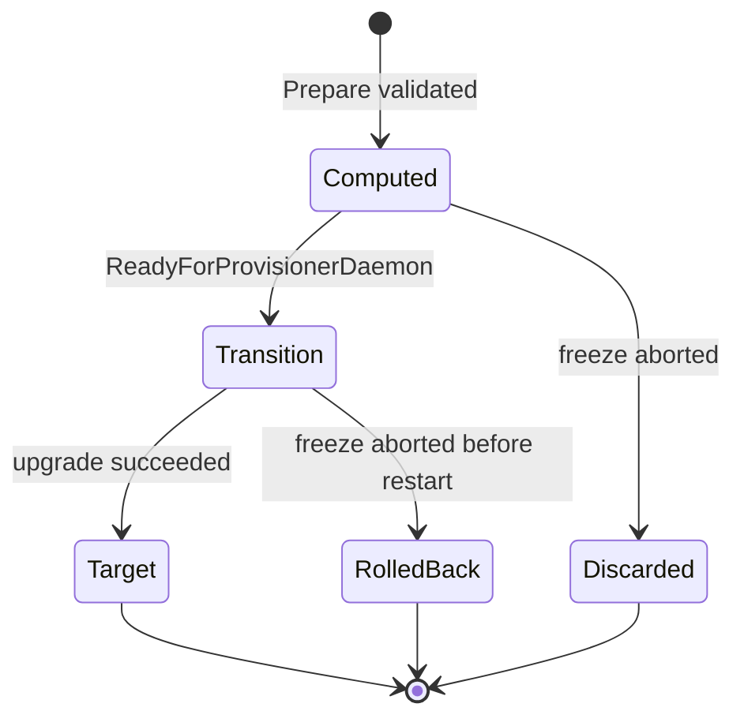

# DAB-driven key rotation, firewall and roster changes

How a Dynamic Address Book (DAB) change — a node operator's `NodeUpdate`, or a council
`NodeCreate` / `NodeDelete` — becomes an automatic gossip signing-key swap, host-firewall update and
roster adoption during a freeze upgrade. The actors are the UC sidecar, the operator and the
`solo-provisioner-daemon`.

**This document starts from the event.** It assumes the UC has already received a CN event and asks:
*what happens next?* How the event travels from the CN to the UC — the durable gRPC stream, acks,
restart recovery — is the job of the companion
[dab-cn-uc-event-stream.md](dab-cn-uc-event-stream.md). The host-side commands a node operator runs
(`consensus node install` / `join` / `reconfigure` / `uninstall`, key import) live in
[dab-provisioner-host-operations.md](dab-provisioner-host-operations.md). This doc is the middle
layer: **event in, custom resource and host change out.**

> **Live document.** Every CN event has a processing section. Where the design is settled, the
> section is complete. Where it is not, the section carries a **TODO** so the gap is visible rather
> than missing. The registered-node events and one DAB open point are TODOs today.

**Status:** design, partly implemented. See [Custom resources and conditions](#custom-resources-and-conditions).
Statements about the CN were read from `hiero-consensus-node` `main`; anything not verified is listed
under [Open questions](#open-questions).

---

# Part 1 — Shared contract

Everyone implementing a piece of this reads Part 1. It fixes the vocabulary, the event set, the
custom resources and the single rule that decides when the operator acts. Parts 2 and 3 build on it.

## The problem

A DAB transaction changes the node's entry in consensus state and nothing else. The change only
takes effect when the network **adopts a new roster**, which today happens only at an upgrade
restart. At that restart three things must line up on different machines:

1. The rotating node starts with the **new private key** that matches its new certificate.
2. Every other node's host firewall **allows the new gossip address**.
3. A missing key or a closed port is found **before** the freeze, not after it.

## The model

**The candidate roster is authoritative; the operator decides.** The CN snapshots a candidate roster
at `PREPARE_UPGRADE` and hands it to the UC in an event. The **UC forwards it unmodified** into a
custom resource. The **operator diffs it** against the roster the node last ran and derives every
action: which key to swap, which firewall addresses to open and close, whether this node is being
added or removed. Individual DAB transaction events (`nodecreate`, `nodeupdate`, `nodedelete`) are an
**early warning** of what the roster will later show; they do not drive the change themselves.

Five points fix the behaviour:

1. The **UC forwards** the candidate roster in the Prepare CR. The **operator decides** what to do
   with it. Every configuration change is visible to the operator as a CR field before anything acts.
2. The operator finds the staged key by matching the roster entry's certificate fingerprint to a
   Secret label, and checks this **early**, at prepare time (or earlier, from a DAB event).
3. The key swap rides the normal upgrade patch: one capsule patch changes the images **and** the
   signing Secret, so there is one restart.
4. The firewall changes **make-before-break**: open the union of old and new addresses before the
   restart, close the old ones only after the upgrade has succeeded.
5. The operator acts only for upgrades at or above the version floor in
   `orbit.spec.consensus.canAdoptRosterFromVersion` (see [When the operator acts](#when-the-operator-acts)).
   Below the floor, or when it is empty (the default), the operator only **warns** and changes
   nothing.

## Roles

| Component | Role |
|---|---|
| Node operator | Imports the new key, submits `NodeUpdate`. Runs the host commands. |
| Council | Sends `PREPARE_UPGRADE`, `FREEZE_UPGRADE`, and `FREEZE_ABORT` if needed. |
| CN | Emits the events (this doc's input). |
| UC sidecar | Turns each event into a custom resource or a status. **Never interprets the roster.** |
| Operator | Validates the roster, matches the key, computes the plan, patches the capsule. |
| `solo-provisioner-daemon` | Applies the firewall plan on the host. |
| `solo-provisioner` | Generates and imports keys; owns the initial `cn-gossip` rule; installs, joins, reconfigures and removes a CN on its host. Covered in the [host-operations doc](dab-provisioner-host-operations.md). |

Rule of thumb: **the UC forwards, the operator decides.**

## Terms

| Term | Meaning |
|---|---|
| Candidate roster | The roster the CN snapshots at `PREPARE_UPGRADE`. It becomes active at the next upgrade restart, if adopted. Delivered in the `candidaterosterready` event. |
| Adoption | The CN replacing its active roster with the candidate at an upgrade restart. It can be refused (see [When the operator acts](#when-the-operator-acts)). Reported in the `rosteradoption` event. |
| Applied roster | The roster the node is believed to be running. The baseline the next plan is diffed against. |
| Staged Secret | A key Secret imported before the upgrade, named `node<N>-gossip-keys-<date>-<fp8>`. |
| Firewall plan | The operator's computed firewall membership for one upgrade (`rollback`, `transition`, `target`). |

## Every CN event and how it is processed

Twelve event types reach the UC (the `EventType` enum in the
[event-stream doc](dab-cn-uc-event-stream.md)). Each has a processing section in
[Part 2](#part-2--event-processing). This table is the index.

| # | Event (`type`) | Trigger | Role | What the UC does | Detail |
|---|---|---|---|---|---|
| 1 | `nodecreate` | DAB txn | Informational | Log, metric, ack. Optionally pre-check the key. | [A](#a-dab-node-events) |
| 2 | `nodeupdate` | DAB txn | Informational | Log, metric, ack. Optionally pre-check the key. | [A](#a-dab-node-events) |
| 3 | `nodedelete` | DAB txn | Informational | Log, metric, ack. | [A](#a-dab-node-events) |
| 4 | `registerednodecreate` | txn | **Reserved (TODO)** | Ack, log. No CR. | [B](#b-registered-node-events-reserved) |
| 5 | `registerednodeupdate` | txn | **Reserved (TODO)** | Ack, log. No CR. | [B](#b-registered-node-events-reserved) |
| 6 | `registerednodedelete` | txn | **Reserved (TODO)** | Ack, log. No CR. | [B](#b-registered-node-events-reserved) |
| 7 | `upgradeprepare` | `PREPARE_UPGRADE` | Driver | Create `NetworkUpgradePrepare` with the held roster. | [C](#c-upgrade-prepare) |
| 8 | `candidaterosterready` | same `PREPARE_UPGRADE` | Driver | Hold and verify the roster; attach it to the Prepare CR. | [C](#c-upgrade-prepare) |
| 9 | `upgradefreeze` | `FREEZE_UPGRADE` | Driver | Create `NetworkUpgradeFreeze`. | [D](#d-upgrade-freeze) |
| 10 | `upgradefrozen` | freeze round | Driver | Create `NetworkUpgradeExecute`. | [E](#e-upgrade-frozen-execute) |
| 11 | `upgradeabort` | `FREEZE_ABORT` | Driver | Create `NetworkUpgradeFreezeAbort`. | [F](#f-upgrade-abort) |
| 12 | `rosteradoption` | restart round | Driver | Set the `roster-adoption` pod condition. | [G](#g-roster-adoption) |

**Not in this set, by design:**

- **Platform status** (`ACTIVE`, `FREEZING`, `BEHIND` …) travels on a separate channel — the UC
  platform-status sensor sets a pod condition the operator proxies to `ConsensusCapsule.status`. It
  is not an event here.
- **`FREEZE_ONLY` and `TELEMETRY_UPGRADE`** are freeze *types* carried in the `upgradeprepare` /
  `upgradefreeze` payload, not separate events. `TELEMETRY_UPGRADE` touches no roster or firewall;
  `FREEZE_ONLY` carries no package. The handlers branch on the freeze type and scope these out.

## Custom resources and conditions

The operator and daemon code against these objects. The UC writes the inputs; the operator and
daemon write the rest.

| Object | Field / condition | Written by | Meaning | Status |
|---|---|---|---|---|
| `NetworkUpgradePrepare` | `spec.artifacts[]` | UC | Opaque files read from the node. The roster is named `candidate-roster.json` with `name`, `sha256`, `content` (≤ 512 KiB). | done |
| `NetworkUpgradePrepare` | `status.firewallPlan` | Operator | The plan. | type done, logic todo |
| `NetworkUpgradeExecute` | `status.firewallPlan` | Operator | Verbatim copy, so the daemon reads one CR. Present only when automation is enabled. | type done, logic todo |
| Prepare / Execute | conditions `FirewallPlanComputed`, `FirewallApplied` | Operator, daemon | Progress and outcome. | names done |
| Prepare / Execute | conditions `NodeRemoved`, `NodeAdded`, `RosterKeyMismatch` | Operator | The roster diff for this node. | todo |
| `Orbit` | `spec.consensus.canAdoptRosterFromVersion` | solo-provisioner / upgrade job, once | First package version the CN is expected to adopt. At or above: act. Below or empty: warn only. | done |
| Pod (UC's own) | condition `operator.solo.hiero.org/roster-adoption` | UC | `Adopted`, `Rejected` or `NoCandidate`, with the round and time. | done |
| `ConsensusCapsule` | `status.rosterAdoption` | Operator | Proxied from the pod condition. | todo |
| ConfigMap `<capsule>-applied-roster` | roster and annotations | Operator | Baseline for the next diff. | todo |

`FirewallPlan` is the operator's **declaration of intent**, not a set of concrete firewall rules. It
names which addresses need the gossip port reachable at each phase. The operator is
**backend-agnostic** — it never produces nftables/iptables/cloud rules and never tracks what is
applied. Translating intent into real rules, applying them idempotently and keeping the applied-rule
state is the **`solo-provisioner` CLI's** job; the daemon only invokes it. See the
[FirewallPlan reference](#firewallplan-detail). The detailed field layout is still being finalised on
the firewall-plan track.

## When the operator acts

**The problem.** At an upgrade restart the CN adopts the candidate roster only if its TSS readiness
check allows it. Otherwise it keeps the old roster and still reaches `ACTIVE`
(`V0540RosterSchema.restart`). If the operator had swapped the key or changed the firewall for a
roster that was then refused, the node would run a new key against the old roster. So the operator
acts only where the CN is **expected to adopt**.

**The switch: `orbit.spec.consensus.canAdoptRosterFromVersion`** (empty by default). The first
package version whose candidate roster the CN is expected to adopt, as a semantic version. "Version"
means `images.consensusNode.version` in the package's `consensus-node-components.yaml`, which the
Prepare CR already carries. It is set **once**; every upgrade at or above it is eligible, with no
per-upgrade step. Choose a version where the CN's own `canAdoptRoster` check will pass: the TSS gate
is off, or TSS readiness is always complete before the freeze.

| Upgrade version vs the floor | What the operator does |
|---|---|
| At or above | **Acts.** Swaps the signing key to the matching staged Secret, applies the firewall `transition`, then `target` after the upgrade succeeds, and updates the baseline. |
| Below, or the field is empty | **Warns only.** Keeps the old key, makes no firewall change, logs a warning with an event. Prepare still validates the roster and computes the plan, so the warning says exactly what would have changed. |

**When it is read.** Prepare reads it to decide how specific a warning to raise. The Execute CR
**records the decision when it is created**, and every acting step in that upgrade uses the recorded
value, so it cannot change halfway through.

**The trade-off.** A floor holds for every later upgrade, so it cannot notice one upgrade whose
candidate the CN refuses. The `rosteradoption` event ([handler G](#g-roster-adoption)) is the safety
net. To switch automation off, clear the field or raise it above the next version.

---

# Part 2 — Event processing

Each section assumes **the UC already holds the event**, durably stored and about to be processed.
The transport and ordering guarantees that get it there are in the
[event-stream doc](dab-cn-uc-event-stream.md). Sections share a shape: **UC does → CR → Operator does
→ Daemon does → Failure**.

## A. DAB node events

`nodecreate`, `nodeupdate`, `nodedelete`. One CN emits these when the DAB transaction reaches
consensus, **before** any `PREPARE_UPGRADE`. They are an **early warning**: the authoritative change
arrives later, as a roster diff in [handler C](#c-upgrade-prepare).

**Payload** (`NodeChange`): `node_id` (the subject), `account_id`, `gossip_cert_fingerprint`
(SHA-384 hex), `gossip_endpoint[]`. `nodedelete` carries only `node_id`.

**UC does.**
- Log the pending change and raise a metric (one counter per type). Ack.
- Create **no** custom resource. There is no upgrade yet, and the `NetworkUpgrade*` CRs are keyed to
  an upgrade.

**Operator does (base design).** Nothing. The roster diff at prepare is the sole driver, so a missed
or duplicated DAB event is harmless and self-correcting.

**Why the fingerprint is in the payload.** `gossip_cert_fingerprint` exists so the operator can
**pre-check the staged key days earlier than prepare**: look for a Secret labelled with that
fingerprint, and warn now if it is missing. The value is lead time.

> **TODO — surface pending DAB changes to the operator.** The pre-check needs a Kubernetes surface
> the operator watches, because the operator does not read the UC event stream. Options to decide:
> (a) UC sets an annotation/condition on the `ConsensusCapsule` (e.g. `pendingNodeChange` with the
> fingerprint); (b) a small dedicated CR; (c) leave it UC-local (log + alert only) and rely on the
> prepare-time check. Until this is decided, DAB events are **observability only**.

> **TODO — auto-stage `accountId` from `nodeupdate`.** The event carries the new `account_id`. A
> future enhancement could stage `pendingAccountId` on the capsule from the event, instead of the
> node operator setting it by hand (see [handler E](#e-upgrade-frozen-execute)). Decide whether the
> event is trusted for this, or only the roster/mirror node.

**Failure.** None that matters. These events never block and never commit a change on their own.

## B. Registered node events (reserved)

`registerednodecreate`, `registerednodeupdate`, `registerednodedelete`.

**Payload** (`RegisteredNodeChange`): `registered_node_id`, `block_node_endpoint[]`
(block-node API endpoints). These describe the **block-node registry**, not consensus-node gossip.

**UC does.** Ack and log. Create **no** custom resource.

> **TODO — block-node handling is out of scope here.** Block-node firewall and endpoint management is
> a separate design. These three events are kept in the catalogue so the UC's handler switch is
> exhaustive and acks every event, but the downstream behaviour (does the daemon open block-node
> ports? does any CR change?) is **not designed in this document**. When the block-node design lands,
> replace this section with its handlers or link to them.

**Failure.** None. Reserved events are acked and dropped.

## C. Upgrade prepare

Two events, one trigger. `PREPARE_UPGRADE` raises both `candidaterosterready` (seq 0, the roster
bytes) and `upgradeprepare` (seq 1, the upgrade file id, hash and freeze type). They share a trigger
and are processed as a pair.

**Ordering the UC must respect.** The Prepare CR spec is **immutable** (a CEL rule, `self ==
oldSelf`), so the roster cannot be attached after the CR exists. The UC therefore **holds the Prepare
CR until it has the roster**, then creates it once with the roster inside. The CN guarantees
`candidaterosterready` is sent first, but the UC must not depend on arrival order: it buffers
whichever event arrives first and creates the CR when both are in hand (or when the roster wait ends).

**UC does.**
- On `candidaterosterready`: verify `sha256` against the `roster` bytes; reject a roster over 512 KiB
  or not valid JSON. Hold it, keyed to this upgrade.
- On `upgradeprepare`: branch on `freeze_type`. For `PREPARE_UPGRADE`, create `NetworkUpgradePrepare`
  with the held roster in `spec.artifacts` as `candidate-roster.json` (`name`, `sha256`, `content`),
  **unmodified**. For `TELEMETRY_UPGRADE` / `FREEZE_ONLY`, see "Freeze-type branches" below.
- If no roster arrived within the wait, create the CR without it (with a warning) unless the roster
  is required, which holds the CR back.

**Operator does.** Reconcile the new Prepare CR:
1. Verify the `sha256` and parse the roster. A missing `nodeId` means node 0.
2. Load `<capsule>-applied-roster`, or [seed it](#the-applied-roster-baseline).
3. Find this capsule's entry by node ID, and diff against the baseline.
4. **Key check.** If the entry's cert differs from the mounted signing cert, compute the SHA-384 of
   the entry's DER and look for a Secret labelled `solo.hiero.org/node=node<N>`,
   `solo.hiero.org/key-type=gossip`, `solo.hiero.org/cert-fingerprint=<first 32 hex>`. A hit means
   the staged key matches the roster. No hit sets a failing condition now, days before the freeze.
5. **Diff outcomes** (set the condition, raise an event, whether or not automation is enabled):
   - This capsule's entry **missing** → `NodeRemoved` ([handler E](#e-upgrade-frozen-execute) runs
     the offline path).
   - A node ID in the roster but **not in the baseline** → informational `NodeAdded`. Existing nodes
     change nothing else; the firewall plan already includes the new address.
   - This node's **cert or a gossip address changed** → the key swap and/or firewall plan below.
6. Compute the firewall plan and set `FirewallPlanComputed`. No change for this node and no address
   changes gives reason `NoChange`.
7. If the roster changes this node's key or any gossip address but **automation is not enabled** for
   this version, raise the early warning event: "the operator will not swap the key or change the
   firewall." This is the prompt to set the Orbit floor or handle it by hand.

**Daemon does.** Nothing yet. The plan is computed but not applied until Execute.

**Freeze-type branches.** `TELEMETRY_UPGRADE` changes no roster or firewall — the UC may create a
Prepare CR for tracking but the operator computes no plan. `FREEZE_ONLY` carries no package and no
roster; it is a scheduled halt, out of scope for key and firewall changes.

**Failure.**

| Situation | Behaviour |
|---|---|
| No roster in the event | Prepare CR created without it. No rotation or firewall change planned. |
| Roster invalid or oversized | Skipped with a warning, or the CR held back if the roster is required. |
| This node's cert changed, no matching Secret | Best effort. The condition `RosterKeyMismatch` is set; the upgrade still proceeds. The node later comes up on the old key until it is fixed. |

## D. Upgrade freeze

`upgradefreeze` — the council's `FREEZE_UPGRADE` scheduled the freeze. Payload (`FreezeScheduled`):
`freeze_time`, `upgrade_file_hash`.

**UC does.** Create `NetworkUpgradeFreeze`.

**Operator does.** A cheap extra safeguard: re-check that the staged Secret matched at prepare still
exists. Nothing is applied here.

**Daemon does.** Nothing.

**Failure.** The staged Secret vanished since prepare → warn; the Execute handler will fall to the
`RosterKeyMismatch` path.

## E. Upgrade frozen (execute)

`upgradefrozen` — the network reached the freeze round and halted; it is safe to restart. Payload
(`NowFrozen`): `freeze_round`. This is where the change is applied.

**UC does.** Create `NetworkUpgradeExecute`.

**Operator does.** Decide automation for this version against the floor and **record the decision in
the Execute status** so it cannot change halfway through. Then, by diff outcome:

- **Normal upgrade or a changed node (automation enabled).**
  1. Copy the firewall plan into the Execute status, scale the pod down, set
     `ReadyForProvisionerDaemon`.
  2. Wait for the daemon's `transition` (below).
  3. **One capsule patch:** new images, and — when automation is enabled — repoint
     `spec.secrets.secretResources.signingPrivateKey` and `signingPublicCertificate` to the matched
     Secret. This changes an existing mount's source and adds no mount point, so one restart covers
     both. When automation is not enabled, the patch carries the images only and the old key stays.
  4. Apply any staged `accountId` in the **same** patch, then clear it (see below), and scale up.
- **Removed node (`NodeRemoved`, automation enabled).** The removed node stays offline.
  - No daemon handoff — there is no infrastructure work for a node that is leaving.
  - No image patch and no scale-up. A restarted node that is not in the roster cannot load its
    signing certificate and crash-loops.
  - Force the capsule offline, even where the upgrade would normally skip the scale-down.
  - Set `NodeRemoved=True` and end the CR `Succeeded`, without waiting for `ACTIVE`.
  - The host stays as it is; decommissioning is manual (`consensus node uninstall`, in the
    [host-operations doc](dab-provisioner-host-operations.md)). The operator never deletes the
    capsule, its volumes or its Secrets.
- **Added node.** Nothing extra at Execute for the existing nodes. The new node is started separately
  by `consensus node join` after the freeze (host-operations doc). Its first baseline is seeded from
  the supplied roster.

**The staged `accountId`.** `spec.accountId` feeds the pod label, the Helm network map and the
Cheetah uploader folders (`record<accountId>`, `block-<accountId>`), and the CN names its stream
folders after the node account at start. Because the pod label is part of the pod template, changing
it before the freeze would restart the node early, so a `NodeUpdate` account change is **staged**
(working name `pendingAccountId`) and applied by the operator inside this patch, with the mirror
node's `node_account_id` as a cross-check after the upgrade. The field name and who clears it are
[open](#open-questions).

**Daemon does (automation enabled, not a removed node).** Apply `transition` with
`solo-provisioner network firewall set --name cn-gossip --cidrs <transition>` through its `privexec`
delegation, report `FirewallApplied` with reason `Transition`, and advance to `PendingNodeUpgrade`. A
digest it already applied is skipped.

**The CN then restarts** with the new key and adopts the candidate roster if TSS readiness allows,
otherwise logs a rejection and keeps the old one. The result arrives as [handler G](#g-roster-adoption).

**Failure.**

| Situation | Behaviour |
|---|---|
| Automation not enabled, roster changes this node | Warn at prepare, keep the old key, change no firewall. If the CN adopts anyway, the key must be swapped by hand. |
| `RosterKeyMismatch` (no staged Secret) | Best effort: the upgrade proceeds, the node comes up on the old key, the firewall plan is still applied so peers can reach it. |
| Daemon cannot apply the rule | `FirewallApplied=False`, which fails the Execute CR, like `DaemonResult=False`. |

## F. Upgrade abort

`upgradeabort` — the council sent `FREEZE_ABORT`, only possible **before** the freeze round. Payload
(`FreezeAborted`): `aborted_freeze_time`.

**UC does.** Create `NetworkUpgradeFreezeAbort`.

**Operator does.** Discard the computed plan. Nothing was committed: the staged Secret was never
repointed and the baseline never changed, so nothing needs undoing on the operator side.

**Daemon does.** If it already applied `transition`, restore `rollback`. Otherwise nothing.



**Failure.** Once the network is `FREEZING`, an abort is impossible, so there is no late-abort race.

## G. Roster adoption

`rosteradoption` — emitted once per upgrade restart, carrying whether the CN took the candidate.
Payload (`RosterAdoption`): the result (`Adopted`, `Rejected`, `NoCandidate`) and the `round`.

This is the **safety net** the version floor cannot provide: the floor holds for every upgrade, but
this event reports what actually happened in **this** one.

**UC does.** Set the `operator.solo.hiero.org/roster-adoption` condition on its **own pod**, the same
way it reports platform status. Reason is `Adopted`, `Rejected` or `NoCandidate`; the message carries
the round and time. The UC makes no decision and does not know the Orbit setting.

> Today this result is parsed from the CN log (`Adopting / Rejecting / No candidate roster in round
> N`) as a text-matched safety net. The `rosteradoption` **event** makes it explicit and sturdy; the
> log parser stays as a fallback until the event ships. An absent result always means "unknown,"
> never "adopted."

**Operator does.** It is the only writer of `ConsensusCapsule` status, so it proxies the pod
condition into `status.rosterAdoption` and reacts, using the first result after the Execute CR's
`nodeUpgradeStartTime`:

| Automation enabled when Execute started | Result | Operator reaction |
|---|---|---|
| yes | `Adopted` | Promote the candidate to `<capsule>-applied-roster`; the daemon applies `target`. |
| yes | `Rejected` | The setting was wrong for this upgrade. Do **not** apply `target` or update the baseline; keep the `transition` rules; raise a loud `RosterRejected`. The node is on the new key against the old roster until the key is repointed by hand. |
| no | `Adopted` | The setting was wrong the other way. Raise a loud warning: the key may no longer match the adopted roster. Update the baseline, since the roster really changed. |
| any | `NoCandidate` / absent | No extra action. |

**Daemon does.** On an adopted upgrade, apply `target` (removes addresses no longer in the roster).
On a rejection, hold `transition`.

**Failure / caveats.** Recovery from a wrong floor is manual at first: repoint the capsule's signing
Secret to the previous one (never overwritten) and restart. Automatic rollback can follow if needed.

---

# Part 3 — Cross-cutting

## The applied-roster baseline

The firewall plan needs the roster the node ran **before** the upgrade.

| Aspect | Design |
|---|---|
| Storage | ConfigMap `<capsule>-applied-roster`. Annotations: `source` (`genesis` or `upgrade`), `operationId`, `sha256`, time applied. |
| Never touch | `genesis-config`. The CN init container copies it. |
| Seeding | Lazy, on the first Prepare for a capsule without a baseline. Copy `genesis-config` / `genesis-network.json` as-is with `source=genesis`. |
| Seed source | The package's pre-built genesis, or in cluster-only mode a roster generated from the capsules (hostnames, not IPs). |
| No baseline at all | The plan is **add-only** (reason `BaselineUnknown`): nothing unknown is removed. |
| Update | After the Execute CR succeeds and the operator acted, or when `rosteradoption` reports `Adopted`. Keyed by `operationId` so a repeat is a no-op. Never at prepare, freeze, abort or failure, and never on `Rejected`. |
| Staleness | A genesis-seeded baseline predates any DAB change since, so the first diff may show unexplained differences. Because `set` replaces whole membership, this costs a stale diff, not a broken rule. |
| Reset | Deleting the ConfigMap forces a reseed. |

## Cluster-only mode

The firewall steps are the only part that differs: there is no daemon and no host firewall, so the
operator **records the plan but does not apply it**. Everything else — the key swap, the offline
path for a removed node, moving a state for a new node — works the same.

- **NodeUpdate / NodeDelete.** Identical. The operator patches the key and images in one change
  (update) or forces the capsule offline (delete). The firewall plan is recorded, not applied.
- **NodeCreate.** Simpler, because everything is in one cluster: roster entries come from an existing
  node's Prepare CR and node details from the capsules; the state is copied between `saved` volumes.
  Firewall and reachability steps are skipped. Details in the
  [host-operations doc](dab-provisioner-host-operations.md).
- **Gossip addresses.** The CN refuses a hostname in a gossip endpoint unless
  `nodes.gossipFqdnRestricted` is `false`. Set it before `NodeCreate` or `NodeUpdate` on networks
  that use service hostnames.

## Failure handling (summary)

| Situation | Behaviour |
|---|---|
| No roster in the event | Prepare CR created without it. No rotation or firewall change planned. |
| Roster invalid or oversized | Skipped with a warning, or the CR held back if the roster is required. |
| This node's cert changed, no matching Secret | Best effort. `RosterKeyMismatch=True` and an event. The node comes up on the old key; its events are rejected until the key is fixed. The firewall plan is still applied so peers can reach it. |
| Automation not enabled and the roster changes this node or the firewall | Warn at prepare, keep the old key, change no firewall. Manual key swap if the CN adopts anyway. |
| Automation enabled but the CN refuses the roster | `target` and the baseline update are skipped, `transition` stays, `RosterRejected` raised. |
| Daemon cannot apply the rule | `FirewallApplied=False`, fails the Execute CR. |
| Many nodes mismatch at once | Over 1/3 of the weight halts the network. A per-node CR cannot see it. Fleet-level visibility is an open item (HIP-1496 HCS notifications). |

---

# Reference

## FirewallPlan detail

> **Being finalised (firewall-plan track).** The field layout below is the current shape and may
> change. The **responsibility split is settled**; the plan's exact format is not.

**Who owns what.**

- **Operator** — from the roster diff, decides *which addresses need the gossip port open or closed*
  at each phase, and writes that intent to the CR status. It is backend-agnostic and is aware of no
  actual firewall rule.
- **Daemon** — on the phase handoff in the CR status, invokes the `solo-provisioner` CLI. It applies
  nothing itself.
- **`solo-provisioner` CLI** — translates the declared addresses and port into concrete rules for the
  host's firewall backend, applies them idempotently, and **manages its own state**: the applied-rule
  inventory, convergence on a retry, and rollback of its own partial changes. This state is never
  visible to the operator.

`FirewallPlan` expresses the intent as three **complete** membership lists (not diffs), so the CLI
converges on whichever it is handed:

| List | Contents | Applied |
|---|---|---|
| `rollback` | Addresses of the roster in use before this upgrade | On abort |
| `transition` | Union of in-use and candidate addresses | Before the restart |
| `target` | Candidate addresses only | After the Execute CR succeeds |

`digest` is a cheap change-detector for the handoff; the authoritative applied state lives in the
CLI. `rosterDigest` ties the plan to one roster.

## Candidate roster format

`candidate-roster.json` is PBJ JSON of the `Network` message with one `rosterEntry` per node
(`DiskStartupNetworks.tryToExport`). The `candidaterosterready` event carries these same bytes.

```json
{
  "nodeMetadata": [
    {
      "rosterEntry": {
        "nodeId": "1",
        "weight": "1",
        "gossipCaCertificate": "MIIDpjCCAg6gAwIBAgIIdUmp...",
        "gossipEndpoint": [ { "ipAddressV4": "fwAAAQ==", "port": 31013 } ]
      }
    }
  ]
}
```

- 64-bit integers are strings, bytes are base64, zero values are omitted, so node 0 has **no
  `nodeId`**.
- `gossipCaCertificate` is the base64 of the certificate DER.
- An endpoint has `ipAddressV4` (4 base64 bytes) or `domainName`, plus `port`.
- Samples: `hedera-node/configuration/dev/genesis-network.json` in `hiero-consensus-node`.

## Configuration summary

| Where | Setting | Value |
|---|---|---|
| UC | `--candidate-roster-wait` / `UC_CANDIDATE_ROSTER_WAIT` | `15s` (how long to hold the Prepare CR for the roster event) |
| UC | roster required | `false` until the CN reliably emits the roster event |
| Orbit | `spec.consensus.canAdoptRosterFromVersion` | The first package version to automate, e.g. `0.76.0`. Empty by default (never act). |

CN-side export and marker settings move with the transport; see the
[event-stream doc](dab-cn-uc-event-stream.md) and the
[host-operations doc](dab-provisioner-host-operations.md).

## Security considerations

- A node's gossip endpoint is set by its own admin key, so one operator's transaction decides what
  every peer's firewall opens. The operator must reject unspecified, loopback and multicast addresses
  and limit the rule to the gossip port(s) before writing a plan.
- The operator re-verifies the `sha256` of the roster in the event and never trusts `content`
  blindly.
- Roster and plan are public. Private keys never appear in a CR; only Secret names change.
- The daemon runs unprivileged and changes the firewall only by running the `solo-provisioner` CLI
  under sudo.
- The operator needs `list` on Secrets with a label selector for the fingerprint lookup.

## Key decisions

| Decision | Choice | Why |
|---|---|---|
| Who reads the roster | UC forwards, operator decides | The operator must see every configuration change. The UC stays simple. |
| Where the roster travels | Inline in the Prepare CR (`spec.artifacts`) | One object, no new RBAC, no UC-created ConfigMap. |
| How the key is found | SHA-384 fingerprint label on the Secret | Provisioner names and labels Secrets this way. |
| When the key is swapped | In the same patch as the images, only when automation is enabled | One restart. The decision is made before the restart. |
| Firewall order | Open the union first, close old addresses last | Peers can always reach the node. |
| Firewall plan form | Full membership lists, never diffs | Idempotent; a retry or restart converges. |
| Acting on a roster | `canAdoptRosterFromVersion`, a version floor set once | Every upgrade at or above it is eligible, with no per-upgrade job. |
| DAB events | Early warning only; roster diff drives the change | A missed or duplicate DAB event is harmless. |
| Removed node | Stays offline, Execute ends `Succeeded` with `NodeRemoved=True`, no daemon handoff | A node outside the roster cannot restart. |
| Decommissioning | Manual | The other nodes already drop it; the operator never deletes data. |

## Updating the Orbit

`canAdoptRosterFromVersion` is set by an **upgrade job** (the package's `jobs/` descriptors,
HIP-1494), idempotent per operation ID, patching the Orbit through a narrowly-scoped ServiceAccount.
Because it is a version floor, it needs none of the per-upgrade resets a boolean would, and an
aborted freeze leaves nothing stale. Set it in the `prepare` phase of the rollout upgrade — before
the first upgrade that should be eligible.

---

## Open questions

1. **DAB-event surface to the operator.** Which Kubernetes surface carries a pending DAB change for
   the early key pre-check (capsule annotation/condition, a small CR, or UC-local only). See
   [handler A](#a-dab-node-events).
2. **Registered-node handling.** Out of scope here; needs the block-node design. See
   [handler B](#b-registered-node-events-reserved).
3. **Staged `accountId`.** The `pendingAccountId` field name, who clears it, and whether the
   `nodeupdate` event is trusted to set it.
4. **Who sets the floor, and which version.** Owner and the right first version, which depends on
   each network's TSS gate state.
5. **TSS interplay.** `PlatformStateUpdates` notes the candidate may also be set at stake-period
   boundaries when TSS machinery keys it; whether such a candidate differs from the `PREPARE_UPGRADE`
   one was not traced. This could be a second `candidaterosterready` trigger.
6. **Firewall timing.** `transition` is applied at `ReadyForProvisionerDaemon`, inside the freeze
   window. Applying it at prepare time needs a daemon watch on Prepare CRs and avoids a slow node
   briefly being unreachable after restart.
7. **Endpoint form.** Real rosters use `ipAddressV4`; operator-generated genesis uses hostnames.
   Diffs should compare resolved values.
8. **Software version must rise.** The CN adopts a candidate only if the restart's software version
   is higher. A freeze that adds, removes or changes a node needs a version bump; confirm how the
   package pipeline guarantees this.
9. **Gossip port changes.** How the CN picks its own listen port, and so whether a changed gossip
   port needs more than the capsule's Service to follow, was not traced.

## Future: no-freeze changes

Not designed. Two CN facts constrain it. Roster adoption is only implemented at an upgrade restart.
And a node's cert in the roster and the key it signs with must change at the same consensus instant,
which a restart cannot do without an outage unless the platform accepts both certs for a window. A
workable shape would add a candidate-roster export at DAB transaction time, a `pending` event
carrying the effective time ahead of adoption, and a new `NetworkRosterChange` CR reusing
`spec.artifacts` and `FirewallPlan`.

## References

- HIP-1495 (Kubernetes-native deployment), HIP-1496 (network upgrade process), HIP-1494 (upgrade jobs).
- Companion designs: [dab-cn-uc-event-stream.md](dab-cn-uc-event-stream.md) (transport),
  [dab-provisioner-host-operations.md](dab-provisioner-host-operations.md) (host commands).
- `hashgraph/solo-weaver` PR 1198 (key import/export and Secret naming) and issue 1305 (`cn-gossip`
  rule).
- `hiero-consensus-node`: `NodeUpdateHandler`, `PlatformStateUpdates`, `ReadableFreezeUpgradeActions`,
  `FreezeHandler`, `V0540RosterSchema`, `DiskStartupNetworks`.
