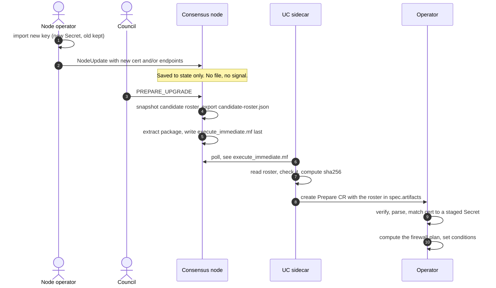
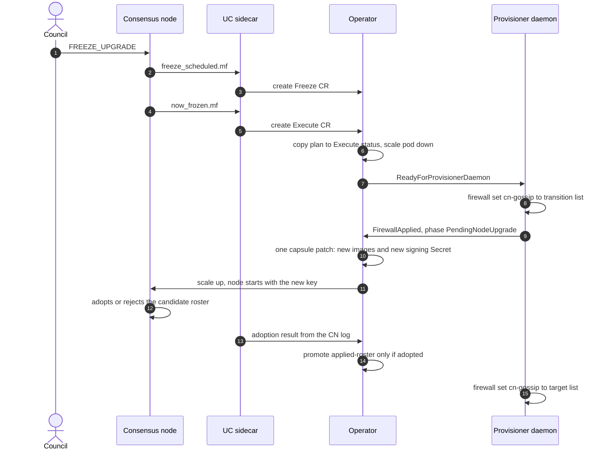
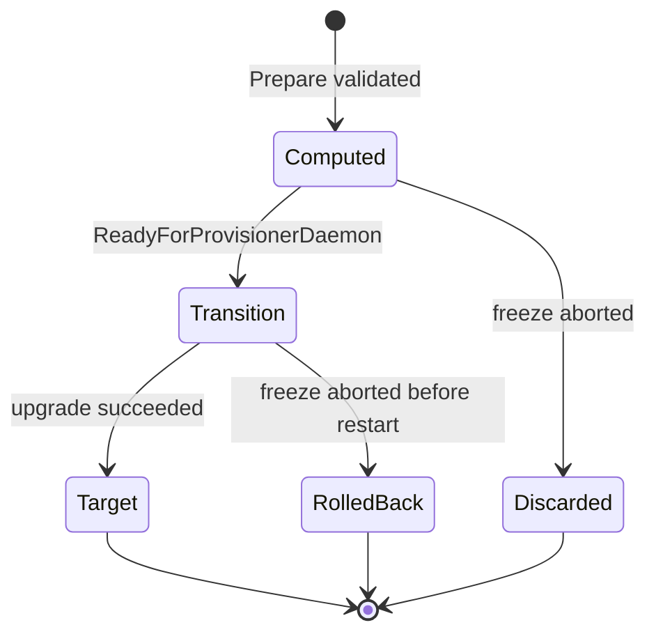

# Signing-key rotation and firewall changes from DAB transactions

How a node operator's `NodeUpdate` (or a council `NodeCreate` / `NodeDelete`) becomes an
automatic gossip signing-key swap and host-firewall update during a normal freeze upgrade.
The pieces involved are the consensus node (CN), the UC sidecar, the operator and the
`solo-provisioner-daemon`.

**This is the marker-file design.** It needs no CN code change: the CN already writes marker files and a
candidate roster, and everything else happens in the UC, operator and daemon. A possible evolution, where
the CN also notifies the UC through a signed local API, is described in
[dab-notification-sinks.md](dab-notification-sinks.md).

**Status:** design, partly implemented. See [Implementation status](#implementation-status).
Statements about the CN were read from `hiero-consensus-node` `main`; anything not verified is
listed under [Open questions](#open-questions).

## Summary

**The problem.** A DAB transaction changes the node's entry in consensus state and nothing
else: no file is written and no signal reaches the UC. The change only takes effect when the
network adopts a new roster, which today happens only at an upgrade restart. At that restart
three things must line up on different machines:

1. The rotating node starts with the **new private key** that matches its new certificate.
2. Every other node's host firewall **allows the new gossip address**.
3. A missing key or a closed port is found **days before** the freeze, not after it.

**The design in five points.**

1. The CN already exports a candidate roster at `PREPARE_UPGRADE`. The **UC forwards it
   unmodified** in the Prepare CR. The **operator decides** what to do with it.
2. The operator finds the staged key by matching the roster's certificate fingerprint to a Secret
   label, and checks this early, at prepare time.
3. The key swap rides the normal upgrade patch: one capsule patch changes the images and the
   signing Secret, so there is one restart.
4. The firewall is changed **make-before-break**: open the union of old and new addresses before
   the restart, close the old ones only after the upgrade has succeeded.
5. The operator acts on the roster only for upgrades at or above the package version set in
   `orbit.spec.consensus.canAdoptRosterFromVersion`, meaning the CN is expected to adopt the roster.
   The field is set once. For lower versions, or when it is empty (the default), the operator only
   warns, keeps the old key and changes no firewall rules.

## Terms

| Term | Meaning |
|---|---|
| Candidate roster | The roster the CN snapshots at `PREPARE_UPGRADE` and exports as `candidate-roster.json`. It becomes active at the next upgrade restart, if adopted. |
| Adoption | The CN replacing its active roster with the candidate at an upgrade restart. It can be refused (see [When the operator acts](#when-the-operator-acts)). |
| Applied roster | The roster the node is believed to be running. The baseline the next plan is diffed against. |
| Staged Secret | A key Secret imported before the upgrade, named `node<N>-gossip-keys-<date>-<fp8>`. |
| Firewall plan | The operator's computed firewall membership for one upgrade (`rollback`, `transition`, `target`). |

## Scope

In scope: gossip signing certificate and key rotation for the node whose entry changed, and gossip
endpoint changes with the resulting firewall change on **every** node. Freeze upgrades only.
Firewall steps apply to the **mainnet (bare-metal) profile only**; the cluster-only profile has no
daemon or host firewall, so there the operator only records the plan.

Out of scope: gRPC TLS and admin key rotation (same mechanism, other fields), service endpoints and
the off-host HAProxy machine (HIP-1495), block-node firewall and shaping, and the
[no-freeze model](#future-no-freeze-changes).

## Roles

| Component | Role |
|---|---|
| Node operator | Imports the new key, submits `NodeUpdate`. |
| Council | Sends `PREPARE_UPGRADE`, `FREEZE_UPGRADE`, and `FREEZE_ABORT` if needed. |
| CN | Exports the candidate roster and writes the marker files. |
| UC sidecar | Reads the roster and creates the upgrade CRs. **Never interprets the roster.** |
| Operator | Validates the roster, matches the key, computes the plan, patches the capsule. |
| `solo-provisioner-daemon` | Applies the firewall plan on the host. |
| `solo-provisioner` | Generates and imports keys. Owns the initial `cn-gossip` firewall rule. |

Rule of thumb: **the UC forwards, the operator decides.** Every configuration change is visible to
the operator as a CR field before anything acts on it.

## Implementation status

| Piece | Status |
|---|---|
| UC reads `candidate-roster.json` and forwards it | done |
| `spec.artifacts` on the Prepare CR | done |
| `FirewallPlan` type, status fields and condition names | done |
| `orbit.spec.consensus.canAdoptRosterFromVersion` | done |
| CN exports the roster to `data/upgrade/` (property shipped in a package) | todo |
| UC parses the CN's adoption log lines and sets the `roster-adoption` condition on its own pod (safety net) | done |
| Operator proxies that condition to `ConsensusCapsule.status.rosterAdoption` and reacts | todo |
| Operator Prepare reconciler (validate, key match, plan) | todo |
| Operator Execute changes (copy plan, repoint Secrets, gating, promote) | todo |
| `<capsule>-applied-roster` baseline ConfigMap | todo |
| Daemon applies the firewall plan | todo |
| `cn-gossip` rule created at provisioning (solo-weaver#1305) | todo |

## Before you start

1. **The CN exports the roster where the UC can read it.** Set
   `networkAdmin.candidateRosterExportFile` to
   `/opt/hgcapp/services-hedera/HapiApp2.0/data/upgrade/candidate-roster.json`.
   - Put it beside `current/`, not inside it. The CN wipes `current/` while extracting the package
     (`ReadableFreezeUpgradeActions` calls `cleanDirectory` on a separate thread), so a file
     written there can be lost.
   - It is a node property (`node.properties`). Ship it in a deployment package in one freeze
     window. It is active from the next, because the CN that handles that `PREPARE_UPGRADE` is still
     the old process.
   - A `node.properties` in the package becomes a whole-file ConfigMap, so it must include any
     overrides operators already set or it replaces them.
   - Leave `--candidate-roster-required` off until the property is active.
2. **The `cn-gossip` firewall rule exists** (mainnet), created by `solo-provisioner` at
   provisioning. The daemon only creates it as a fallback.
3. **Key Secrets follow the provisioner naming** (solo-weaver PR 1198). The fingerprint in the name
   is the SHA-384 of the certificate DER. A new key creates a new Secret beside the old one and
   never overwrites it.
4. **`orbit.spec.consensus.canAdoptRosterFromVersion` names the first package version to automate.**
   Empty by default, which means never act. Set it once, to a version where the CN is expected to
   adopt the candidate: the TSS gate is off, or TSS readiness is always complete before the freeze.
   Every upgrade at or above that version is then eligible, with no per-upgrade step. See
   [When the operator acts](#when-the-operator-acts) and [Updating the Orbit](#updating-the-orbit).

## The flow at a glance

| Phase | Trigger | What happens |
|---|---|---|
| A. Prepare the key | Node operator, days ahead | Import the new key as a new Secret. Submit `NodeUpdate`. |
| B. Prepare upgrade | `PREPARE_UPGRADE` | CN exports the roster. UC forwards it. Operator validates, matches the key, computes the plan. |
| C. Schedule | `FREEZE_UPGRADE` | UC creates the Freeze CR. |
| D. Execute | `now_frozen.mf` | If automation is enabled for this version: daemon opens the transition firewall, operator swaps images and key in one patch. If not: images only, with a warning. CN restarts. |
| E. Finish | After restart | If the operator acted: it promotes the baseline and the daemon closes the old addresses. |

### Before the freeze



### During and after the freeze



## Step by step

### A. Prepare the key (days ahead)

1. **Import the key.** The node operator runs `solo-provisioner consensus keys generate`, then
   `keys import --node-id N` off-cluster. This creates `node<N>-gossip-keys-<date>-<fp8>` beside the
   current Secret. The running node is unaffected.
2. **Submit `NodeUpdate`** with the new `gossip_ca_certificate` and any endpoint changes, signed by
   the node's admin key. `solo-provisioner` does not submit DAB transactions.
   **It must land before `PREPARE_UPGRADE`**, because the candidate roster is a snapshot taken then.

### B. Prepare upgrade

3. **`PREPARE_UPGRADE`.** Each CN snapshots the future roster with the latest weights and stores it
   as the candidate (`PlatformStateUpdates`), exports it to `candidate-roster.json` (best effort,
   never affects consensus), extracts the package asynchronously, and writes `execute_immediate.mf`
   last.
4. **The UC reads the roster** when it sees the marker (60s poll by default). It:
   - waits up to `--candidate-roster-wait` (15s), because the marker can precede the export;
   - rejects symlinks, files over 512 KiB, non-UTF-8 or non-JSON content, and files more than 30
     minutes older than the marker (a leftover);
   - computes the sha256 and creates the `NetworkUpgradePrepare` CR with the roster in
     `spec.artifacts`, unmodified.

   If the roster is missing or invalid, the CR is still created without it (with a warning), unless
   `--candidate-roster-required` holds the CR back.
5. **The operator validates:**
   1. Verify the sha256 and parse the roster. A missing `nodeId` means 0.
   2. Load `<capsule>-applied-roster`, or [seed it](#the-applied-roster-baseline).
   3. Find this capsule's entry by node ID.
   4. **Key check.** If the entry's cert differs from the mounted signing cert, compute the SHA-384
      of the entry's DER and look for a Secret labelled `solo.hiero.org/node=node<N>`,
      `solo.hiero.org/key-type=gossip` and `solo.hiero.org/cert-fingerprint=<first 32 hex>`. A hit
      means the staged key matches the roster by construction. No hit sets a failing condition now,
      days before the freeze.
   5. Compute the firewall plan and set `FirewallPlanComputed`. A roster with no change for this
      node and no address changes gives reason `NoChange`.
   6. If the roster changes this node's key or any gossip address but automation is not enabled for
      this version, log a specific warning and raise an event now: "the operator will not swap the
      key or change the firewall". This is the early prompt to set the Orbit field or handle it
      manually.

### C. Schedule

6. `FREEZE_UPGRADE` produces `freeze_scheduled.mf`, and the UC creates `NetworkUpgradeFreeze`.
   Re-checking that the staged Secret still exists here would be a cheap extra safeguard.

### D. Execute (inside the freeze window)

7. `now_frozen.mf` makes the UC create `NetworkUpgradeExecute`. The operator decides whether automation
   is enabled for this version, records the decision in the Execute status so it cannot change halfway
   through, copies the plan into its status when enabled, scales the pod down and sets
   `ReadyForProvisionerDaemon`.
8. **If automation is enabled, the daemon applies `transition`** with `solo-provisioner network firewall set --name cn-gossip
   --cidrs <transition>`, through its `privexec` delegation, and reports `FirewallApplied` with
   reason `Transition`. A digest it already applied is skipped. It then advances to
   `PendingNodeUpgrade`.
9. **The operator patches the capsule.** One patch applies the new images and, when automation is
   enabled, repoints
   `spec.secrets.secretResources.signingPrivateKey` and `signingPublicCertificate` to the matched
   Secret. This changes the source of an existing mount and adds no mount point. One pod restart
   covers both, so the swap adds no downtime. When automation is not enabled the patch carries the
   images only and the old key stays.
10. **The CN restarts** with the new key and adopts the candidate roster if TSS readiness allows,
    otherwise it logs a rejection and keeps the old one.

### E. Confirm

11. **Finish.** If the operator acted, it promotes the candidate to `<capsule>-applied-roster` and
    the daemon applies `target`, which removes addresses no longer in the roster. The UC's log
    result is a safety net (see [When the operator acts](#when-the-operator-acts)).
12. The Execute CR reaches `Succeeded` when the node is `ACTIVE`, as today.

### Abort



`FREEZE_ABORT` is only possible before the freeze round. On `freeze_aborted.mf` the UC creates
`NetworkUpgradeFreezeAbort`. If the daemon already applied `transition`, it restores `rollback`.
The staged Secret was never repointed and the baseline was never changed, so nothing else needs
undoing. Once the network is `FREEZING`, an abort is impossible.

## Key decisions

| Decision | Choice | Why |
|---|---|---|
| Who reads the roster | UC reads and forwards, operator decides | The operator must see every configuration change. The UC stays simple. |
| Where the roster travels | Inline in the Prepare CR (`spec.artifacts`) | One object, no new RBAC, no UC-created ConfigMap. |
| Where the CN writes it | `data/upgrade/candidate-roster.json`, beside `current/` | The CN wipes `current/` during extraction. |
| How the key is found | SHA-384 fingerprint label on the Secret | Provisioner names and labels Secrets this way. No extra convention. |
| When the key is swapped | In the same patch as the images, only when automation is enabled for the version | One restart. The decision is made before the restart. |
| Firewall order | Open the union first, close old addresses last | Peers can always reach the node. |
| Firewall plan form | Full membership lists, never diffs | Idempotent. A retry or restart converges. |
| Acting on a roster | `orbit.spec.consensus.canAdoptRosterFromVersion`, a version floor set once | Every upgrade at or above the version is eligible, with no per-upgrade job. Empty or lower means warn and change nothing. |
| Safety net | UC log result (`adopted` or `rejected`) | The floor cannot notice a single refused upgrade. A rejection holds `target` and the baseline and raises a warning. |
| Missing key at prepare | Best effort, upgrade proceeds with a loud warning | One node's key problem should not block the network's upgrade. |

## When the operator acts

**The problem.** At an upgrade restart the CN adopts the candidate roster only if its TSS readiness
check allows it. Otherwise it logs `Rejecting candidate roster in round N`, keeps the old roster, and
the node can still reach `ACTIVE` (`V0540RosterSchema.restart`). If the operator had swapped the key
or changed the firewall for a roster that was then refused, the node would run a new key against the
old roster and peers' addresses could be dropped wrongly. So the operator should act only where the CN
is expected to adopt the roster.

**The switch: `orbit.spec.consensus.canAdoptRosterFromVersion`** (empty by default). The first package
version whose candidate roster the CN is expected to adopt, as a semantic version. "Version" means
`images.consensusNode.version` in the package's `consensus-node-components.yaml`, which the Prepare CR
already carries. It is set **once**. Every upgrade to that version or a later one is eligible, so no job
or step runs per upgrade. It is configuration, not a feature gate, and is set by solo-provisioner or an
upgrade job (see [Updating the Orbit](#updating-the-orbit)). Do not derive it from
`genesis.addressBook.ledgerId`, which is the HAPI ledger id.

It mirrors the CN's own `canAdoptRoster` check, so choose a version where that check will pass: the TSS
gate is off (both `tss.hintsEnabled` and `tss.historyEnabled` are off, or there is no TSS ledger id yet),
or TSS readiness for a candidate is always complete before the council freezes the network.

| Upgrade version vs the floor | What the operator does |
|---|---|
| At or above | **Acts.** Swaps the signing key to the matching staged Secret, applies the firewall `transition`, then `target` after the upgrade succeeds, and updates the baseline. |
| Below, or the field is empty | **Warns only.** Keeps the old key, makes no firewall change, and logs a warning with an event. Prepare still validates the roster and computes the plan so the warning says exactly what would have changed. |

**The trade-off of a floor.** Because it holds for every later upgrade, it cannot notice one upgrade
whose candidate the CN refuses. The UC's log result below is the safety net, and recovery from a wrong
setting is manual at first. To switch automation off, clear the field or raise it above the next version.

**When it is read.** Prepare reads it to decide how specific a warning to raise. The Execute CR records the
decision when it is created, and every acting step in that upgrade uses the recorded value.

**The silent failure to watch for.** The default is empty, so on a network where the CN does adopt the
roster, forgetting to set the field leaves a node whose certificate changed in the adopted roster but
whose key was never swapped. That node cannot gossip. The Prepare warning exists to catch this days
ahead, and the roster-adoption result below catches it again after the restart.

**The UC's roster-adoption result (safety net).** The UC's log monitor already tails
`output/swirlds.log`. It now also matches the three lines the CN logs once per upgrade restart
(`Adopting candidate roster in round N`, `Rejecting candidate roster in round N`,
`No candidate roster to adopt in round N`). It logs a warning on a rejection and sets the
`operator.solo.hiero.org/roster-adoption` condition on **its own pod**, the same way it reports platform
status. The condition's reason is `Adopted`, `Rejected` or `NoCandidate`, and its message carries the
round and the log time. The operator, which is the only writer of the `ConsensusCapsule` status, proxies
it into `status.rosterAdoption` (not built yet). The operator uses the first result after the Execute CR's
`nodeUpgradeStartTime`. The UC makes no decision about it and does not know the Orbit setting. An absent
condition means "unknown".

| Automation enabled when Execute started | Log result | Operator reaction |
|---|---|---|
| yes | `rejected` | The setting was wrong for this upgrade. Do **not** apply `target` or update the baseline, keep the `transition` rules, and raise a loud `RosterRejected` warning. The node is on the new key against the old roster until the key is repointed by hand. |
| no | `adopted` | The setting was wrong the other way. Raise a loud warning: the node's key may no longer match the adopted roster. Update the baseline, since the roster really changed. |
| any other | `adopted`, `none`, or absent | No extra action. |

**The UC does not know the Orbit setting.** It reports the log result for every upgrade and the operator
makes every decision. Handing it to the UC would be worse: an argument or env var on the UC container
changes the pod template and rolls the consensus pod, reading the Orbit needs new UC RBAC, and the UC
has no `data/config` mount to read the CN's TSS settings.

**Caveats.** The log result depends on message text, so a missing line means "unknown", never
"adopted". A structured CN signal (a marker written when adoption is decided) would be sturdier and
needs a CN change. Recovery from a wrong `true` is manual at first: repoint the capsule's signing Secret
to the previous one (never overwritten) and restart. Automatic rollback can follow if it is needed.

## The applied-roster baseline

The firewall plan needs the roster the node ran before the upgrade.

| Aspect | Design |
|---|---|
| Storage | ConfigMap `<capsule>-applied-roster`. Annotations: `source` (`genesis` or `upgrade`), `operationId`, `sha256`, time applied. |
| Never touch | `genesis-config`. The CN init container copies it. |
| Seeding | Lazy, on the first Prepare for a capsule without a baseline. Copy `genesis-config` / `genesis-network.json` as-is with `source=genesis`. |
| Seed source | The package's pre-built genesis (from `consensus network genesis`), or in cluster-only mode a roster generated from the capsules (hostnames, not IPs). |
| No baseline at all | The plan is **add-only** (reason `BaselineUnknown`): nothing unknown is removed. |
| Update | After the Execute CR succeeds and the operator acted, or when the UC log reports `adopted`. Keyed by `operationId` so a repeat is a no-op. Never at prepare, freeze, abort or failure, and never when the log reports `rejected`. |
| Staleness | A genesis-seeded baseline predates any DAB change made since, so the first diff may show unexplained differences. Because `set` replaces whole membership, this costs a stale diff, not a broken rule. |
| Reset | Deleting the ConfigMap forces a reseed. |

## Updating the Orbit

The Orbit spec is set by **upgrade jobs**, the package's `jobs/` descriptors (HIP-1494). They are
idempotent per operation ID and run on both profiles: the UC triggers the `prepare` and `post-upgrade`
phases always, and the `frozen` phase is triggered by the daemon on mainnet and by the UC on
cluster-only. A job runs a migration-style step (check, apply, roll back) that patches the Orbit through a
ServiceAccount allowed to patch only that Orbit, which keeps the package's privilege narrow.

Which phase to use depends on the kind of update:

| Kind of Orbit update | Example | Phase | Why |
|---|---|---|---|
| Set once, read by later upgrades | `canAdoptRosterFromVersion` | `prepare` of the rollout upgrade | Set it before the first upgrade that should be eligible. Nothing after the upgrade needs it. |
| Component-coupled gate that must match the CN that restarts | `nodeNameZeroBased` | `frozen` | Set while the CN is stopped and before the capsule patch, so one restart covers both. |
| Cleanup | clearing a value | `post-upgrade` | Runs only after the Execute CR succeeds. It does not run when a freeze is aborted. |

Because `canAdoptRosterFromVersion` is a version floor, it needs none of the per-upgrade resets that a
boolean would, and an aborted freeze leaves nothing stale behind.

## Failure handling

| Situation | Behaviour |
|---|---|
| No roster file | Prepare CR created without it. No rotation or firewall change is planned. |
| Roster invalid or oversized | Skipped with a warning, or the CR held back if `--candidate-roster-required`. |
| This node's cert changed, no matching Secret | **Best effort:** the upgrade proceeds. The Execute CR carries `RosterKeyMismatch=True` and an event. The node comes up on the old key, which no longer matches its roster entry, so its events are rejected until the key is fixed. The firewall plan is still applied so peers can reach it. |
| Automation is not enabled for this version and the roster changes this node or the firewall | The operator warns at prepare, keeps the old key and changes no firewall. If the CN adopts the roster anyway, the node's key will not match it until someone swaps the key by hand. |
| Automation is enabled but the CN refuses the roster | `target` and the baseline update are not applied, `transition` rules stay, and `RosterRejected` is raised. The node is on the new key against the old roster until the key is repointed by hand. |
| Daemon cannot apply the rule | `FirewallApplied=False`, which fails the Execute CR, like `DaemonResult=False`. |
| Many nodes mismatch at once | Over 1/3 of the weight in this state halts the network. A per-node CR cannot see it. Fleet-level visibility is an open item (HIP-1496 HCS notifications). |

## Reference

### Data model

| Object | Field | Written by | Meaning |
|---|---|---|---|
| `NetworkUpgradePrepare` | `spec.artifacts[]` | UC | Opaque files read from the node. The roster entry is named `candidate-roster.json` with `name`, `sha256`, `content` (raw file, at most 512 KiB). |
| `NetworkUpgradePrepare` | `status.firewallPlan` | Operator | The plan. |
| `NetworkUpgradeExecute` | `status.firewallPlan` | Operator | Verbatim copy, so the daemon reads one CR. Present only when automation is enabled. |
| Both | conditions `FirewallPlanComputed`, `FirewallApplied` | Operator, daemon | Progress and outcome. |
| `Orbit` | `spec.consensus.canAdoptRosterFromVersion` | solo-provisioner or an upgrade job, once | First package version the CN is expected to adopt. At or above: the operator acts. Below or empty: warn only. |
| Pod (UC's own) | condition `operator.solo.hiero.org/roster-adoption` | UC | Reason `Adopted`, `Rejected` or `NoCandidate`, with the log round and time. A safety net. |
| `ConsensusCapsule` | `status.rosterAdoption` | Operator | Proxied from the pod condition. |
| ConfigMap `<capsule>-applied-roster` | roster and annotations | Operator | Baseline for the next diff. |

`FirewallPlan` holds one named allow rule (`cn-gossip`, tcp, the gossip port) and three **complete**
membership lists, so applying one is idempotent:

| List | Contents | Applied |
|---|---|---|
| `rollback` | Addresses of the roster in use before this upgrade | On abort |
| `transition` | Union of in-use and candidate addresses | Before the restart |
| `target` | Candidate addresses only | After the Execute CR succeeds |

`digest` lets the daemon skip a plan it already applied. `rosterDigest` ties the plan to one roster.

### Candidate roster format

`candidate-roster.json` is PBJ JSON of the `Network` message with one `rosterEntry` per node
(`DiskStartupNetworks.tryToExport`):

```json
{
  "nodeMetadata": [
    {
      "rosterEntry": {
        "nodeId": "1",
        "weight": "1",
        "gossipCaCertificate": "MIIDpjCCAg6gAwIBAgIIdUmp...",
        "gossipEndpoint": [ { "ipAddressV4": "fwAAAQ==", "port": 31013 } ]
      }
    }
  ]
}
```

- 64-bit integers are strings, bytes are base64, and zero values are omitted, so node 0 has **no
  `nodeId`**.
- `gossipCaCertificate` is the base64 of the certificate DER.
- An endpoint has `ipAddressV4` (4 base64 bytes) or `domainName`, plus `port`.
- Samples: `hedera-node/configuration/dev/genesis-network.json` in `hiero-consensus-node`.

### Configuration summary

| Where | Setting | Value |
|---|---|---|
| CN `node.properties` | `networkAdmin.candidateRosterExportFile` | `/opt/hgcapp/services-hedera/HapiApp2.0/data/upgrade/candidate-roster.json` |
| CN | `networkAdmin.exportCandidateRoster`, `createCandidateRosterOnPrepareUpgrade` | `true` (defaults) |
| UC | `--candidate-roster-path` / `UC_CANDIDATE_ROSTER_PATH` | same path |
| UC | `--candidate-roster-wait` / `UC_CANDIDATE_ROSTER_WAIT` | `15s` |
| UC | `--candidate-roster-required` / `UC_CANDIDATE_ROSTER_REQUIRED` | `false` until the CN property has shipped |
| Orbit | `spec.consensus.canAdoptRosterFromVersion` | The first package version to automate, for example `0.76.0`. Empty by default (never act). |

### Security considerations

- A node's gossip endpoint is set by its own admin key, so one operator's transaction decides what
  every peer's firewall opens. The operator must reject unspecified, loopback and multicast
  addresses and limit the rule to the gossip port(s) before writing a plan.
- The UC treats the upgrade directory as untrusted: no symlinks, a size cap, `O_NOFOLLOW` reads. The
  operator re-verifies the sha256 and never trusts `content` blindly.
- Roster and plan are public. Private keys never appear in a CR; only Secret names change.
- The daemon runs unprivileged and changes the firewall only by running the `solo-provisioner` CLI
  under sudo.
- The operator needs `list` on Secrets with a label selector for the fingerprint lookup.

## Open questions

1. **Who sets the floor, and which version.** The field is set once, by solo-provisioner or an upgrade job.
   Open: the owner, and the right version. It should be the first version where the CN is expected to
   adopt candidates, which depends on the TSS gate state of each network.
2. **Operator side of the adoption signal.** The UC part is built. Still to do: proxy the pod condition
   to the capsule status and implement the reactions in the table above. The CN log text can change, so
   a missing result is always "unknown".
3. **TSS interplay.** `PlatformStateUpdates` notes the candidate may instead be set at stake-period
   boundaries when TSS machinery keys it. Whether such a candidate can differ from the one exported
   at `PREPARE_UPGRADE` was not traced.
4. **Prepare spec immutability.** The Execute spec is immutable by CEL rule. Confirm that adding
   `spec.artifacts` to Prepare interacts correctly with any rule on its spec.
5. **Firewall timing.** `transition` is applied at `ReadyForProvisionerDaemon`, inside the freeze
   window. Applying it at prepare time needs a daemon watch on Prepare CRs and avoids a slow node
   briefly being unreachable after restart.
6. **Endpoint form.** Real rosters use `ipAddressV4`, operator-generated genesis uses hostnames.
   Diffs should compare resolved values.
7. **A real exported file.** Only dev and test samples of the format were inspected.

## Future: no-freeze changes

Not designed. Two CN facts constrain it. Roster adoption is only implemented at an upgrade restart.
And a node's cert in the roster and the key it signs with must change at the same consensus instant,
which a restart cannot do without an outage unless the platform accepts both certs for a window.
A workable shape would add a candidate-roster export at DAB transaction time, a CN "pending" marker
carrying the effective time ahead of adoption, and a new `NetworkRosterChange` CR reusing
`spec.artifacts` and `FirewallPlan`.

## References

- HIP-1495 (Kubernetes-native deployment), HIP-1496 (network upgrade process).
- `hashgraph/solo-weaver` PR 1198 (key import/export and Secret naming) and issue 1305 (`cn-gossip`
  rule).
- `hiero-consensus-node`: `NodeUpdateHandler`, `PlatformStateUpdates`, `ReadableFreezeUpgradeActions`,
  `FreezeHandler`, `V0540RosterSchema`, `DiskStartupNetworks`.
