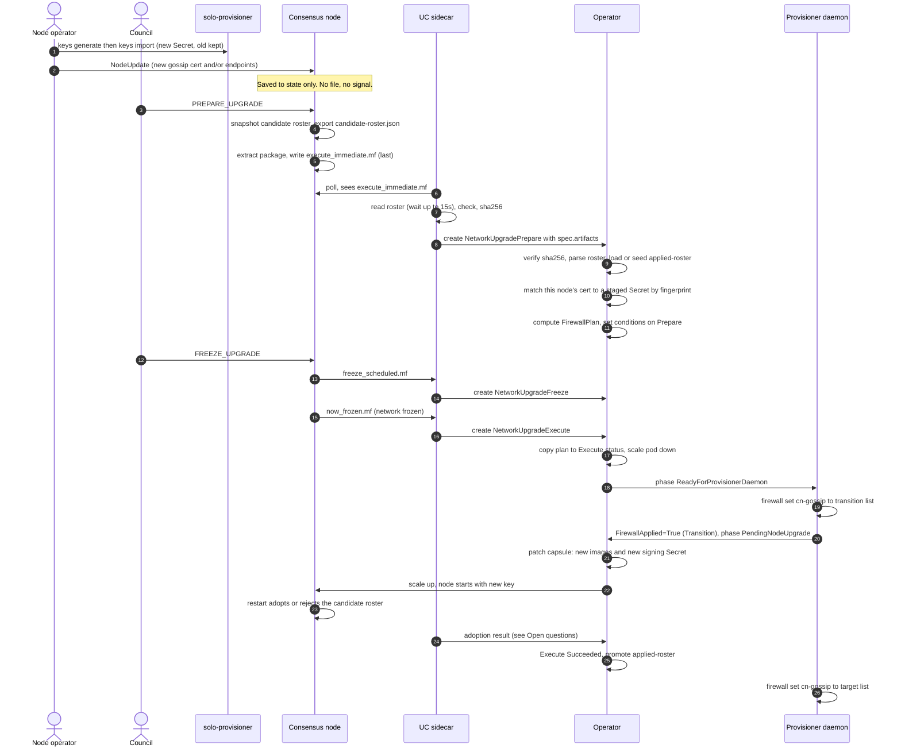
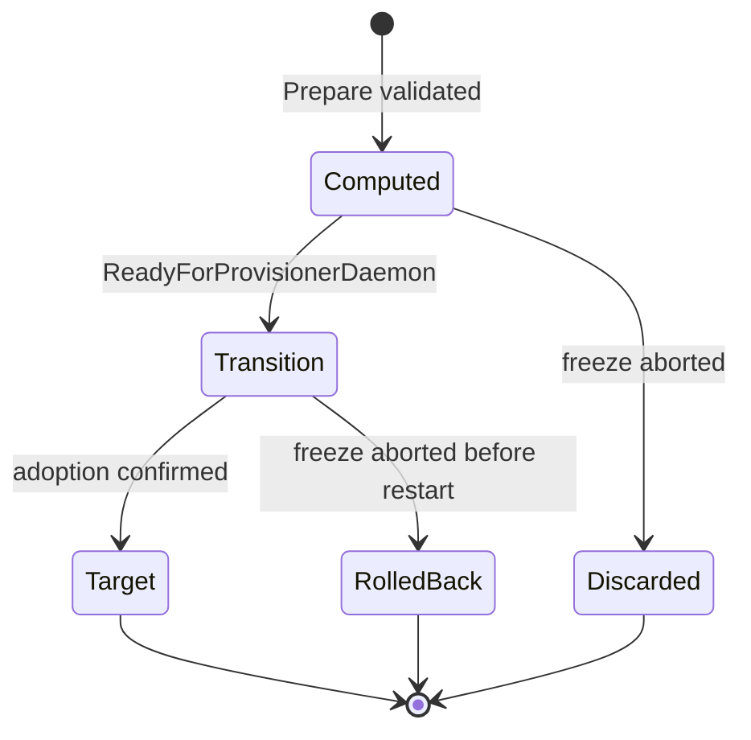

# Signing-key rotation and firewall changes from DAB transactions

How a node operator's `NodeUpdate` (or a council `NodeCreate` / `NodeDelete`) turns into
an automated gossip signing-key swap and a host-firewall update during a normal
freeze upgrade, using the consensus node (CN), the UC sidecar, the operator, and the
`solo-provisioner-daemon`.

**Status:** design. Parts marked **[done]** are implemented on this branch; parts marked
**[todo]** are not. Statements about the consensus node were read from
`hiero-consensus-node` `main` and are cited by path; anything not verified is listed under
[Open questions](#open-questions).

## Scope

In scope:

- Gossip **signing certificate / private key** rotation for the node whose entry changed.
- **Gossip endpoint** changes (new, changed or removed node addresses) and the resulting
  host-firewall change on **every** node, not just the one that changed.
- The freeze-based upgrade path (`PREPARE_UPGRADE` → `FREEZE_UPGRADE` → restart).

Out of scope here:

- gRPC TLS certificate and admin key rotation (same mechanism, different fields).
- Service-endpoint changes and the HAProxy machine, which sit off-host on mainnet
  (HIP-1495).
- Block-node firewall and traffic shaping.
- The no-freeze model, sketched under [Future: no-freeze changes](#future-no-freeze-changes).

## Why this is needed

A DAB transaction changes the node's entry in consensus state only. Nothing is written to
disk and nothing is sent to the UC when it is handled
(`NodeUpdateHandler.handle` only calls `nodeStore.put`). The change takes effect when the
network adopts a new roster, which today happens only at an upgrade restart
(`V0540RosterSchema.restart`, and only when `ctx.isUpgrade(...)`).

So three things must line up at the upgrade restart, on different machines:

1. The rotating node must start with the **new private key** that matches the new cert in
   the adopted roster.
2. Every other node's host firewall must **allow the new gossip address** (and may drop
   the old one afterwards).
3. Nobody should discover a missing key or a closed port after the network is frozen.

## Roles

| Component | Role |
|---|---|
| Node operator | Generates and imports the new key, submits `NodeUpdate`. |
| Council | Sends `PREPARE_UPGRADE`, `FREEZE_UPGRADE` (and `FREEZE_ABORT` if needed). |
| CN | Exports the candidate roster, writes the marker files. |
| UC sidecar | Reads the roster and creates the upgrade CRs. **Does not interpret the roster.** |
| Operator | Validates the roster, matches the key, computes the firewall plan, patches the capsule. |
| `solo-provisioner-daemon` | Applies the firewall plan on the host. |
| `solo-provisioner` | Generates and imports keys; owns the initial `cn-gossip` firewall rule. |

Design rule: the UC forwards, the operator decides. Every configuration change is visible
to the operator as a CR field before anything acts on it.

## Prerequisites

1. **CN exports the candidate roster where the UC can read it.** Set
   `networkAdmin.candidateRosterExportFile` to
   `/opt/hgcapp/services-hedera/HapiApp2.0/data/upgrade/candidate-roster.json`. The path is
   deliberately *beside* `current/`: the CN wipes `current/` when it extracts the package
   (`ReadableFreezeUpgradeActions.extractAndReplaceArtifacts` calls `cleanDirectory`) on a
   separate thread, so a file written into `current/` can be lost. The property is a node
   property (`node.properties`). It ships in the deployment package in one freeze window and
   is active from the next: the first window cannot export a roster, because the CN
   handling that `PREPARE_UPGRADE` is still the old process.
2. **`cn-gossip` host-firewall rule exists** (mainnet), created by `solo-provisioner` at
   provisioning (hashgraph/solo-weaver#1305). The daemon only creates it as a fallback.
3. **Key Secrets follow the provisioner naming** (hashgraph/solo-weaver PR 1198):
   `node<N>-gossip-keys-<date>-<fp8>`, where the fingerprint is the SHA-384 of the
   certificate DER. A new key creates a new Secret next to the old one and never
   overwrites it.

## Data model

| Object | Field | Written by | Meaning |
|---|---|---|---|
| `NetworkUpgradePrepare` | `spec.artifacts[]` **[done]** | UC | Opaque files read from the node. Entry `candidate-roster.json` carries `name`, `sha256`, `content`. Content is the raw file, at most 512 KiB. |
| `NetworkUpgradePrepare` | `status.firewallPlan` **[done: type]** | Operator | The plan below. |
| `NetworkUpgradeExecute` | `status.firewallPlan` **[done: type]** | Operator | Verbatim copy, so the daemon reads one CR. |
| Both | conditions `FirewallPlanComputed`, `FirewallApplied` **[done: constants]** | Operator / daemon | Progress and outcome. |
| ConfigMap `<capsule>-applied-roster` **[todo]** | roster + annotations | Operator | The roster the node is believed to run. Baseline for the next diff. |

`FirewallPlan` holds one named allow rule (`cn-gossip`, tcp, the gossip port) and three
**complete** membership lists, never diffs, so applying one is idempotent:

| List | Contents | Applied |
|---|---|---|
| `rollback` | Addresses of the roster in use before this upgrade | On abort |
| `transition` | Union of the in-use and candidate addresses | Before the restart |
| `target` | Candidate addresses only | After the upgrade is confirmed |

`digest` lets the daemon skip a plan it already applied. `rosterDigest` ties the plan to one
candidate roster.

### Candidate roster format

`candidate-roster.json` is PBJ JSON of the `Network` message with one `rosterEntry` per
node (`DiskStartupNetworks.tryToExport`). 64-bit integers are strings, bytes are base64,
and zero values are omitted, so node 0 has **no `nodeId`**. `gossipCaCertificate` is the
base64 of the certificate DER; `gossipEndpoint[]` has `ipAddressV4` (4 base64 bytes) or
`domainName`, plus `port`. Samples:
`hedera-node/configuration/dev/genesis-network.json` in `hiero-consensus-node`.

## End-to-end flow

### Step by step

**A. Before the upgrade (days ahead)**

1. **Generate and import the key.** The node operator runs `solo-provisioner consensus
   keys generate` off-cluster, then `keys import --node-id N`. This creates
   `node<N>-gossip-keys-<date>-<fp8>` beside the current Secret. The running node is
   unaffected.
2. **Submit `NodeUpdate`.** The node operator submits it with the new
   `gossip_ca_certificate` (and any endpoint changes), signed by the node's admin key.
   `solo-provisioner` does not submit DAB transactions. **It must land before
   `PREPARE_UPGRADE`**, because the candidate roster is a snapshot taken at that moment.
3. **`PREPARE_UPGRADE`.** The council sends it. Each CN:
   1. snapshots the future roster from the node store with the latest weights
      (`PlatformStateUpdates`, `snapshotOfFutureRoster`) and stores it as the candidate;
   2. exports it to `candidate-roster.json` (best effort, never affects consensus);
   3. extracts the package asynchronously and writes `execute_immediate.mf` last.

**B. Prepare phase (UC and operator)** **[UC done, operator todo]**

4. **UC reads the roster.** On `execute_immediate.mf` the UC reads
   `data/upgrade/candidate-roster.json` (flag `--candidate-roster-path`). It waits up to
   `--candidate-roster-wait` (15s), because the marker can be written before the export. It
   rejects symlinks, files over 512 KiB, non-UTF-8 or non-JSON content, and files older than
   30 minutes before the marker (a leftover). It computes the sha256 and creates the
   `NetworkUpgradePrepare` CR with the roster in `spec.artifacts`, unmodified.
   Missing or invalid roster: the CR is still created without it (warning), unless
   `--candidate-roster-required` holds the CR back.
5. **Operator validates.** The Prepare reconciler:
   1. verifies the sha256 and parses the roster (missing `nodeId` means 0);
   2. loads `<capsule>-applied-roster`, or [seeds it](#the-applied-roster-baseline);
   3. finds this capsule's entry by node ID;
   4. **key check:** if the entry's cert differs from the mounted signing cert, compute
      SHA-384 of the entry's DER and look for a Secret labelled
      `solo.hiero.org/node=node<N>`, `solo.hiero.org/key-type=gossip`,
      `solo.hiero.org/cert-fingerprint=<first 32 hex>`. A hit means the staged key matches
      the roster by construction. No hit sets a failing condition now, days before the freeze;
   5. computes the `FirewallPlan` and sets `FirewallPlanComputed`.
   A roster with no change for this node and no address changes yields reason `NoChange`.

**C. Freeze phase**

6. `FREEZE_UPGRADE` → `freeze_scheduled.mf` → UC creates `NetworkUpgradeFreeze`.
   Re-verifying that the staged Secret still exists here is a cheap extra check **[todo]**.

**D. Execute phase (inside the freeze window)**

7. `now_frozen.mf` → UC creates `NetworkUpgradeExecute`. The operator copies the plan into
   its status, scales the pod down and sets `ReadyForProvisionerDaemon`.
8. **Daemon applies `transition`** (`solo-provisioner network firewall set --name cn-gossip
   --cidrs <transition>`, run through the daemon's `privexec` delegation) and reports
   `FirewallApplied` with reason `Transition`. It then advances to `PendingNodeUpgrade`. A
   digest it already applied is skipped.
9. **Operator patches the capsule.** In the same patch that applies the new images it
   repoints `spec.secrets.secretResources.signingPrivateKey` and
   `signingPublicCertificate` to the matched Secret. This repoints an existing mount source;
   it adds no mount point. One pod restart covers images and key, so the swap adds no extra
   downtime.
10. **CN restarts** with the new key. During restart the CN adopts the candidate roster if
    TSS readiness allows (`canAdoptRoster`), otherwise it logs a rejection and keeps the old
    one.

**E. After the restart**

11. **Confirm adoption** (see [Open questions](#open-questions)). Only then:
    1. the operator promotes the candidate to `<capsule>-applied-roster`;
    2. the daemon applies `target`, which removes addresses no longer in the roster.
12. The Execute CR reaches `Succeeded` when the node is `ACTIVE`, as today.

### Abort

`FREEZE_ABORT` is only possible before the freeze round. On `freeze_aborted.mf` the UC
creates `NetworkUpgradeFreezeAbort`. If the daemon had already applied `transition`, it
restores `rollback`. The staged Secret is simply never repointed and the baseline is never
changed. Once the network is `FREEZING` an abort is impossible.

## The applied-roster baseline

The firewall plan needs the roster the node was running before the upgrade.

- **Storage.** A ConfigMap per capsule, `<capsule>-applied-roster`. Annotations:
  `source` (`genesis` or `upgrade`), `operationId`, `sha256`, applied time. The
  `genesis-config` ConfigMap is **never** written to; the CN init container copies it.
- **Seeding (lazy).** On the first Prepare for a capsule with no baseline, copy
  `genesis-config` / `genesis-network.json` as-is, `source=genesis`. That file is the
  package's pre-built genesis (from `consensus network genesis`) or, in cluster-only mode,
  generated from the capsules, where gossip endpoints are hostnames. If neither exists the
  baseline is unknown and the plan is **add-only** (reason `BaselineUnknown`): nothing
  is removed that is not known.
- **Update.** Only after the Execute CR succeeds **and** adoption is confirmed, keyed by
  `operationId` so a repeat is a no-op. Never at prepare, freeze, abort or failure.
- **Staleness.** A genesis-seeded baseline predates any DAB change made since. The first
  plan may therefore show unexplained differences. `set` replaces whole membership, so this
  costs a stale diff, not a broken rule. Deleting the ConfigMap forces a reseed.

## Failure handling

| Situation | Behaviour |
|---|---|
| No roster file | Prepare CR created without it. No rotation or firewall change is planned. |
| Roster invalid or oversized | Skipped with a warning, or the CR held back if `--candidate-roster-required`. |
| This node's cert changed, no matching Secret | **Best effort:** the upgrade still proceeds. The Execute CR carries `RosterKeyMismatch=True` and an event. The node comes up on the old key, which no longer matches its roster entry, so its events are rejected until the key is fixed. The firewall plan is still applied so peers can reach it. |
| Candidate roster rejected at restart | Baseline and `target` are not applied. |
| Daemon cannot apply the rule | `FirewallApplied=False`, which fails the Execute CR, like `DaemonResult=False`. |
| Many nodes mismatch at once | More than 1/3 of the weight in this state halts the network. A per-node CR cannot see this; fleet-level visibility is an open item (HIP-1496 HCS notifications). |

## Security considerations

- A node's gossip endpoint is set by its own admin key, so one operator's transaction
  decides what every peer's firewall opens. The operator must reject unspecified, loopback
  and multicast addresses and limit the rule to the gossip port(s) before writing a plan.
- The UC treats the upgrade directory as untrusted: no symlinks, a size cap, `O_NOFOLLOW`
  reads. The operator re-verifies the sha256 and never trusts `content` blindly.
- Roster and plan are public information. Private keys never appear in a CR; only Secret
  names change.
- The daemon runs unprivileged and changes the firewall only by running the
  `solo-provisioner` CLI under sudo, as for other privileged work.
- The operator needs `list` on Secrets with a label selector for the fingerprint lookup.

## Configuration summary

| Where | Setting | Value |
|---|---|---|
| CN `node.properties` | `networkAdmin.candidateRosterExportFile` | `/opt/hgcapp/services-hedera/HapiApp2.0/data/upgrade/candidate-roster.json` |
| CN | `networkAdmin.exportCandidateRoster`, `createCandidateRosterOnPrepareUpgrade` | `true` (defaults) |
| UC | `--candidate-roster-path` / `UC_CANDIDATE_ROSTER_PATH` | same path |
| UC | `--candidate-roster-wait` / `UC_CANDIDATE_ROSTER_WAIT` | `15s` |
| UC | `--candidate-roster-required` / `UC_CANDIDATE_ROSTER_REQUIRED` | `false` until the CN property has shipped |

## Open questions

1. **Adoption signal.** `Succeeded` does not prove the candidate was adopted (the CN may
   log a rejection and keep the old roster). Promoting the baseline or applying `target`
   without confirmation could cut off peers still in the active roster. Preferred: the UC
   log monitor matches "Adopting candidate roster in round" / "Rejecting candidate roster in
   round" (`V0540RosterSchema`) and records it on the Execute status. A CN-side signal would
   be cleaner and needs a CN change.
2. **TSS interplay.** `PlatformStateUpdates` comments that the candidate may instead be set
   at stake-period boundaries when TSS machinery keys it. Whether a candidate set that way
   can differ from the one exported at `PREPARE_UPGRADE` was not traced.
3. **Prepare spec immutability.** The Execute spec is immutable by CEL rule; confirm adding
   `spec.artifacts` to Prepare interacts correctly with any rule on that spec.
4. **Timing of the firewall `transition`.** Applied at `ReadyForProvisionerDaemon`, inside the
   freeze window. Applying it at prepare time would need a daemon watch on Prepare CRs and
   avoids a slow node briefly being unreachable after restart.
5. **Endpoint form.** Real rosters use `ipAddressV4`; operator-generated genesis uses
   hostnames. Diffs should compare resolved values.
6. **A real exported file.** Only dev and test samples of the format were inspected.

## Future: no-freeze changes

Not designed. Two CN facts constrain it: roster adoption is only implemented at an
upgrade restart, and a node's cert in the roster and the key it signs with must change at
the same consensus instant, which a restart cannot do without an outage unless the platform
accepts both certs for a window. A workable shape would add a candidate-roster export at DAB
transaction time, a CN "pending" marker carrying the effective time ahead of adoption, and a
new `NetworkRosterChange` CR reusing `spec.artifacts` and `FirewallPlan`.

## References

- HIP-1495 (Kubernetes-native deployment), HIP-1496 (network upgrade process).
- `hashgraph/solo-weaver` PR 1198 (key import/export and Secret naming), issue 1305
  (`cn-gossip` rule).
- `hiero-consensus-node`: `NodeUpdateHandler`, `PlatformStateUpdates`,
  `ReadableFreezeUpgradeActions`, `FreezeHandler`, `V0540RosterSchema`,
  `DiskStartupNetworks`.
