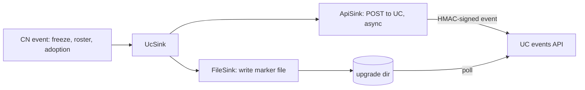
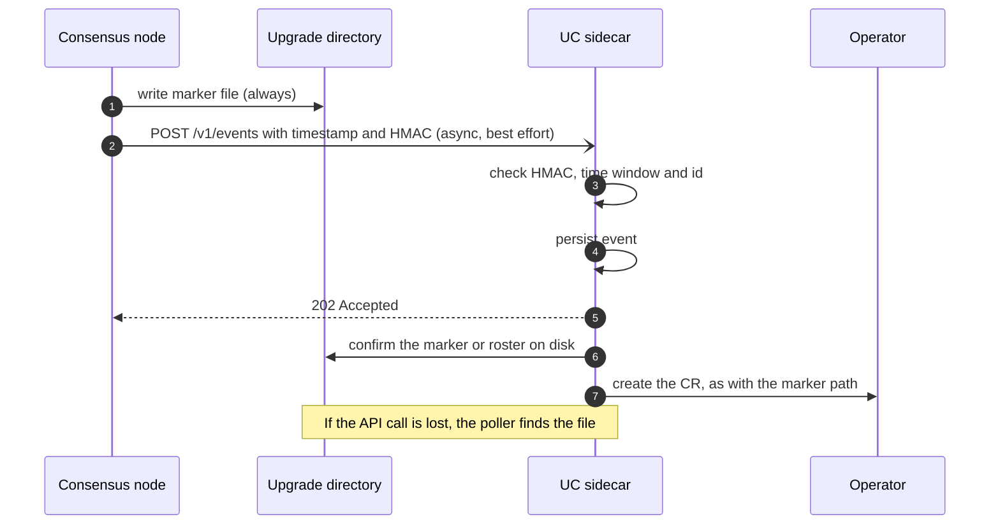

# CN notification sinks: an authenticated UC events API alongside marker files

How the consensus node (CN) could notify the UC sidecar through an authenticated local API in
addition to the marker files it writes today.

**Status:** proposal. Unlike the [marker-file design](dab-key-rotation-and-firewall-marker-file.md),
which needs no CN code change, this one does. The marker-file design stays the baseline and keeps
working on its own. This document says what the API would add and how to build it safely.

## Summary

1. The CN gets a small `NotificationSink` abstraction. `FileSink` is today's behaviour (marker files).
   `ApiSink` posts the same event to the UC. `UcSink` is `FileSink` and `ApiSink` composed.
2. **The marker file is always written; the API is additional.** If the UC is down, slow or not yet
   started, nothing is lost, because the file is still there.
3. The UC exposes `POST /v1/events` on `127.0.0.1`. The CN and UC share the pod's network namespace.
4. **Requests carry an HMAC-SHA256 made with a per-capsule shared secret.** The operator creates the
   secret and injects it as an environment variable into the CN and UC containers only. The secret is
   never sent, so a sniffed request cannot be turned into a different one. It works at any point of CN
   start-up, because it needs no platform object or key store.
5. The API can carry what files cannot: the roster itself, the adoption decision, and TSS readiness.
   These replace log scraping and the version-floor assumption in the marker-file design.

## Why add an API

| | Marker files (today) | With the API as well |
|---|---|---|
| Latency | UC polls every 60s (1s after `freeze_scheduled.mf`) | Immediate |
| Payload | None (a check mark or a timestamp) | Roster, decision, reason, round |
| Adoption result | Parsed from CN log text, which can change | An explicit event from the CN |
| TSS readiness for the candidate | Not visible outside state | An explicit event |
| Delivery proof | None | The UC acknowledges after persisting |
| Works when the UC is down | Yes (the file persists) | Yes, because the file is still written |

## What was verified

- Marker files are written in one place, `ReadableFreezeUpgradeActions.writeMarker` (and re-written by
  `catchUpOnMissedSideEffects` at restart).
- The UC already serves HTTP: the control plane is `daemonkit.NewServer(SocketPath, ...)` with routes on an
  `http.ServeMux` (`internal/uc/uc.go`, `consensus_status_handler.go:47`), and a separate TCP listener
  serves metrics (`metrics_server.go`). A third listener for events fits the same structure.
- The capsule deployment code sets no `hostNetwork`, so `localhost` is private to the pod.
- **Start-up order in the CN** (`ServicesMain.java`): `hedera.initializeStatesApi(...)` runs first (lines ~202
  and 205), and it runs the service migrations, including the roster schema's `restart` and therefore the
  adoption hook (`Hedera.java` ~1024, `serviceMigrator.doMigrations`). Only afterwards does
  `new PlatformBuilder(...).build()` create the platform (lines ~252 to 270), and `platform.start()` follows
  (line 272). `Hedera.platform` is assigned only in `onStateInitialized` (`Hedera.java:921`). So at adoption
  time there is **no `Platform` object**, and `Platform.sign` (public, `Platform.java:57`) cannot be used. This
  is why the authentication does not depend on the node key.
- The UC container is built in `buildUcContainer` (`internal/resources/consensus/deployment.go`) and runs as
  uid and gid 2000. Each container lists its own environment, so a variable can be given to the CN and UC
  and not to the sidecars.

## Design

### The sinks (CN side)

- `NotificationSink` has one method that takes an event. Call sites stay where markers are written today
  (`writeMarker`, the roster export, the roster schema's adoption hook), so the file behaviour is
  unchanged.
- **`UcSink` calls `FileSink` first and `ApiSink` second.** A failure in `ApiSink` is logged and
  ignored. A fallback-only policy (API first, file only if it fails) was considered and rejected: the NMT
  and the legacy UC read the files, the CN's restart catch-up rewrites them, and a fallback would save no
  writes while adding a case where an accepted-then-lost event leaves no file.
- **Never block consensus handling or start-up.** The API call is asynchronous with a short timeout and a
  bounded queue, off the handle thread. Exceptions never propagate (the same rule as the roster export in
  `PlatformStateUpdates.doExport`). Events are node-local and non-consensus.
- The sink object must be built before `initializeStatesApi`, so the adoption hook can use it.
- Configured in `node.properties`, for example `notification.sinks=file,uc` (default `file`).

### Events

| Event | Replaces or adds | Payload |
|---|---|---|
| `PrepareUpgradeReady` | `execute_immediate.mf` | Upgrade file hash |
| `FreezeScheduled` | `freeze_scheduled.mf` | Freeze time |
| `FreezeAborted` | `freeze_aborted.mf` | none |
| `NowFrozen` | `now_frozen.mf` | none |
| `CandidateRosterReady` | adds | The candidate roster, so no export file or `cleanDirectory` race |
| `RosterAdoptionDecided` | replaces log parsing | `adopted`, `rejected` or `none`, and the round |
| `CandidateReadyToAdopt` | adds | The candidate's roster hash once TSS readiness for it holds |

Every event has `schemaVersion`, an `id`, `type`, `time`, `nodeId` and `payload`. The `id` must be
deterministic for the same underlying occurrence (for example type plus the round or file hash), so that
the file path and the API path, and any retry, map to one event.

### Transport

`POST /v1/events` on `127.0.0.1:<port>`, a new UC listener beside the metrics one.

- The UC persists the event to its inbox directory **before** replying `202`. A repeated `id` is accepted
  again and ignored.
- Request size is capped, unknown fields are ignored (forward compatibility), and `GET /v1/health` lets
  the sink check availability.
- Both sides use their standard HTTP clients (`java.net.http.HttpClient` in the CN, `net/http` in the UC).

### Authentication: a shared secret and an HMAC per request

**The secret.** A random 32-byte value per capsule, in a Secret such as `<capsule>-uc-events-secret`, created
by the operator before the StatefulSet exists (it already reads and writes Secrets). The CN and UC
containers get it as an environment variable (for example `UC_EVENTS_SECRET`) through `secretKeyRef`. No
other container does. Mark the reference `optional`, so a missing Secret never stops the pod: without it the
CN disables the API sink, the UC rejects API events, and the marker files carry on as before.

**The signature.** The CN sends two headers: a timestamp, and `HMAC-SHA256(secret, canonical)` in hex, where
`canonical` is `"solo-uc-events-v1\n" + method + "\n" + path + "\n" + timestamp + "\n" + hex(sha256(body))`. The
event `id` and `nodeId` are inside the body, so they are covered. The fixed prefix is domain separation. In
Java this is `javax.crypto.Mac` (`HmacSHA256`), which is in the JDK and needs nothing started.

**What the UC checks:**
- recompute the HMAC and compare in constant time;
- reject a timestamp outside a short window (a couple of minutes: the containers share a host clock);
- dedupe by event `id`, so a replay within the window changes nothing;
- cap the body size before reading it.

**Why this resists sniffing.** The secret never travels. Someone who can read loopback traffic (needs
`NET_RAW`, and the HIP uses CRI-O, whose defaults may already exclude it) sees events, which are public data,
but cannot produce a different valid request.

**Rotation.** Environment variables are fixed when a container starts. The CN and UC restart together with
the pod, so they agree. Change the Secret only as part of a pod restart (for example together with the
capsule patch at `PendingNodeUpgrade`). The edge case is a single container restarting inside a live pod, such
as a CN crash restart: it re-reads the Secret and could differ from the UC that kept the old value, so events
would be rejected until the UC restarts. The UC logs a clear "signature mismatch" warning, and the marker
files keep working in the meantime. If this proves a problem, the UC can accept a current and a previous
secret during an overlap.

**What it does not give you:** no automatic tie to key rotation, a new secret to manage, and the UC holds
the same secret, so it could also produce valid events (it is the receiver, so that does not matter).

Options considered:

| Option | Why not |
|---|---|
| The CN signs with its node key (`Platform.sign`) | Not available during start-up, when the adoption hook runs, because the platform does not exist yet. It also needs the signing certificate mounted into the UC, which does not work in `hostPath` key mode without mounting a single file. |
| Operator-issued JWT | A bearer credential (reusable if copied), plus an operator signing key and re-minting. |
| Plain bearer token from env | Simplest, but reusable if copied from traffic. The HMAC variant uses the same secret with no extra deployment cost. |
| Unix socket in a shared directory | Pod-spec volume and a custom Java client, for isolation the secret already gives. |

### Behaviour in `hostPath` key mode

The shared secret does not depend on how keys are stored, so the events API works in `hostPath` mode as in
Secret mode. `hostPath` mode (`ConsensusSecrets.hostPath`, `deployment.go:478` onwards) mounts a host directory
as the `keys` volume with no per-key Secrets. In that mode the operator-driven **key swap** still does not
apply, because it works by repointing Secret references. See the marker-file design.

### The UC side

- An `EventSource` abstraction next to today's `MarkerMonitor`. The marker poller and the API listener
  both feed the same handlers (`HandleExecuteImmediate` and the others), which already dedupe by
  operation ID and persist before sending.
- **Events are advisory.** The UC treats an event as a claim and checks it against what is on disk (the
  marker file, the roster file) before acting, so a valid HMAC proves the sender holds the secret but never
  replaces the state the UC already trusts.

## Failure and ordering

- **UC down or not started yet:** the file is written, the API call fails quietly, and the poller picks up
  the marker later. For events raised during CN start-up the sink retries for a short bounded time, since
  the UC usually comes up moments later.
- **Adoption at startup.** The adoption hook runs during `initializeStatesApi`, before the platform is
  built. The HMAC needs no platform, so the event can be queued from the hook itself. The marker file is
  written first as always.
- **Restart catch-up:** the existing catch-up paths must call the sinks too, so a restarted CN re-announces
  state that the UC may have missed.
- **Duplicates:** expected, and harmless with deterministic event IDs.
- **UC restart:** persisted events survive in the inbox directory and are replayed like persisted CRs.
- **Secret missing or mismatched:** the API path is off or rejected, with a clear warning, and the marker
  files continue to work.

## Security considerations

- Local only: `127.0.0.1`, no Service or containerPort, and no `hostNetwork`.
- Authenticity from a secret that is never sent, with a time window, ID dedupe and constant-time comparison.
- The secret is visible to anyone who can read that Secret through the API (the operator's RBAC governs this),
  or run commands inside the CN or UC containers, like any other Secret. I did not check whether the capsule
  enables a shared process namespace, which would let containers read each other's environment.
- Bounded request size, strict parsing, rate limit on the listener.
- The UC never trusts payloads beyond what it can confirm on disk.
- The API grants no new capability: every effect already needs a CR, and the operator still decides.

## Rollout

HIP-1494's two-upgrade pattern applies:

1. **Upgrade N:** the UC (events listener) and operator (creates the Secret first, then adds the optional
   environment variable to the CN and UC containers) understand the API. The CN does not send events yet, and
   a CN without the sinks ignores the variable. Adding the variable changes the pod template and rolls the pod
   once, so it rides the upgrade restart.
2. **Upgrade N+1:** a CN release with the sinks, enabled through `node.properties`.

## What it changes in the marker-file design

| In the marker-file design | With sinks |
|---|---|
| UC parses `swirlds.log` for the adoption result | The CN sends `RosterAdoptionDecided` |
| `canAdoptRosterFromVersion` is a standing assumption | `CandidateReadyToAdopt` can make it per upgrade and automatic |
| The roster travels as an export file in `data/upgrade/` | It can travel in the event, avoiding the `cleanDirectory` race |
| The CN property for the export path must ship first | Not needed for the event path |

## Open questions

1. **Ownership:** who builds the CN change, and which release carries it.
2. **How the CN reads the secret:** whether its configuration system can take it from the environment, or
   whether the sink reads `System.getenv` directly.
3. **Event ID scheme:** a deterministic ID per occurrence that both sinks compute identically.
4. **Port and versioning:** the listener port, and how `/v1` evolves.
5. **Secret rotation policy:** only with a pod restart, or support a current and previous secret in the UC.
6. **Shared process namespace:** confirm the capsule does not enable it.
7. **Event schema ownership:** a shared definition used by the CN and the UC.
8. **How much of the payload the UC should act on without disk confirmation**, if any.
