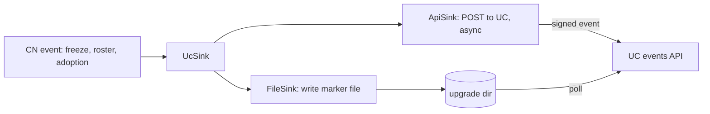
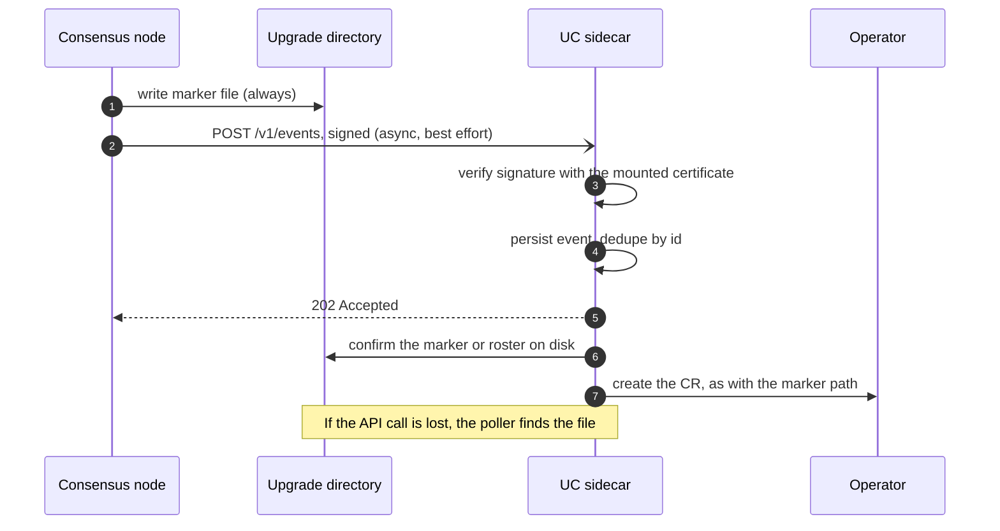

# CN notification sinks: a signed UC events API alongside marker files

How the consensus node (CN) could notify the UC sidecar through an authenticated local API in
addition to the marker files it writes today.

**Status:** proposal. Unlike the [marker-file design](dab-key-rotation-and-firewall-marker-file.md),
which needs no CN code change, this one does. The marker-file design stays the baseline and keeps
working on its own. This document says what the API would add and how to build it safely.

## Summary

1. The CN gets a small `NotificationSink` abstraction. `FileSink` is today's behaviour (marker files).
   `ApiSink` posts the same event to the UC. `UcSink` is `FileSink` and `ApiSink` composed.
2. **The marker file is always written; the API is additional.** If the UC is down, slow or not yet
   started, nothing is lost, because the file is still there.
3. The UC exposes `POST /v1/events` on `127.0.0.1`. The CN and UC share the pod's network namespace.
4. **The CN signs each event with its own node key** (`Platform.sign`, RSA `SHA384withRSA`). The UC
   verifies with the node's signing certificate, which the operator mounts into the UC container. No
   shared secret, and rotation follows key rotation automatically.
5. The API can carry what files cannot: the roster itself, the adoption decision, and TSS readiness.
   These replace log scraping and the version-floor assumption in the marker-file design.

## Why add an API

| | Marker files (today) | With the API as well |
|---|---|---|
| Latency | UC polls every 60s (1s after `freeze_scheduled.mf`) | Immediate |
| Payload | None (a check mark or a timestamp) | Roster, decision, reason, round |
| Adoption result | Parsed from CN log text, which can change | An explicit event from the CN |
| TSS readiness for the candidate | Not visible outside state | An explicit event |
| Delivery proof | None | The UC acknowledges after persisting |
| Works when the UC is down | Yes (the file persists) | Yes, because the file is still written |

## What was verified

- Marker files are written in one place, `ReadableFreezeUpgradeActions.writeMarker` (and re-written by
  `catchUpOnMissedSideEffects` at restart).
- `Platform.sign(byte[])` is public on the platform interface
  (`platform-sdk/swirlds-platform-core/.../Platform.java:57`) and application code already calls it
  (`Hedera.java:1099`, `TssSubmissions.java:49` via `appContext.gossip().sign`). The signature type is
  `SHA384withRSA` (`platform-sdk/base-crypto/.../SignatureType.java:15`).
- The UC already serves HTTP: the control plane is `daemonkit.NewServer(SocketPath, ...)` with routes on an
  `http.ServeMux` (`internal/uc/uc.go`, `consensus_status_handler.go:47`), and a separate TCP listener
  serves metrics (`metrics_server.go`). A third listener for events fits the same structure.
- The capsule deployment code sets no `hostNetwork`, so `localhost` is private to the pod.
- **Start-up order in the CN** (`ServicesMain.java`): `hedera.initializeStatesApi(...)` runs first (lines ~202
  and 205), and it runs the service migrations, including the roster schema's `restart` and therefore the
  adoption hook (`Hedera.java` ~1024, `serviceMigrator.doMigrations`). Only afterwards does
  `new PlatformBuilder(...).build()` create the platform (lines ~252 to 270), and `platform.start()` follows
  (line 272). `Hedera.platform` is assigned only in `onStateInitialized` (`Hedera.java:921`), which the
  platform calls later. So at adoption time there is **no `Platform` object** and `Platform.sign` cannot be
  called.
- The UC container is built in `buildUcContainer` (`internal/resources/consensus/deployment.go`) with a fixed
  mount list plus `AdditionalVolumeMounts`, runs as uid and gid 2000, and pod volumes are created in
  `buildVolumes` with a default file mode of 0644.

## Design

### The sinks (CN side)

- `NotificationSink` has one method that takes an event. Call sites stay where markers are written today
  (`writeMarker`, the roster export, the roster schema's adoption hook), so the file behaviour is
  unchanged.
- **`UcSink` calls `FileSink` first and `ApiSink` second.** A failure in `ApiSink` is logged and
  ignored. A fallback-only policy (API first, file only if it fails) was considered and rejected: the NMT
  and the legacy UC read the files, the CN's restart catch-up rewrites them, and a fallback would save no
  writes while adding a case where an accepted-then-lost event leaves no file.
- **Never block consensus handling.** The API call is asynchronous with a short timeout and a bounded
  queue, off the handle thread. Exceptions never propagate (the same rule as the roster export in
  `PlatformStateUpdates.doExport`). Events are node-local and non-consensus.
- Configured in `node.properties`, for example `notification.sinks=file,uc` (default `file`).

### Events

| Event | Replaces or adds | Payload |
|---|---|---|
| `PrepareUpgradeReady` | `execute_immediate.mf` | Upgrade file hash |
| `FreezeScheduled` | `freeze_scheduled.mf` | Freeze time |
| `FreezeAborted` | `freeze_aborted.mf` | none |
| `NowFrozen` | `now_frozen.mf` | none |
| `CandidateRosterReady` | adds | The candidate roster, so no export file or `cleanDirectory` race |
| `RosterAdoptionDecided` | replaces log parsing | `adopted`, `rejected` or `none`, and the round |
| `CandidateReadyToAdopt` | adds | The candidate's roster hash once TSS readiness for it holds |

Every event has `schemaVersion`, an `id`, `type`, `time`, `nodeId` and `payload`. The `id` must be
deterministic for the same underlying occurrence (for example type plus the round or file hash), so that
the file path and the API path, and any retry, map to one event.

### Transport

`POST /v1/events` on `127.0.0.1:<port>`, a new UC listener beside the metrics one.

- The UC persists the event to its inbox directory **before** replying `202`. A repeated `id` is accepted
  again and ignored.
- Request size is capped, unknown fields are ignored (forward compatibility), and `GET /v1/health` lets
  the sink check availability.
- A Unix socket in a shared directory is an alternative with the same API. It needs a pod-spec volume and
  a custom Java client, since the JDK's HTTP client cannot use Unix sockets. It was not chosen because
  authentication is handled by the signature, so localhost is enough.

### Authentication: the CN signs, the UC verifies

- The CN signs `"solo-uc-event-v1" || id || type || time || payload` with `Platform.sign` and sends the
  signature in a header. The fixed prefix is domain separation, so a signature made for gossip cannot be
  reused here and the reverse.
- The operator mounts **only the node's signing certificate** (the capsule's `signingPublicCertificate`
  Secret key, public) into the UC container. The UC verifies with `SHA384withRSA` (PKCS#1 v1.5).
- **Rotation is automatic.** The key swap repoints the signing Secret in one capsule patch. The CN gets
  the new private key and the UC the new certificate from the same Secret, and both restart together.
- **Replay is harmless:** the UC dedupes by `id` and rejects timestamps outside a window. A sniffed
  request cannot become a different event.
- A sidecar has neither the private key nor a shared secret, so it cannot forge an event.

Options considered:

| Option | Why not |
|---|---|
| Shared secret with an HMAC per request | A new secret to create, store and rotate, and the UC could also mint events. |
| Operator-issued JWT | A bearer credential (reusable if copied), plus an operator signing key and re-minting. More machinery for weaker replay behaviour. |
| Unix socket in a shared directory | Pod-spec change and custom Java client for isolation we get from the signature. |
| Bearer token from env | Reusable if sniffed, and rotation needs a restart. |

### Mounting the certificate into the UC

Yes, this is feasible with the existing building blocks.

**Where the certificate lives.** The capsule references it as `spec.secrets.secretResources.signingPublicCertificate`,
a `KeyReference` (Secret name and key). With the provisioner's naming (solo-weaver PR 1198) that Secret
also holds the private key, which is why the mount must list only the certificate key.

**How to mount it (Secret mode):**

1. In `buildVolumes`, add a pod volume from that Secret with `Items` listing **only** the certificate key,
   mapped to a fixed path such as `signing-cert.pem`, and `DefaultMode` 0444. The private key in the same
   Secret is not projected into that volume.
2. In `buildUcContainer`, add a read-only mount of that volume (for example at `/etc/uc/signing`). Only the UC
   mounts it. The CN's own mounts are unchanged.
3. The UC runs as 2000:2000, and the volumes here already default to 0644, so it can read the file.
4. The UC reads the file at start (and again on a verification failure). **If the file is absent, the UC
   rejects API events and carries on with marker files**, so a missing mount can never break the existing path.

Because this repoints with the same capsule patch that swaps the key, the UC always holds the certificate
that matches the CN's private key (see rotation above). Adding the volume changes the pod template, so it
rolls the pod once, and is best shipped with an upgrade restart.

**What `Secrets.HostPath` is.** `ConsensusSecrets` has two alternatives: `secretResources` (per-key Secrets,
used above) or `hostPath` (`deployment.go:478` onwards). With `hostPath` the operator mounts a host directory
as the `keys` volume at `data/keys` and uses no Secrets: the directory holds the node's `s-private-node<N>.pem`
and `s-public-node<N>.pem` files exactly as the legacy layout has them. It exists for bare-metal nodes whose
keys already sit on disk, such as nodes migrating from the Docker layout, where the HIP reuses host paths in
place. In that mode the certificate is **not in a Secret**, and mounting the whole directory into the UC would
hand it the private keys.

Two consequences for `hostPath` mode:

- **The signature check can still work** by mounting only the certificate file with a `subPath` on the same
  hostPath volume (`s-public-node<N>.pem`, named by the same zero-based convention the CN uses). The file must
  exist at pod start, because kubelet creates a directory at a missing `subPath`. A subPath mount is fixed at
  container start, which is fine because the pod restarts at every upgrade.
- **Key rotation by the operator does not apply.** The key swap works by repointing Secret references, and there
  are none in this mode, so the swap stays manual. Roster validation and the firewall plan still work.

### The UC side

- An `EventSource` abstraction next to today's `MarkerMonitor`. The marker poller and the API listener
  both feed the same handlers (`HandleExecuteImmediate` and the others), which already dedupe by
  operation ID and persist before sending.
- **Events are advisory.** The UC treats an event as a claim and checks it against what is on disk (the
  marker file, the roster file) before acting, so a signature proves the sender but never replaces the
  state the UC already trusts.

## Failure and ordering

- **UC down or not started yet:** the file is written, the API call fails quietly, and the poller picks up
  the marker later.
- **Adoption at startup (verified).** The adoption hook runs during `initializeStatesApi`, before the platform
  is built, so `Platform.sign` does not exist yet. The CN records the decision, writes the file marker at
  once (no signature needed), and sends the signed event after `onStateInitialized` has set the platform. An
  alternative is to sign earlier with the node's `keysAndCerts`, which `ServicesMain` loads before the
  platform, but that puts key material in application start-up code. Deferring is simpler.
- **Restart catch-up:** the existing catch-up paths must call the sinks too, so a restarted CN re-announces
  state that the UC may have missed.
- **Duplicates:** expected, and harmless with deterministic event IDs.
- **UC restart:** persisted events survive in the inbox directory and are replayed like persisted CRs.

## Security considerations

- Local only: `127.0.0.1`, no Service or containerPort, and no `hostNetwork`.
- Authenticity from the node key, with domain separation, replay window and ID dedupe.
- Bounded request size, strict parsing, rate limit on the listener.
- The UC never trusts payloads beyond what it can confirm on disk.
- The API grants no new capability: every effect already needs a CR, and the operator still decides.

## Rollout

HIP-1494's two-upgrade pattern applies:

1. **Upgrade N:** the UC (events listener) and operator (certificate mount) understand the API. The CN does
   not send events yet. Old CNs keep working on files alone.
2. **Upgrade N+1:** a CN release with the sinks, enabled through `node.properties`.

## What it changes in the marker-file design

| In the marker-file design | With sinks |
|---|---|
| UC parses `swirlds.log` for the adoption result | The CN sends `RosterAdoptionDecided` |
| `canAdoptRosterFromVersion` is a standing assumption | `CandidateReadyToAdopt` can make it per upgrade and automatic |
| The roster travels as an export file in `data/upgrade/` | It can travel in the event, avoiding the `cleanDirectory` race |
| The CN property for the export path must ship first | Not needed for the event path |

## Open questions

1. **Ownership:** who builds the CN change, and which release carries it.
2. **Signing right after `onStateInitialized`:** the platform object exists then, but confirm `Platform.sign`
   is usable before `platform.start()`, and decide the queue that holds events raised earlier.
3. **Event ID scheme:** a deterministic ID per occurrence that both sinks compute identically.
4. **Port and versioning:** the listener port, and how `/v1` evolves.
5. **`hostPath` mode:** whether to support the `subPath` certificate mount at all, given the key swap does not apply there.
6. **Event schema ownership:** a shared definition used by the CN and the UC.
7. **How much of the payload the UC should act on without disk confirmation**, if any.
