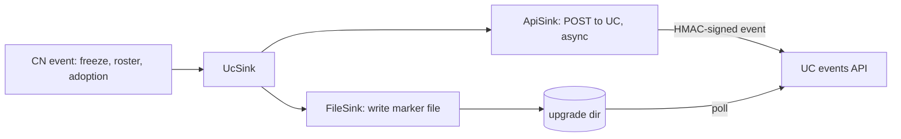
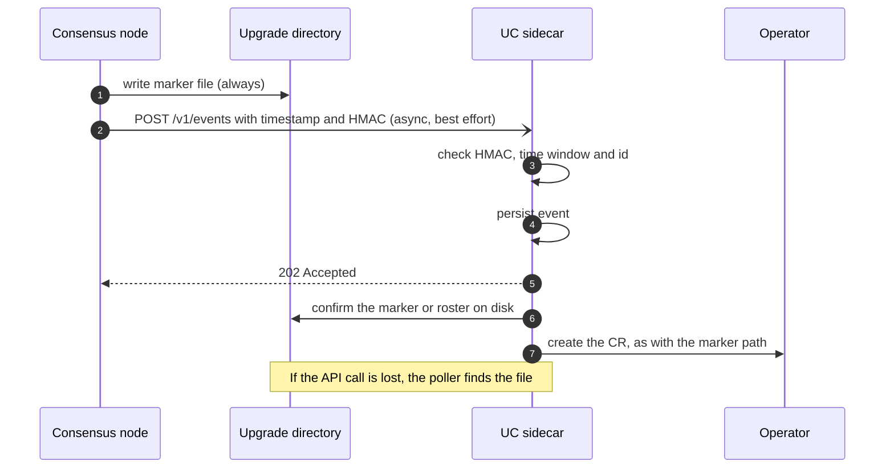

# CN notification sinks: an authenticated UC events API alongside marker files

How the consensus node (CN) could notify the UC sidecar through an authenticated local API in
addition to the marker files it writes today.

**Status:** proposal. Unlike the [marker-file design](dab-key-rotation-and-firewall-marker-file.md),
which needs no CN code change, this one does. The marker-file design stays the baseline and keeps
working on its own. This document says what the API would add and how to build it safely.

## Summary

1. The CN gets a small `NotificationSink` abstraction. `FileSink` is today's behaviour (marker files).
   `ApiSink` posts the same event to the UC. `UcSink` is `FileSink` and `ApiSink` composed.
2. **The marker file is always written; the API is additional.** If the UC is down, slow or not yet
   started, nothing is lost, because the file is still there.
3. The UC exposes `POST /v1/events` on `127.0.0.1`. The CN and UC share the pod's network namespace.
4. **Requests carry an HMAC-SHA256 made with a per-capsule shared secret.** The operator creates the
   secret and mounts it as a **file** into the CN and UC containers only. The secret is never sent, so a
   sniffed request cannot be turned into a different one. It works at any point of CN start-up, because it
   needs no platform object or key store. It is a file, not an environment variable, because the CN prints
   its configuration, which includes every environment variable (see below).
5. The API can carry what files cannot: the roster itself, the adoption decision, and TSS readiness.
   These replace log scraping and the version-floor assumption in the marker-file design.

## Why add an API

| | Marker files (today) | With the API as well |
|---|---|---|
| Latency | UC polls every 60s (1s after `freeze_scheduled.mf`) | Immediate |
| Payload | None (a check mark or a timestamp) | Roster, decision, reason, round |
| Adoption result | Parsed from CN log text, which can change | An explicit event from the CN |
| TSS readiness for the candidate | Not visible outside state | An explicit event |
| Delivery proof | None | The UC acknowledges after persisting |
| Works when the UC is down | Yes (the file persists) | Yes, because the file is still written |

## What was verified

- Marker files are written in one place, `ReadableFreezeUpgradeActions.writeMarker` (and re-written by
  `catchUpOnMissedSideEffects` at restart).
- The UC already serves HTTP: the control plane is `daemonkit.NewServer(SocketPath, ...)` with routes on an
  `http.ServeMux` (`internal/uc/uc.go`, `consensus_status_handler.go:47`), and a separate TCP listener
  serves metrics (`metrics_server.go`). A third listener for events fits the same structure.
- The capsule deployment code sets no `hostNetwork`, so `localhost` is private to the pod.
- **Start-up order in the CN** (`ServicesMain.java`): `hedera.initializeStatesApi(...)` runs first (lines ~202
  and 205), and it runs the service migrations, including the roster schema's `restart` and therefore the
  adoption hook (`Hedera.java` ~1024, `serviceMigrator.doMigrations`). Only afterwards does
  `new PlatformBuilder(...).build()` create the platform (lines ~252 to 270), and `platform.start()` follows
  (line 272). `Hedera.platform` is assigned only in `onStateInitialized` (`Hedera.java:921`). So at adoption
  time there is **no `Platform` object**, and `Platform.sign` (public, `Platform.java:57`) cannot be used. This
  is why the authentication does not depend on the node key.
- The UC container is built in `buildUcContainer` (`internal/resources/consensus/deployment.go`) and runs as
  uid and gid 2000. Each container lists its own volume mounts, so a Secret can be mounted into the CN and
  UC and not into the sidecars.
- **The CN prints its configuration, and that includes every environment variable.** The CN registers the
  environment as a config source (`SystemEnvironmentConfigSource`, in `ConfigProviderImpl.java:131`,
  `BootstrapConfigProviderImpl.java:64` and `ServicesMain.java:381`), and that source reports every variable
  name as a property. `ConsensusLayerStaticSetup.writeSettingsUsed` then writes all configuration values,
  including properties not declared in any config record, to `settingsUsed.txt` (through
  `ConfigExport.printConfig`), and `Hedera.logConfiguration()` logs "Active Configuration" at INFO. I found no
  masking in the config modules. A secret in the CN's environment would therefore be written to disk and
  possibly to logs, which the Alloy sidecar ships off the pod. I did not confirm that `Utils.allProperties`
  (used by the INFO log) includes environment variables.

## Design

### The sinks (CN side)



- `NotificationSink` has one method that takes an event. Call sites stay where markers are written today
  (`writeMarker`, the roster export, the roster schema's adoption hook), so the file behaviour is
  unchanged.
- **`UcSink` calls `FileSink` first and `ApiSink` second.** A failure in `ApiSink` is logged and
  ignored. A fallback-only policy (API first, file only if it fails) was considered and rejected: the NMT
  and the legacy UC read the files, the CN's restart catch-up rewrites them, and a fallback would save no
  writes while adding a case where an accepted-then-lost event leaves no file.
- **Never block consensus handling or start-up.** The API call is asynchronous with a short timeout and a
  bounded queue, off the handle thread. Exceptions never propagate (the same rule as the roster export in
  `PlatformStateUpdates.doExport`). Events are node-local and non-consensus.
- The sink object must be built before `initializeStatesApi`, so the adoption hook can use it.
- Configured in `node.properties`, for example `notification.sinks=file,uc` (default `file`).

### Events

| Event | Replaces or adds | Payload |
|---|---|---|
| `PrepareUpgradeReady` | `execute_immediate.mf` | Upgrade file hash |
| `FreezeScheduled` | `freeze_scheduled.mf` | Freeze time |
| `FreezeAborted` | `freeze_aborted.mf` | none |
| `NowFrozen` | `now_frozen.mf` | none |
| `CandidateRosterReady` | adds | The candidate roster, so no export file or `cleanDirectory` race |
| `RosterAdoptionDecided` | replaces log parsing | `adopted`, `rejected` or `none`, and the round |
| `CandidateReadyToAdopt` | adds | The candidate's roster hash once TSS readiness for it holds |

For marker events the payload has `marker` (the file name) and `contents`, which is exactly what the file
holds: the freeze or telemetry time in epoch seconds, or the check mark `✓`. The UC can therefore handle an event
the same way it handles reading the file. The candidate roster event carries the roster in the same format as the
export file (`roster`), its `sha256`, and the export `path`. The adoption event carries `result` (`adopted`,
`rejected` or `none`) and `round`.

Every event has `schemaVersion`, an `id`, `type`, `time` (when the node raised it), `nodeId`, `softwareVersion` (the
version the node is running) and `payload`. Payload values are all strings, and keys are sorted so the same event
always produces the same bytes.

**Event IDs.** Events raised while a transaction is handled (`PREPARE_UPGRADE_READY`, `FREEZE_SCHEDULED`,
`FREEZE_ABORTED`) use the transaction's **consensus time**, which is the same on every node, so the ID is
network-wide: `PREPARE_UPGRADE_READY:<consensusTime>`. `NOW_FROZEN` uses the consensus time of the freeze round.
`ROSTER_ADOPTION_DECIDED` uses the round, and `CANDIDATE_ROSTER_READY` the first 32 hex characters of the roster's
SHA-256. Without a consensus time (for example a catch-up announcement after a reconnect) the ID falls back to the
freeze time, then the upgrade file hash, then wall-clock time. An announcement of a past occurrence made during
catch-up can therefore have a different ID than the original, which is harmless because the UC also dedupes on
state.

**Size.** Marker events are a few hundred bytes. The only large one is the roster. The CN drops any event whose JSON
exceeds `notification.maxEventBytes` (default 256 KiB) with a warning, and holds at most `notification.queueCapacity`
(default 64) events in memory. The `transaction` field is the `FreezeTransactionBody` only, never the whole signed
transaction, which carries every signature.

### Example events

These are illustrative: the field names and shapes follow the code, but the values are made up. Each is sent as
`POST /v1/events` with these headers, shown once:

```
Content-Type: application/json
X-Hiero-Timestamp: 1792400123
X-Hiero-Signature: v1=<64 hex characters: HMAC-SHA256 of the canonical text>
```

`transaction` is the freeze body as the HAPI JSON encoder renders it, embedded as a string. Its field order and
omitted zero values follow the protobuf rules, and zero values (such as shard 0 and realm 0) are left out.

**`PREPARE_UPGRADE_READY`** (raised after the package is extracted, together with `execute_immediate.mf`):

```json
{
  "schemaVersion": 1,
  "id": "PREPARE_UPGRADE_READY:2026-10-18T09:00:00.123456789Z",
  "type": "PREPARE_UPGRADE_READY",
  "time": "2026-10-18T09:00:07.482Z",
  "nodeId": 3,
  "softwareVersion": "0.76.1",
  "payload": {
    "consensusTime": "2026-10-18T09:00:00.123456789Z",
    "contents": "✓",
    "freezeType": "PREPARE_UPGRADE",
    "marker": "execute_immediate.mf",
    "source": "handle",
    "transaction": "{\"updateFile\":{\"fileNum\":\"150\"},\"fileHash\":\"3q2+7w...\",\"freezeType\":\"PREPARE_UPGRADE\"}",
    "transactionId": "0.0.2@1792399990.000000007",
    "upgradeFileHash": "9f86d081884c7d659a2feaa0c55ad015a3bf4f1b2b0b822cd15d6c15b0f00a08c1d0f4b6e5f0c2a9d3e4b7a1c8f6d2e5",
    "upgradeFileId": "0.0.150"
  }
}
```

**`FREEZE_SCHEDULED`**. `contents` is the epoch-seconds value that `freeze_scheduled.mf` holds:

```json
{
  "schemaVersion": 1,
  "id": "FREEZE_SCHEDULED:2026-10-19T10:30:00.500000000Z",
  "type": "FREEZE_SCHEDULED",
  "time": "2026-10-19T10:30:00.512Z",
  "nodeId": 3,
  "softwareVersion": "0.76.1",
  "payload": {
    "consensusTime": "2026-10-19T10:30:00.500000000Z",
    "contents": "1792492200",
    "freezeTimeNanos": "0",
    "freezeTimeSeconds": "1792492200",
    "freezeType": "FREEZE_UPGRADE",
    "marker": "freeze_scheduled.mf",
    "source": "handle",
    "transaction": "{\"updateFile\":{\"fileNum\":\"150\"},\"fileHash\":\"3q2+7w...\",\"startTime\":{\"seconds\":\"1792492200\"},\"freezeType\":\"FREEZE_UPGRADE\"}",
    "transactionId": "0.0.2@1792492190.000000001",
    "upgradeFileHash": "9f86d081884c7d659a2feaa0c55ad015a3bf4f1b2b0b822cd15d6c15b0f00a08c1d0f4b6e5f0c2a9d3e4b7a1c8f6d2e5",
    "upgradeFileId": "0.0.150"
  }
}
```

**`NOW_FROZEN`** (raised when the freeze state has been written to disk, so it carries the round, not a transaction):

```json
{
  "schemaVersion": 1,
  "id": "NOW_FROZEN:2026-10-19T10:30:00.810000000Z",
  "type": "NOW_FROZEN",
  "time": "2026-10-19T10:30:04.220Z",
  "nodeId": 3,
  "softwareVersion": "0.76.1",
  "payload": {
    "consensusTime": "2026-10-19T10:30:00.810000000Z",
    "contents": "✓",
    "freezeRound": "48211397",
    "freezeTimeNanos": "0",
    "freezeTimeSeconds": "1792492200",
    "marker": "now_frozen.mf",
    "source": "freeze-complete",
    "upgradeFileHash": "9f86d081884c7d659a2feaa0c55ad015a3bf4f1b2b0b822cd15d6c15b0f00a08c1d0f4b6e5f0c2a9d3e4b7a1c8f6d2e5",
    "upgradeFileId": "0.0.150"
  }
}
```

**`FREEZE_ABORTED`**. The aborted freeze time is captured before the node clears it:

```json
{
  "schemaVersion": 1,
  "id": "FREEZE_ABORTED:2026-10-19T09:00:00.250000000Z",
  "type": "FREEZE_ABORTED",
  "time": "2026-10-19T09:00:00.260Z",
  "nodeId": 3,
  "softwareVersion": "0.76.1",
  "payload": {
    "abortedFreezeTimeNanos": "0",
    "abortedFreezeTimeSeconds": "1792492200",
    "consensusTime": "2026-10-19T09:00:00.250000000Z",
    "contents": "✓",
    "freezeType": "FREEZE_ABORT",
    "marker": "freeze_aborted.mf",
    "source": "handle",
    "transaction": "{\"freezeType\":\"FREEZE_ABORT\"}",
    "transactionId": "0.0.2@1792488000.000000003",
    "upgradeFileHash": "9f86d081884c7d659a2feaa0c55ad015a3bf4f1b2b0b822cd15d6c15b0f00a08c1d0f4b6e5f0c2a9d3e4b7a1c8f6d2e5",
    "upgradeFileId": "0.0.150"
  }
}
```

**`CANDIDATE_ROSTER_READY`**. `roster` has the same format as `candidate-roster.json`, embedded as a string (shortened to two
nodes here; node 0's entry has no `nodeId` because zero values are omitted):

```json
{
  "schemaVersion": 1,
  "id": "CANDIDATE_ROSTER_READY:5b0f3c9a77d14e2a8c61d0b94e1f7a32",
  "type": "CANDIDATE_ROSTER_READY",
  "time": "2026-10-18T09:00:00.140Z",
  "nodeId": 3,
  "softwareVersion": "0.76.1",
  "payload": {
    "path": "/opt/hgcapp/services-hedera/HapiApp2.0/data/upgrade/candidate-roster.json",
    "roster": "{\"nodeMetadata\":[{\"rosterEntry\":{\"weight\":\"1\",\"gossipCaCertificate\":\"MIIDpjCCAg6gAwIB...\",\"gossipEndpoint\":[{\"ipAddressV4\":\"CgAAAQ==\",\"port\":50111}]}},{\"rosterEntry\":{\"nodeId\":\"1\",\"weight\":\"1\",\"gossipCaCertificate\":\"MIIDnjCCAgagAwIB...\",\"gossipEndpoint\":[{\"ipAddressV4\":\"CgAAAg==\",\"port\":50111}]}}]}",
    "sha256": "5b0f3c9a77d14e2a8c61d0b94e1f7a32e9c4d81f05a6b37d2c9e48f1a0b7d635"
  }
}
```

**`ROSTER_ADOPTION_DECIDED`**. `result` is `adopted`, `rejected` or `none`:

```json
{
  "schemaVersion": 1,
  "id": "ROSTER_ADOPTION_DECIDED:48211398",
  "type": "ROSTER_ADOPTION_DECIDED",
  "time": "2026-10-19T10:44:51.903Z",
  "nodeId": 3,
  "softwareVersion": "0.76.2",
  "payload": {
    "result": "adopted",
    "round": "48211398"
  }
}
```

`TELEMETRY_UPGRADE_READY` has the same shape as `PREPARE_UPGRADE_READY`, with `execute_telemetry.mf` as the marker and
the telemetry time as `contents`. `source` is `handle` for transaction-driven events, `freeze-complete` for
`NOW_FROZEN`, and `catch-up` for announcements made after a reconnect.

### Transport

`POST /v1/events` on `127.0.0.1:<port>`, a new UC listener beside the metrics one.

- The UC persists the event to its inbox directory **before** replying `202`. A repeated `id` is accepted
  again and ignored.
- Request size is capped, unknown fields are ignored (forward compatibility), and `GET /v1/health` lets
  the sink check availability.
- Both sides use their standard HTTP clients (`java.net.http.HttpClient` in the CN, `net/http` in the UC).

### Authentication: a shared secret and an HMAC per request

**The secret.** A random 32-byte value per capsule, in a Secret such as `<capsule>-uc-events-secret`, created
by the operator before the StatefulSet exists (it already reads and writes Secrets). It is mounted
**read-only as a file** (for example `/etc/uc-events/secret`) in the CN and UC containers, and in no other
container. Mark the volume `optional`: a missing Secret then gives an empty directory, so the pod still
starts and the feature is simply off (the CN disables the API sink, the UC rejects API events, and the marker
files carry on as before). Use `defaultMode` 0444 rather than a restrictive mode plus `fsGroup`, because
`fsGroup` can trigger a recursive ownership change of large volumes at pod start. Only the two containers
mount the file, so 0444 does not widen access. The CN reads the file path from a config property (for example
`notification.uc.secretFile`), so the path appears in config dumps and the secret never does.

**The signature.** The CN sends two headers: `X-Hiero-Timestamp` (epoch seconds) and `X-Hiero-Signature`
(`v1=` followed by the lower-case hex of `HMAC-SHA256(secret, canonical)`), where
`canonical` is `"hiero-uc-events-v1\n" + method + "\n" + path + "\n" + timestamp + "\n" + hex(sha256(body))`. The
event `id` and `nodeId` are inside the body, so they are covered. The fixed prefix is domain separation. In
Java this is `javax.crypto.Mac` (`HmacSHA256`), which is in the JDK and needs nothing started.

**Shared test vector** (computed independently with Python's `hmac` and `hashlib`, and asserted by the CN's
`NotificationSignerTest`; the UC's tests should assert the same values):

| Input | Value |
|---|---|
| secret | `test-secret-0123456789abcdef` |
| method, path | `POST`, `/v1/events` |
| timestamp | `1700000000` |
| body | `{"a":1}` |
| sha256(body) | `015abd7f5cc57a2dd94b7590f04ad8084273905ee33ec5cebeae62276a97f862` |
| HMAC-SHA256 | `e67752eb78aafe08f34e040526e9f20f4b0958861e4be5c8b400a93228a5955a` |

**What the UC checks:**
- recompute the HMAC and compare in constant time;
- reject a timestamp outside a short window (a couple of minutes: the containers share a host clock);
- dedupe by event `id`, so a replay within the window changes nothing;
- cap the body size before reading it.

**Why this resists sniffing.** The secret never travels. Someone who can read loopback traffic (needs
`NET_RAW`, and the HIP uses CRI-O, whose defaults may already exclude it) sees events, which are public data,
but cannot produce a different valid request.

**Rotation.** Both containers mount the same pod volume, so they see the same file. When the operator updates
the Secret, the kubelet refreshes the mounted file in about a minute (this does not apply to `subPath`
mounts, which this design does not use), and both sides see the new value together. The CN reads the file
when it sends (or re-reads when the file changes), and the UC re-reads it on a verification failure, so
rotation needs **no restart**. During the refresh window a request may fail verification once. The UC logs a
clear warning, the CN retries, and the marker files keep working. If this proves a problem, the UC can accept
a current and a previous secret during an overlap.

**What it does not give you:** no automatic tie to key rotation, a new secret to manage, and the UC holds
the same secret, so it could also produce valid events (it is the receiver, so that does not matter).

Options considered:

| Option | Why not |
|---|---|
| The CN signs with its node key (`Platform.sign`) | Not available during start-up, when the adoption hook runs, because the platform does not exist yet. It also needs the signing certificate mounted into the UC, which does not work in `hostPath` key mode without mounting a single file. |
| Operator-issued JWT | A bearer credential (reusable if copied), plus an operator signing key and re-minting. |
| Secret as an environment variable | The CN prints all environment variables in `settingsUsed.txt` and its configuration log, so the secret would be written to disk and could be shipped with the logs. A mounted file avoids this. |
| Plain bearer token | Simplest, but reusable if copied from traffic. The HMAC variant uses the same secret with no extra deployment cost. |
| Unix socket in a shared directory | Pod-spec volume and a custom Java client, for isolation the secret already gives. |

### Behaviour in `hostPath` key mode

The shared secret does not depend on how keys are stored, so the events API works in `hostPath` mode as in
Secret mode. `hostPath` mode (`ConsensusSecrets.hostPath`, `deployment.go:478` onwards) mounts a host directory
as the `keys` volume with no per-key Secrets. In that mode the operator-driven **key swap** still does not
apply, because it works by repointing Secret references. See the marker-file design.

### The UC side

- An `EventSource` abstraction next to today's `MarkerMonitor`. The marker poller and the API listener
  both feed the same handlers (`HandleExecuteImmediate` and the others), which already dedupe by
  operation ID and persist before sending.
- **Events are advisory.** The UC treats an event as a claim and checks it against what is on disk (the
  marker file, the roster file) before acting, so a valid HMAC proves the sender holds the secret but never
  replaces the state the UC already trusts.



## Failure and ordering

- **UC down or not started yet:** the file is written, the API call fails quietly, and the poller picks up
  the marker later. For events raised during CN start-up the sink retries for a short bounded time, since
  the UC usually comes up moments later.
- **Adoption at startup.** The adoption hook runs during `initializeStatesApi`, before the platform is
  built. The HMAC needs no platform, so the event can be queued from the hook itself. The marker file is
  written first as always.
- **Restart catch-up:** the existing catch-up paths must call the sinks too, so a restarted CN re-announces
  state that the UC may have missed.
- **Duplicates:** expected, and harmless with deterministic event IDs.
- **UC restart:** persisted events survive in the inbox directory and are replayed like persisted CRs.
- **Secret missing or mismatched:** the API path is off or rejected, with a clear warning, and the marker
  files continue to work.
- **Secret file unreadable at start-up:** the CN logs once and disables the API sink for that run.

## Security considerations

- Local only: `127.0.0.1`, no Service or containerPort, and no `hostNetwork`.
- Authenticity from a secret that is never sent, with a time window, ID dedupe and constant-time comparison.
- The secret is visible to anyone who can read that Secret through the API (the operator's RBAC governs this),
  or run commands inside the CN or UC containers, like any other Secret. It is never in the environment or in
  a config dump. I did not check whether the capsule enables a shared process namespace, which would let a
  sidecar running as the same user read another container's filesystem through `/proc`.
- Bounded request size, strict parsing, rate limit on the listener.
- The UC never trusts payloads beyond what it can confirm on disk.
- The API grants no new capability: every effect already needs a CR, and the operator still decides.

## Rollout

HIP-1494's two-upgrade pattern applies:

1. **Upgrade N:** the UC (events listener) and operator (creates the Secret first, then adds the optional
   volume and its mounts to the CN and UC containers) understand the API. The CN does not send events yet, and
   a CN without the sinks ignores the file. Adding the volume changes the pod template and rolls the pod
   once, so it rides the upgrade restart.
2. **Upgrade N+1:** a CN release with the sinks, enabled through `node.properties`.

## What it changes in the marker-file design

| In the marker-file design | With sinks |
|---|---|
| UC parses `swirlds.log` for the adoption result | The CN sends `RosterAdoptionDecided` |
| `canAdoptRosterFromVersion` is a standing assumption | `CandidateReadyToAdopt` can make it per upgrade and automatic |
| The roster travels as an export file in `data/upgrade/` | It can travel in the event, avoiding the `cleanDirectory` race |
| The CN property for the export path must ship first | Not needed for the event path |

## Open questions

1. **Ownership:** who builds the CN change, and which release carries it.
2. **Secret file location and size:** the mount path, and whether the CN caches the secret between sends.
3. **Event ID scheme:** a deterministic ID per occurrence that both sinks compute identically.
4. **Port and versioning:** the listener port, and how `/v1` evolves.
5. **Rotation overlap:** whether the UC should accept a current and a previous secret while the file refreshes.
6. **Shared process namespace:** confirm the capsule does not enable it, since it would expose container filesystems through `/proc`.
7. **Event schema ownership:** a shared definition used by the CN and the UC.
8. **How much of the payload the UC should act on without disk confirmation**, if any.
