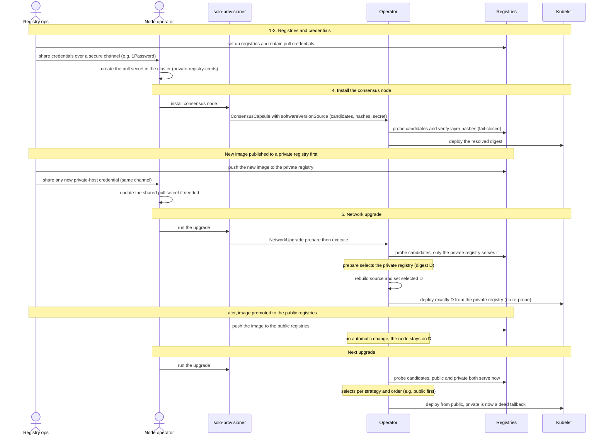
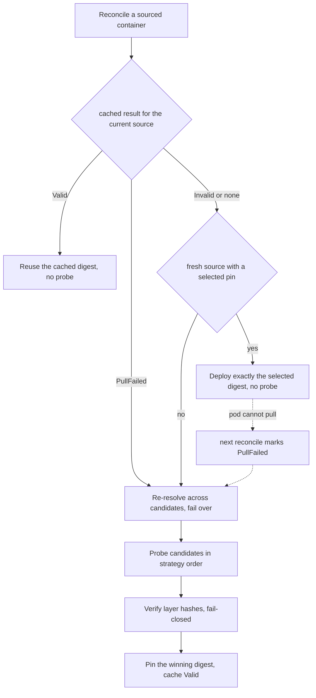

# Multi-registry image sources

A consensus node (and its sidecars) can declare **several candidate registries** for one
container image, together with the **layer hashes** that verify the image. The operator
selects a registry, verifies the image, and deploys it pinned to its content digest. This
doc explains the scenarios this supports and how the pieces fit together, so the team can
reason about install, upgrade, and registry changes.

## Why multi-registry

- **Staged availability.** An image may land in different registries at different times. A
  new consensus-node image can be **published to a private registry first and promoted to
  public registries later**. A node must be able to pull from whichever registry currently
  serves the verified image.
- **Resilience.** If one registry is unreachable when the operator resolves the image, it
  can pick another candidate that serves the same verified content.
- **Per-registry credentials.** Private registries need pull secrets; the model carries a
  pull secret per candidate (host-keyed), so each registry is authenticated with the right
  credential.
- **One verified identity.** Every candidate must serve the **same layer hashes**. A
  deterministic image publishes identical content to every registry, so whichever registry
  wins, the deployed content is the same.

## Key concepts

- **`softwareVersionSource`** — the candidate list on a container: `imageRepositories`
  (ordered registries, each with an explicit tag and optional pull secrets),
  `imageVerificationSpec` (per-platform layer hashes), `selectionStrategy`
  (`Sequential` honors the listed order, `Random` spreads load), and `imagePullPolicy`.
- **Layer-hash verification (fail-closed).** A candidate is usable only when every
  platform's layer hashes match what the registry serves. No match, or no hashes → the
  candidate is rejected. The operator never deploys an unverified source.
- **Digest pinning.** The resolved image is deployed as `repo/name:tag@sha256:…`, so the
  kubelet runs exactly the verified content.
- **`selected` (the upgrade pin).** `softwareVersionSource.selected = {image, digest}` is
  set by an upgrade to the image it already selected and verified. When present, the
  operator deploys exactly that image and **skips re-selection** — see below.
- **`softwareVersion` vs `softwareVersionSource`.** Exactly one is set. A single
  `softwareVersion` is one pinned image (no candidates); a `softwareVersionSource` is the
  multi-registry form. `selected` lives **inside** the source.

## Where it lives

| Piece | Location |
|-------|----------|
| `SoftwareVersionSource`, `SelectedImage` types | `api/v1alpha1/common_types.go` |
| Install-time selection + verification + pinning | `internal/controller/consensuscapsule_image_sources.go` (`resolveImageSources`) |
| Registry probing, strategy, fail-closed hash check | `internal/registry/` |
| Upgrade rebuild of the source + `selected` pin | `internal/controller/networkupgradeexecute_controller.go` (`setSoftwareVersion`, `rebuildSource`) |

## Roles

Two separate parties, in two separate trust domains:

- **Registry ops** — the central team that runs the image registries, publishes images, and
  holds the registry pull credentials. They never touch a node operator's cluster.
- **Node operator** — runs one consensus node in their own cluster. They receive credentials
  out-of-band, create the pull secret, install the node, and run upgrades. The **operator**
  (the controllers in this repo) and the node's pod live in this cluster.

## Lifecycle

**The key point to internalize:** after an upgrade pins `selected`, the node stays on that
exact image and registry **until the next upgrade re-selects**. Promoting the image to more
registries does **not** move a running node on its own.

## How the operator resolves an image

The decision is keyed by the cached result for the **current** source (`status.resolvedImages`,
fingerprinted by the source content):

- **`selected` present on a fresh source** → deploy exactly it, no speculative probe. The
  prepare phase already selected and verified the image, so the roll does not re-select.
  The **kubelet's real pull is the verification**: if the image can't be pulled, the pod
  goes `ImagePullBackOff` and the operator fails over (see Recovery below) — this is more
  reliable than a speculative registry check, which could pass while the real layer pull
  fails.
- **Cache `Valid`** → reuse the cached digest, no probe. The cache is keyed by the source's
  content and is only re-computed when the source changes or the pin stops working.
- **Cache `PullFailed`** → the pinned image can't be pulled; re-resolve across the
  candidates and fail over to a healthy one.
- **Cache `Invalid` / absent, no `selected`** → probe the candidates in strategy order,
  verify layer hashes, pin the winner. This is the install path and the "source edited" path.

## Recovery and failover

Failover is **reactive to a real pull failure**, not a periodic poll — polling a healthy pod
would roll it needlessly (with `IfNotPresent`, a running pod already has the image cached
locally and does not care that a registry is down).

1. The selected registry is unavailable when the pod must pull (a reschedule to a cold
   node, or the registry went down) → the pod enters `ImagePullBackOff`.
2. The operator notices (it re-checks while the pod is pulling) and marks the resolved
   image `PullFailed`.
3. The next reconcile re-resolves across the candidates — the dead registry is unreachable
   so it is skipped — pins a healthy one, and the StatefulSet rolls the pod onto it.
4. Once healthy, the result is cached `Valid` and the node **stays** on that registry
   (even if the original recovers) — no needless roll back.

If **no** candidate is reachable, the operator backs off (workqueue rate limiter) and
retries until one returns. A running pod whose registry goes down is unaffected until it
needs to re-pull.

## Pull-secret / credential model

- **Registries come from the manifest; credentials are supplied separately.** The installer
  attaches a pull secret per candidate, selected by registry host.
- **One shared, host-keyed secret.** A single `dockerconfigjson` secret (for example
  `private-registry-creds`) can hold credentials for several registry hosts and is
  referenced by every candidate. The kubelet and the operator's verification keychain both
  pick the matching host entry.
- **Ops contract.** Keep that shared secret current: add a new private host's entry, or
  rotate credentials, **in that one secret**. This is done out-of-band and is **not** a
  per-upgrade step — the private registry hosts are standing infrastructure, so once the
  secret covers them it authenticates every image pulled from them.
- **New registry in an upgrade.** When an upgrade introduces a registry the install source
  did not list, the rebuilt candidate takes the **union of the old source's secrets** as a
  fallback. Because secrets are host-keyed, attaching the shared secret is enough — and
  harmless where it does not match.

## Edge cases

| Scenario | Behavior |
|----------|----------|
| A registry does not serve the image yet at prepare time | Not selected (unreachable / not found); stays a candidate for a later upgrade. |
| An upgrade introduces a registry not in the install source | Pull secrets via the union fallback; the shared secret must cover its host (ops contract). |
| `selected` points at an image that is **not** a candidate (e.g. the source was edited) | The operator ignores the stale pin and re-resolves across the current candidates. |
| A candidate ref has no tag (digest-only) | Rebuild fails closed; the upgrade aborts rather than write an invalid source. |
| Build is not byte-reproducible across registries | The roll pins the exact prepare digest via `selected`, so it is unaffected; the next upgrade's re-selection is layer-hash based. |
| The selected registry is unavailable when the pod re-pulls after the roll | The pod enters `ImagePullBackOff`; the operator marks it `PullFailed` and re-resolves to a healthy candidate (see Recovery). |
| The selected registry recovers after a failover | The node stays on the failover winner (cached `Valid`); no roll back. |
| Every candidate registry is down | Re-resolution finds none → the operator backs off and retries; a running pod is unaffected until it must re-pull. |
| Credential rotation | Update the one shared secret; the next resolve or pull uses it. |
| Fresh install (no `selected`) | The operator selects and verifies across all candidates. |

## Scope and non-goals

**In scope**

- Registry selection and layer-hash verification at install and at upgrade-prepare.
- Retaining the candidate registry list across upgrades, so the next upgrade can re-select.
- Honoring the exact image an upgrade selected, without re-probing on the roll.
- **Reactive failover** — when the pinned image can't be pulled (`ImagePullBackOff`), the
  operator re-resolves and rolls the pod onto a healthy candidate.

**Not yet supported (possible follow-ups)**

- **Instant kubelet-level failover** — recovery goes through a StatefulSet roll (the pod
  restarts onto the healthy registry); the kubelet does not fail over a digest ref on its own.
- **Proactive migration** — a healthy node is not moved to a newly-available (e.g. public)
  registry on its own; that happens at the next upgrade's re-selection, so a healthy pod is
  never rolled just because another registry appeared.
